# Day 1 — Raspberry Pi and Python

> **Today the Pi becomes a gateway you can trust:** you set it up without a screen, lock it down, write Python that keeps running through crashes and network loss, and finish by switching a real relay safely.

## Before you start

- [ ] Raspberry Pi 4 Model B, power supply and microSD card on your desk
- [ ] Single-channel relay module and 6 female-to-female jumper wires (for Topic 6)
- [ ] Raspberry Pi Imager 2.0 or later installed on your laptop
- [ ] VS Code installed, with the **Remote - SSH** extension
- [ ] A LAN cable, plus a USB-to-Ethernet adapter if your laptop has no LAN port
- [ ] Administrator rights on your laptop (to share its internet with the Pi)
- [ ] The plant Wi-Fi password (on the whiteboard)
- [ ] Your Pi number from the trainer: `pi01` or `pi02`

**Our running use case:** *Stesen Pam PS-01*, a small water pump station. It has a storage tank (level in %), a pump motor (temperature in °C), a door on the pump house and a pump switched by a relay. Your Pi is the station's edge gateway.

---

## Topic 1 — Single-Board Computers and IoT Architecture (concept)

**Goal:** know where a Raspberry Pi fits in an industrial system, so every lab after this has a place on the map.

### 1.1 — What is a Raspberry Pi?

A Raspberry Pi is a **single-board computer (SBC)**: a full computer on one board, with a processor, memory, networking, USB and a row of **GPIO** (General-Purpose Input/Output) pins. It runs a full **operating system (OS)**, Raspberry Pi OS, which is based on Debian Linux.

### 1.2 — Microcontroller or single-board computer?

| | Microcontroller (ESP32, Arduino) | Single-board computer (Raspberry Pi) |
|---|---|---|
| Operating system | None, or a tiny real-time OS | Full Linux |
| Boot time | Milliseconds | 20–40 seconds |
| Timing | Precise, predictable (real-time) | Good, but Linux can pause your program briefly |
| Power | Very low, can run on battery | Needs a steady power supply |
| Software | One program in C/C++ | Many programs, any language, databases, web servers |
| Typical job | Read sensors, control a motor, react in microseconds | Collect, store, secure and forward data; run dashboards and AI |

> **The rule of thumb:** a microcontroller is close to the machine and reacts fast. A single-board computer sits above several machines and thinks: it collects, decides and communicates. In this course the ESP32 plays the field device and the Pi plays the gateway.

**Figure 1.1 — The system you build this week**

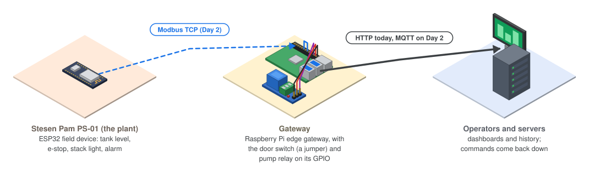

### 1.3 — IoT architecture: device → edge → server

An **IoT** (Internet of Things) system moves data in three layers:

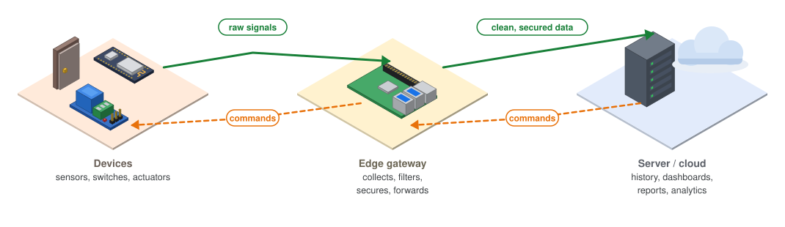

The **edge** is where the plant meets the network. Doing work at the edge, instead of sending every raw reading to a server, means the site keeps working when the network link is down, uses less bandwidth, and reacts faster.

### 1.4 — The industrial view: the Purdue model

Industry describes the same layers with the **Purdue model** (also used in the ISA-95 standard):

| Level | Name | Examples |
|---|---|---|
| 4 | Enterprise | ERP (Enterprise Resource Planning), email, business systems |
| 3 | Site operations | Historian database, production reports |
| 2 | Supervisory | **SCADA** (Supervisory Control and Data Acquisition), **HMI** (Human-Machine Interface) screens |
| 1 | Control | **PLC** (Programmable Logic Controller), controllers |
| 0 | Field | Sensors, switches, valves, motors, relays |

An **IIoT** (Industrial IoT) edge gateway usually sits between Level 1 and Level 2: it talks to field devices and controllers below, and to supervisory and site systems above. That is exactly where your Pi will sit.

**Figure 1.2 — Purdue levels, and where the gateway sits**

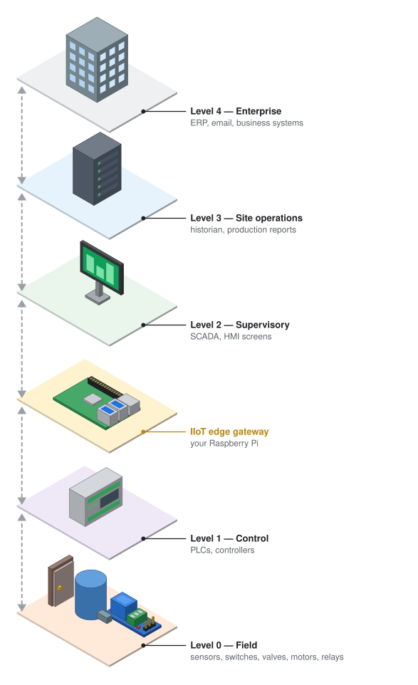

Each arrow is a boundary where traffic can be checked and controlled.

> **Why the levels matter:** each level is a security boundary. Traffic should only pass between neighbouring levels, through controlled points. From Topic 2, your Pi sits on that boundary physically too: a cable to the office side, Wi-Fi into the plant. On Day 2 you will secure the link above your gateway.

**Try it**
1. On paper, map Stesen Pam PS-01 onto the five levels. Place: tank level sensor, pump motor, door switch, pump relay, your Raspberry Pi, the operator's dashboard, and the water utility's billing system.
2. Draw an arrow for each data flow and label it *read* or *command*.
3. Compare with your neighbour. Where did you disagree, and why?

**Checkpoint ✅** You can point to your Pi on the map and explain in one sentence what it does at that level.

---

## Topic 2 — Setting up the Raspberry Pi

**Goal:** a Pi that boots without a screen or keyboard, gets the internet through your laptop's LAN cable, joins the plant's own Wi-Fi, and that you can control from your laptop over SSH and VS Code.

**Open:** Raspberry Pi Imager on your laptop.

Your Pi lives on **two networks** at once, exactly like a real gateway:

| Side | Interface on the Pi | Connected to | Used for |
|---|---|---|---|
| Office side (**IT**, information technology) | `eth0`, the LAN (Local Area Network) port | Your laptop, by cable | Internet, SSH, VS Code, dashboards |
| Plant side (**OT**, operational technology) | `wlan0`, the Wi-Fi | The ESP32 plant's own Wi-Fi network `PS01-PLANT` | Talking to plant equipment and the other Pi |

**Figure 2.1 — Everyone builds the same station: laptop, cable and Pi, all joined to one shared plant**

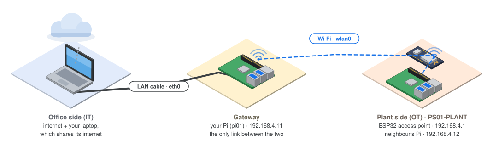

> **Same setup for everyone.** Each participant, and the trainer, has their own laptop, LAN cable and Raspberry Pi 4 Model B, and does every step in these notes the same way. Only your Pi's name and plant address differ. The trainer's Pi, `pi00`, follows along on the big screen.

> **The plant network has no internet, on purpose.** The only machine that touches both sides is your Pi, and it does not pass traffic from one side to the other. This is the Purdue boundary from Topic 1, built with real cables.

### 2.1 — Write the OS to the microSD card

**Figure 2.2 — Headless setup: everything is decided before the first boot**

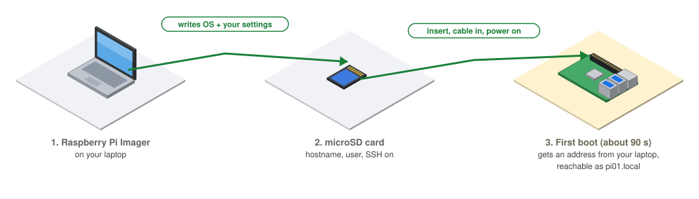

1. Insert the microSD card into your laptop (use the adapter if needed).
2. Open **Raspberry Pi Imager**.
3. **Device:** choose **Raspberry Pi 4**.
4. **OS:** choose **Raspberry Pi OS (other)** → **Raspberry Pi OS Lite (64-bit)**. Lite has no desktop; a gateway does not need one.
5. **Storage:** choose your microSD card. Double-check: everything on it will be erased.
6. Go through the customisation steps the wizard shows:

| Setting | Value |
|---|---|
| Hostname | Your Pi number, e.g. `pi01` |
| Localisation | Time zone `Asia/Kuala_Lumpur`, keyboard `us` |
| Username | `pelatih` |
| Password | Your own, at least 8 characters. Write it down. |
| Wi-Fi | **Leave empty** (skip). The Pi joins the plant's Wi-Fi in 2.4. |
| Remote access | **Enable SSH**, with password authentication |

7. Write the card and wait for **verification** to finish.
8. Eject the card and put it into the Pi. **Do not power it on yet.**

> **Why "headless"?** Equipment in the field rarely has a monitor attached. Setting up everything before the first boot is how gateways are deployed for real.

### 2.2 — Share your laptop's internet over the LAN cable

Your laptop stays on its own Wi-Fi for the internet, and lends that connection to the Pi through the LAN cable. Your laptop becomes the Pi's router.

**Figure 2.3 — Your laptop as the Pi's router**

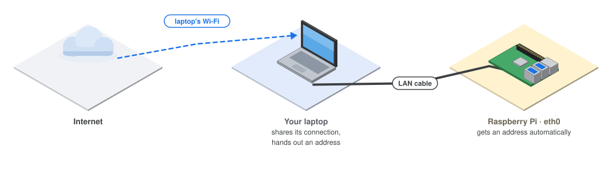

You need a LAN cable, a USB-to-Ethernet adapter if your laptop has no LAN port, and administrator rights on your laptop. Nothing changes on the Pi: it asks for an address on its LAN port automatically.

1. Connect the cable from the Pi's LAN port to your laptop.
2. Turn on sharing on your laptop.

   **Windows**
   1. Open **Control Panel → Network and Sharing Center → Change adapter settings**.
   2. Right-click your **Wi-Fi** adapter → **Properties** → **Sharing** tab.
   3. Tick **Allow other network users to connect through this computer's Internet connection**.
   4. Under **Home networking connection**, choose your **Ethernet** adapter, then **OK**.

   **macOS**
   1. Open **System Settings → General → Sharing**, then click **(i)** next to **Internet Sharing**.
   2. **Share your connection from:** Wi-Fi. **To devices using:** your Ethernet or USB LAN adapter.
   3. Switch **Internet Sharing** on.

   **Linux** (NetworkManager), replacing `eth0` with your laptop's LAN port name from `ip a`:
   ```bash
   nmcli connection add type ethernet ifname eth0 con-name share-to-pi ipv4.method shared
   nmcli connection up share-to-pi
   ```
3. Power on the Pi and wait about 90 seconds; the first boot takes longer than normal.

If `pi01.local` does not answer in the next step, find the Pi's address on your laptop:

| Laptop | The Pi's address is in this range | How to find it |
|---|---|---|
| Windows | `192.168.137.x` | `arp -a`, look under `Interface: 192.168.137.1` for a `dynamic` entry |
| macOS | `192.168.2.x` | `arp -a`, look for an entry on `bridge100` |
| Linux | `10.42.0.x` | `ip neigh`, look for an entry on your LAN port |

### 2.3 — Connect over SSH

**SSH** (Secure Shell) gives you an encrypted terminal on a remote machine.

1. On your laptop, open a terminal (Windows: **PowerShell**).
2. Connect, using your hostname:
   ```bash
   ssh pelatih@pi01.local
   ```
3. The first time, type `yes` to accept the Pi's fingerprint, then your password.
4. Your prompt changes to `pelatih@pi01:~ $`. You are now typing on the Pi.
5. Check the internet works through your laptop: `ping -c 3 8.8.8.8`

> **Error: "Could not resolve hostname"?** Your laptop cannot find the Pi by name. Use the address from the table in 2.2: `ssh pelatih@<ip-address>`.

> **Error: "REMOTE HOST IDENTIFICATION HAS CHANGED"?** You reflashed the card, so the Pi has a new identity. Remove the old one with `ssh-keygen -R pi01.local` and connect again.

### 2.4 — Join the plant network

The ESP32 plant runs its own Wi-Fi network, `PS01-PLANT`. Every device on it has a fixed address, so programs can always find each other:

| Device | Plant address |
|---|---|
| ESP32 plant (the access point) | `192.168.4.1` |
| `pi00` (the trainer's Pi) | `192.168.4.10` |
| `pi01` | `192.168.4.11` |
| `pi02` | `192.168.4.12` |

1. Set the Wi-Fi country, so the radio is allowed to switch on:
   ```bash
   sudo raspi-config nonint do_wifi_country MY
   sudo rfkill unblock wifi
   ```
2. Create the plant connection. Use **your** address (`.11` or `.12`) and the plant Wi-Fi password from the whiteboard:
   ```bash
   sudo nmcli connection add type wifi ifname wlan0 con-name plant ssid PS01-PLANT \
     wifi-sec.key-mgmt wpa-psk wifi-sec.psk 'PLANT-PASSWORD' \
     ipv4.method manual ipv4.addresses 192.168.4.11/24 ipv4.never-default yes \
     ipv6.method disabled
   sudo nmcli connection up plant
   ```

| Setting | What it does |
|---|---|
| `con-name plant` | The name you use for this connection from now on |
| `ipv4.method manual`, `ipv4.addresses` | A fixed address instead of a random one |
| `ipv4.never-default yes` | Never send internet traffic this way. The plant has no internet; your laptop's cable is the way out |
| `ipv6.method disabled` | Keep the plant network simple: IPv4 only |

3. Check both networks:
   ```bash
   nmcli device status
   ping -c 3 192.168.4.1
   ```
   `eth0` and `wlan0` both show `connected`, and the ESP32 plant answers.

> **Error: "Secrets were required, but not provided"?** The Wi-Fi password is wrong. Fix it with `sudo nmcli connection modify plant wifi-sec.psk 'PLANT-PASSWORD'`, then `sudo nmcli connection up plant`.

### 2.5 — Connect VS Code

1. In VS Code, press **F1** and choose **Remote-SSH: Connect to Host…**
2. Type `pelatih@pi01.local` and press **Enter**. Choose **Linux** if asked, then enter your password.
3. Wait while VS Code installs its helper on the Pi (first time only, 1–2 minutes).
4. Open a terminal inside VS Code: **Terminal → New Terminal**. This terminal runs on the Pi.

From now on, you edit files in VS Code on your laptop, and they are saved on the Pi.

**Figure 2.4 — Two ways in, one encrypted door**

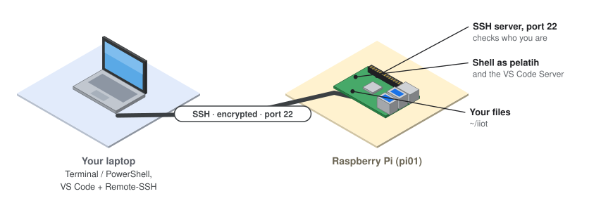

### 2.6 — Linux essentials

Run each command in the terminal and look at the result.

| Command | What it does |
|---|---|
| `pwd` | Print where you are (working directory) |
| `ls -l` | List files with details (owner, permissions, size) |
| `cd ~/iiot` | Change directory; `~` is your home folder |
| `mkdir -p ~/iiot/data` | Make folders, including any missing parents |
| `nano notes.txt` | Simple text editor (**Ctrl+O** save, **Ctrl+X** exit) |
| `cat notes.txt` | Print a file |
| `tail -f file` | Follow a file as new lines are added (**Ctrl+C** to stop) |
| `cp`, `mv`, `rm` | Copy, move/rename, remove (no recycle bin!) |
| `chmod +x script.py` | Make a file executable |
| `sudo <command>` | Run one command as administrator (root) |

1. Update the system (this takes a few minutes):
   ```bash
   sudo apt update
   sudo apt full-upgrade -y
   ```
2. Create the course folder you will use all week:
   ```bash
   mkdir -p ~/iiot/data
   cd ~/iiot
   ```

**Figure 2.5 — Where everything lives by the end of today (green: yours; red: system files, need sudo)**

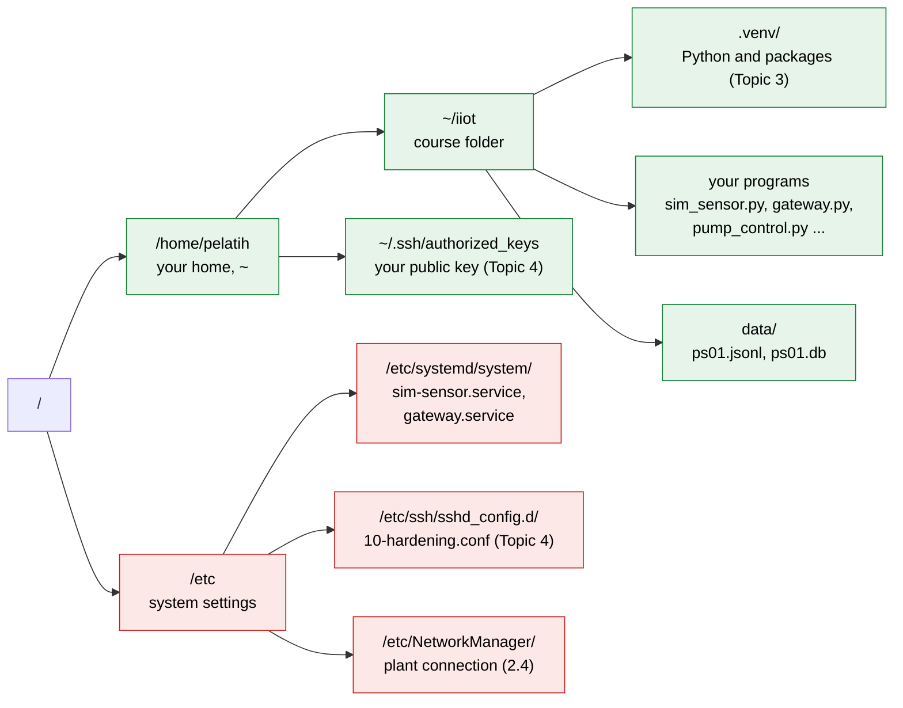

> **`sudo` is a loaded gun.** Use it only when a command needs system rights (installing software, editing system files, managing services). Never run your own Python programs with `sudo`.

### 2.7 — Services and logs

A **service** is a program that Linux starts and supervises in the background. **systemd** is the part of Linux that manages services.

1. Check the SSH service you are using right now:
   ```bash
   systemctl status ssh
   ```
   Look for `active (running)` and `enabled`. Press **q** to leave.
2. Read its log:
   ```bash
   journalctl -u ssh -n 20
   ```
   You should see your own login.

| Command | What it does |
|---|---|
| `systemctl status <name>` | Is it running? Recent log lines |
| `sudo systemctl start/stop/restart <name>` | Control it now |
| `sudo systemctl enable/disable <name>` | Start it on boot, or not |
| `journalctl -u <name> -f` | Follow its log live |

### 2.8 — Network checks

```bash
ip -4 addr               # your addresses: one on eth0, one on wlan0
ip route                 # the only "default" route goes out through eth0
sysctl net.ipv4.ip_forward   # 0 = the Pi does not pass traffic between its networks
ping -c 3 8.8.8.8        # internet, through the cable
ping -c 3 192.168.4.1    # the ESP32 plant, through the Wi-Fi
ss -tulpn                # which programs are listening on which ports
```

In the `ss` output, find port **22**. That is SSH, waiting for connections.

**Try it**
1. Ping your neighbour's Pi on the plant network: `ping -c 3 192.168.4.12` (or `.11` if you are `pi02`).
2. **Cut the plant link.** `sudo nmcli connection down plant`. Ping the ESP32 again: it fails, but `ping 8.8.8.8` still works. The two networks really are separate. Bring it back with `sudo nmcli connection up plant`.
3. **Break it on purpose.** Stop SSH while you are connected through it: `sudo systemctl stop ssh`. Your current session stays open, but try a *new* connection from a second laptop terminal. It is refused. A stopped service means a closed door.
4. **Put everything back:** `sudo systemctl start ssh`, and confirm a new connection works.

**Checkpoint ✅** You can open VS Code on your Pi, the system is updated, `~/iiot/data` exists, and your Pi reaches both the internet (through `eth0`) and the ESP32 plant (through `wlan0`).

---

## Topic 3 — Python for IoT

**Goal:** write a Python program that produces readings from the pump station, stores them safely, and runs as a service that survives crashes and reboots. Day 2 replaces the simulated readings with real equipment.

**Open:** VS Code connected to your Pi, folder `~/iiot`.

### 3.1 — Why Python at the edge?

- Comes with Raspberry Pi OS, and runs the same on your laptop and on the Pi.
- Has libraries for nearly every industrial protocol (Modbus, MQTT, OPC UA) and for data and AI.
- Readable: the person who maintains your gateway in five years can follow it.

### 3.2 — A virtual environment for your project

Raspberry Pi OS protects its own Python. A plain `pip install` fails with `error: externally-managed-environment`. Instead, each project gets its own **virtual environment (venv)**: a private folder of Python packages.

**Figure 3.1 — System Python and your venv**

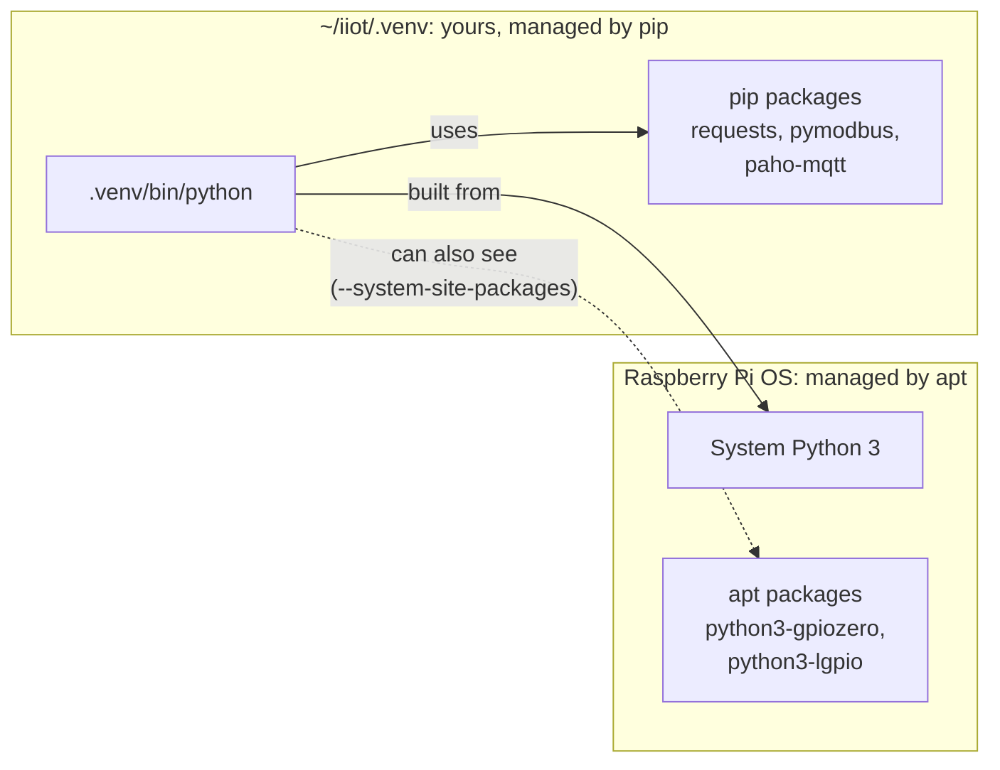

1. Install the GPIO libraries from Raspberry Pi OS (needed in Topic 6):
   ```bash
   sudo apt install -y python3-gpiozero python3-lgpio
   ```
2. Create and activate the venv:
   ```bash
   cd ~/iiot
   python3 -m venv --system-site-packages .venv
   source .venv/bin/activate
   ```
   Your prompt now starts with `(.venv)`. The `--system-site-packages` option lets the venv also see the GPIO libraries you just installed with `apt`, which are built specially for the Pi.
3. Install the packages the course uses, at the versions these notes were tested with, and record them:
   ```bash
   pip install requests pymodbus==3.16.2 paho-mqtt==2.2.0
   pip freeze > requirements.txt
   ```
3. In VS Code, press **F1** → **Python: Select Interpreter** → choose `./.venv/bin/python`.

> **Every new terminal:** run `source ~/iiot/.venv/bin/activate` again. If `(.venv)` is missing from your prompt, you are using the system Python.

### 3.3 — Python in twenty minutes

Type these into the interactive interpreter (`python3`, leave with `exit()`), one block at a time.

```python
# Variables and types
station = "PS-01"            # str
tank_level = 62.5            # float
pump_running = True          # bool
print(f"{station}: tank {tank_level}%, pump running: {pump_running}")

# A dict: named values, the shape of every reading this week
reading = {"station": station, "tank_level_pct": tank_level, "pump_temp_c": 45.2}
print(reading["pump_temp_c"])

# A list and a loop
levels = [62.5, 63.1, 61.8, 95.2, 60.4]
for level in levels:
    if level > 90:
        print(f"HIGH LEVEL ALARM: {level}%")

# A function
def is_alarm(level, limit=90):
    return level > limit

print(is_alarm(95.2), is_alarm(50))
```

### 3.4 — The pump station simulator

1. In VS Code, create `~/iiot/sim_sensor.py` and type in the program below, or copy it from `code/day1/sim_sensor.py` in this repo.

```python
#!/usr/bin/env python3
"""Simulated sensors for Stesen Pam PS-01 (water pump station).

Writes one JSON reading per line to ~/iiot/data/ps01.jsonl every INTERVAL_S seconds.
"""
import json
import logging
import random
import time
from datetime import datetime, timezone
from pathlib import Path

STATION = "PS-01"
INTERVAL_S = 2
DATA_FILE = Path.home() / "iiot" / "data" / "ps01.jsonl"

logging.basicConfig(level=logging.INFO, format="%(asctime)s %(levelname)s %(message)s")
log = logging.getLogger("sim_sensor")


def read_tank_level(previous: float) -> float:
    """Tank level in percent: drifts a little from the previous value."""
    level = previous + random.uniform(-1.5, 1.5)
    return max(0.0, min(100.0, level))


def read_pump_temp() -> float:
    """Pump motor temperature in °C. Fails now and then, like a real sensor."""
    if random.random() < 0.02:
        raise IOError("pump temperature sensor not responding")
    return round(random.gauss(45.0, 1.5), 1)


def main() -> None:
    DATA_FILE.parent.mkdir(parents=True, exist_ok=True)
    level = 60.0
    log.info("Simulator started, writing to %s", DATA_FILE)

    while True:
        level = read_tank_level(level)
        reading = {
            "ts": datetime.now(timezone.utc).isoformat(timespec="seconds"),
            "station": STATION,
            "tank_level_pct": round(level, 1),
        }
        try:
            reading["pump_temp_c"] = read_pump_temp()
            reading["status"] = "OK"
        except IOError as err:
            reading["pump_temp_c"] = None
            reading["status"] = "SENSOR_FAULT"
            log.warning("Read failed: %s", err)

        with DATA_FILE.open("a") as f:
            f.write(json.dumps(reading) + "\n")
        log.info("%s", reading)
        time.sleep(INTERVAL_S)


if __name__ == "__main__":
    main()
```

| Piece | What it does |
|---|---|
| `DATA_FILE` | Where readings go: one **JSON** (JavaScript Object Notation) object per line, a format called JSON Lines |
| `read_tank_level()` | Moves the level a little from the last value, kept between 0 and 100 |
| `read_pump_temp()` | Returns a realistic temperature, but raises an error about 2% of the time |
| `try` / `except IOError` | A failed read becomes a `SENSOR_FAULT` record instead of crashing the program |
| `ts` in UTC | Timestamps in UTC (Coordinated Universal Time), so data from different sites lines up |
| `logging` | Timestamped messages with a level (INFO, WARNING), instead of plain `print` |

**Figure 3.2 — One pass of the simulator loop**

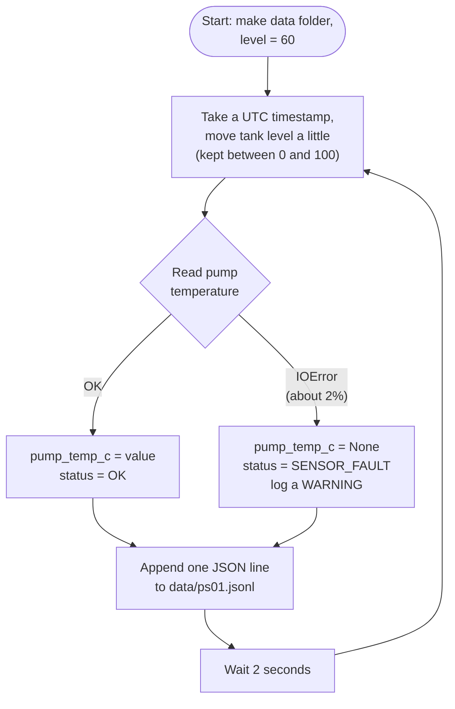

2. Run it:
   ```bash
   python sim_sensor.py
   ```
   A reading appears every 2 seconds. Leave it for a minute, then stop it with **Ctrl+C**.
3. Look at the data file:
   ```bash
   tail -n 5 data/ps01.jsonl
   ```

> **Why keep running after a failed read?** In a plant, one bad reading is normal: a loose cable, electrical noise, a sensor restarting. A gateway that crashes on the first bad value is worse than useless. Record the fault, and carry on.

### 3.5 — Read the log back: a shift report

1. Create `~/iiot/summarise.py` (or copy `code/day1/summarise.py`):

```python
#!/usr/bin/env python3
"""Read the PS-01 data log and print a short shift report."""
import json
from pathlib import Path

DATA_FILE = Path.home() / "iiot" / "data" / "ps01.jsonl"


def main() -> None:
    levels = []
    faults = 0
    bad_lines = 0

    with DATA_FILE.open() as f:
        for line_no, line in enumerate(f, start=1):
            try:
                reading = json.loads(line)
            except json.JSONDecodeError:
                bad_lines += 1
                print(f"Skipping damaged line {line_no}: {line.strip()[:40]}")
                continue

            levels.append(reading["tank_level_pct"])
            if reading["status"] != "OK":
                faults += 1

    if not levels:
        print("No readings yet.")
        return

    print(f"Readings      : {len(levels)}")
    print(f"Tank level    : min {min(levels):.1f}%  max {max(levels):.1f}%  "
          f"avg {sum(levels) / len(levels):.1f}%")
    print(f"Sensor faults : {faults}")
    print(f"Damaged lines : {bad_lines}")


if __name__ == "__main__":
    main()
```

2. Run it: `python summarise.py`

**Figure 3.3 — How the shift report copes with a damaged line**

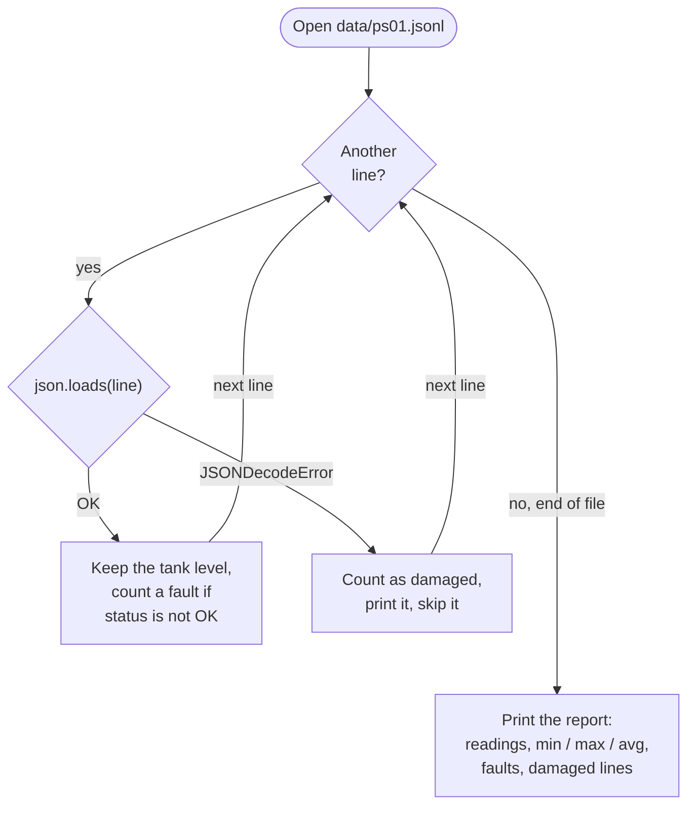

**Try it**
1. **Break it on purpose.** Simulate a power cut in the middle of a write, which leaves half a line in the file:
   ```bash
   echo '{"ts": "2026-11-20T08:00:00+00:00", "station": "PS-0' >> data/ps01.jsonl
   ```
   Run `summarise.py` again. It reports one damaged line and carries on.
2. Now comment out the `try:` / `except` lines (keep the `json.loads` line, unindented) and run it again. Read the `JSONDecodeError` traceback: Python tells you the line and the exact character where the JSON broke.
3. **Put everything back:** restore the `try` / `except`.

> **Recap:** two kinds of failure, two answers. A failed *sensor read* becomes a recorded fault. A damaged *stored record* is skipped and counted. In both cases the program keeps running.

### 3.6 — Run the simulator as a service

A gateway program must start by itself after a power cut and restart itself after a crash. You do not log in to start it. That is a job for systemd.

1. Create the service file:
   ```bash
   sudo nano /etc/systemd/system/sim-sensor.service
   ```
2. Paste this (also in `code/day1/sim-sensor.service`):
   ```ini
   [Unit]
   Description=PS-01 simulated pump station sensors
   After=network.target

   [Service]
   User=pelatih
   WorkingDirectory=/home/pelatih/iiot
   ExecStart=/home/pelatih/iiot/.venv/bin/python /home/pelatih/iiot/sim_sensor.py
   Restart=always
   RestartSec=3
   Environment=PYTHONUNBUFFERED=1

   [Install]
   WantedBy=multi-user.target
   ```

| Line | What it does |
|---|---|
| `User=pelatih` | Runs as your normal user, not as root |
| `ExecStart=` | The venv's Python, so your installed packages are found. Full paths only. |
| `Restart=always` | Restart whenever the program exits, including after a crash |
| `RestartSec=3` | Wait 3 seconds before restarting, so a broken program cannot restart in a tight loop |
| `PYTHONUNBUFFERED=1` | Log lines appear in the journal immediately |
| `WantedBy=multi-user.target` | Start it at boot, once the system is up |

**Figure 3.4 — What systemd does with your service**

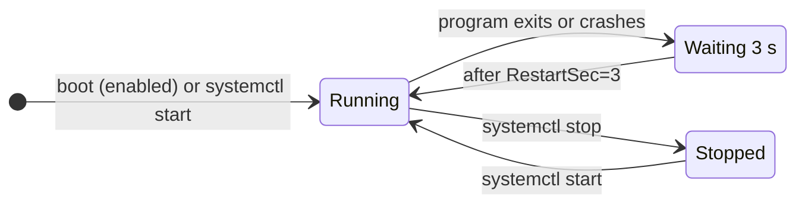

3. Load, enable and start it:
   ```bash
   sudo systemctl daemon-reload
   sudo systemctl enable --now sim-sensor
   systemctl status sim-sensor
   ```
4. Follow its log live: `journalctl -u sim-sensor -f` (**Ctrl+C** to stop following; the service keeps running).

**Try it**
1. **Crash it.** Kill the program the hard way:
   ```bash
   pkill -f sim_sensor.py
   ```
   Wait 3 seconds, then `systemctl status sim-sensor`. It is running again with a new process ID. In the journal you can see it exit and restart.
2. **Power cut.** `sudo reboot`. Reconnect after a minute (VS Code reconnects for you), then check `systemctl status sim-sensor` and `tail data/ps01.jsonl`. Readings resumed without you logging in.
3. **Break it on purpose.** Edit the service and misspell the path in `ExecStart` (for example `sim_sensr.py`). Run `sudo systemctl daemon-reload && sudo systemctl restart sim-sensor`, then `systemctl status sim-sensor`. Read the error in the journal: it names the file it could not open.
4. **Put everything back:** fix the path, reload, restart, and confirm `active (running)`.

> **Later, in production:** `Restart=always` hides crashes if nobody looks. Real gateways also report "I restarted" upstream, so someone notices a program that crashes every hour. You will add that on Day 3.

**Checkpoint ✅** `systemctl status sim-sensor` shows `active (running)` after a reboot, and `summarise.py` reports readings collected while you were not logged in.

---

## Topic 4 — Hardening the Pi

**Goal:** close the doors you do not need. Your Pi will switch a relay this afternoon; anyone on the network who can log in to it can switch the pump.

**Open:** a terminal on your **laptop** and a VS Code terminal on the Pi. Keep both open for the whole topic.

**Figure 4.1 — The checks an incoming connection must pass after this topic**

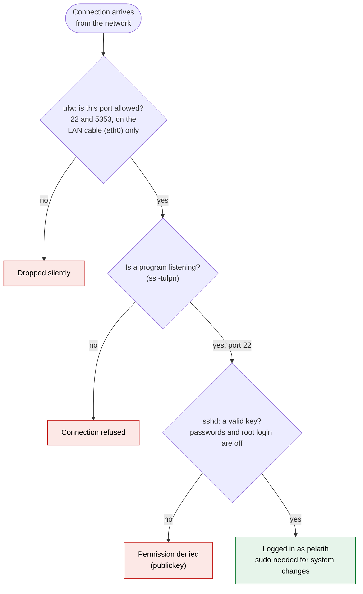

> **Never lock yourself out:** keep your current session open while you change SSH or the firewall. Test the change from a **second, new** connection. If the new one fails, fix it from the old one.

### 4.1 — Log in with a key instead of a password

A **key pair** is two matching files: a private key that never leaves your laptop, and a public key you copy to the Pi. A stolen or guessed password is no longer enough.

**Figure 4.2 — How key login works**

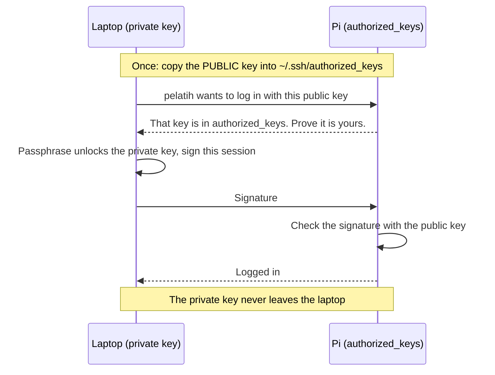

1. On your **laptop**, create a key pair (press **Enter** to accept the default file, and set a passphrase):
   ```bash
   ssh-keygen -t ed25519
   ```
2. Copy the public key to the Pi.

   Windows (PowerShell):
   ```powershell
   type $env:USERPROFILE\.ssh\id_ed25519.pub | ssh pelatih@pi01.local "mkdir -p ~/.ssh && chmod 700 ~/.ssh && cat >> ~/.ssh/authorized_keys && chmod 600 ~/.ssh/authorized_keys"
   ```
   macOS / Linux:
   ```bash
   ssh-copy-id pelatih@pi01.local
   ```
3. Open a **new** laptop terminal and connect: `ssh pelatih@pi01.local`. It asks for your key passphrase, not the Pi password.

### 4.2 — Turn off password login

1. On the Pi, create a settings file for the SSH server:
   ```bash
   sudo nano /etc/ssh/sshd_config.d/10-hardening.conf
   ```
   ```
   PasswordAuthentication no
   KbdInteractiveAuthentication no
   PermitRootLogin no
   ```
2. Check the configuration for mistakes, then confirm the setting that will actually apply:
   ```bash
   sudo sshd -t
   sudo sshd -T | grep -i passwordauthentication
   ```
   The second line must say `passwordauthentication no`.
3. Restart SSH: `sudo systemctl restart ssh`. Your open sessions stay connected.
4. From a **new** laptop terminal, log in with your key again. It must still work.

> **Why `10-` in the file name?** SSH reads the files in `sshd_config.d/` in alphabetical order, and the first value it finds for a setting wins. A low number makes sure yours is read before any file the system adds.

### 4.3 — A firewall: deny by default

**ufw** (Uncomplicated Firewall) decides which incoming connections are allowed. The rule for a gateway: deny everything, then allow only what you can name a reason for.

1. Install it and set the defaults:
   ```bash
   sudo apt install -y ufw
   sudo ufw default deny incoming
   sudo ufw default allow outgoing
   ```
2. Allow what you need, with a comment saying why:
   ```bash
   sudo ufw limit in on eth0 to any port 22 proto tcp comment 'SSH, office side only, rate-limited'
   sudo ufw allow in on eth0 to any port 5353 proto udp comment 'mDNS, so pi01.local still resolves'
   ```
3. Switch it on and check it:
   ```bash
   sudo ufw enable
   sudo ufw status verbose
   ```

| Rule | Why |
|---|---|
| `default deny incoming` | Anything not listed is dropped |
| `limit in on eth0 … port 22` | SSH allowed **only from the LAN cable side**, and an address that tries 6 connections in 30 seconds is blocked for a while (slows password guessing) |
| `allow in on eth0 … port 5353` | Your laptop finds the Pi by name using mDNS (multicast DNS). Without it, `pi01.local` stops working |
| *(nothing for `wlan0`)* | The plant side gets no way in at all. A compromised device in the plant cannot even knock on the gateway's door |

### 4.4 — Turn off what you do not use

1. List running services: `systemctl list-units --type=service --state=running`
2. A gateway does not need Bluetooth. Turn it off (skip this if the service does not exist on your Pi):
   ```bash
   sudo systemctl disable --now bluetooth
   ```
3. Run `ss -tulpn` again and compare with Topic 2.

> **Listening is not the same as reachable.** `ss` shows what is *listening*. `ufw status` shows what is *allowed in*. A port is open to the network only when both say yes.

**Try it**
1. **Break it on purpose.** From your laptop, try to log in with a password only:
   ```bash
   ssh -o PubkeyAuthentication=no pelatih@pi01.local
   ```
   You get `Permission denied (publickey)`. That is what an attacker sees.
2. **Knock from the plant side.** Ask your neighbour to SSH to your Pi over the plant network: `ssh pelatih@192.168.4.11` (or `.12`). It hangs, then times out: `ufw` drops it without a reply.

**Checkpoint ✅** You log in with your key, password login is refused, `sudo ufw status` shows only SSH and mDNS allowed, both on `eth0`, and SSH from the plant side times out.

---

## Topic 5 — Python for gateways: classes, threads, SQLite and HTTP

**Goal:** turn the simulator into a real gateway structure: read, store and forward in separate threads, so a slow or dead network never stops the readings. On Day 2 you swap the simulator for real equipment and keep everything else.

**Open:** VS Code on your Pi, folder `~/iiot`. Work in pairs: `pi01` forwards to `pi02`, and `pi02` forwards to `pi01`.

### 5.1 — The four new ideas

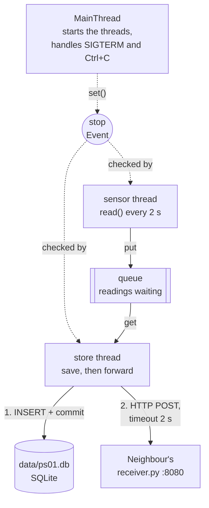

| Idea | What it gives the gateway |
|---|---|
| **Class** | `PumpStationSimulator` keeps its own state (the last tank level) inside one object, with one `read()` method. On Day 2, a Modbus class with the same `read()` replaces it and nothing else changes. |
| **Dataclass** | `Reading` names every field of a reading once. A typo like `reading.tank_levl` is an error straight away, not a missing value discovered next week. |
| **Thread + queue** | The sensor thread only reads and puts readings on the queue. The store thread takes them off. If forwarding hangs, readings wait in the queue; none are skipped. |
| **SQLite** | A real database in a single file. Unlike a text file, a reading is either fully saved or not saved at all, and you can query it with SQL (Structured Query Language). |

### 5.2 — The receiver (your neighbour's end)

**Figure 5.1 — The pair lab: each gateway forwards to the other Pi**

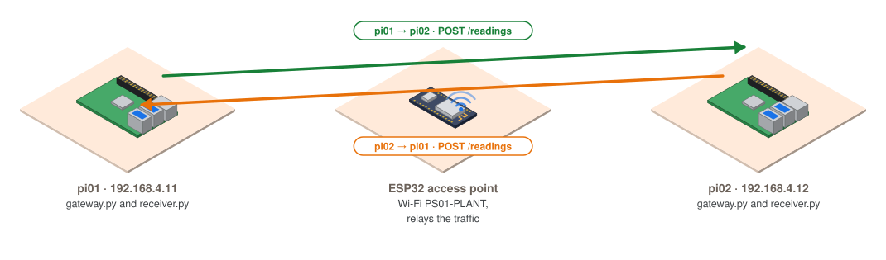

1. Create `~/iiot/receiver.py` (or copy `code/day1/receiver.py`):

```python
#!/usr/bin/env python3
"""A tiny HTTP receiver: prints every reading a neighbour's gateway POSTs to it."""
import json
from http.server import BaseHTTPRequestHandler, HTTPServer

PORT = 8080


class Handler(BaseHTTPRequestHandler):
    def do_POST(self) -> None:
        length = int(self.headers.get("Content-Length", 0))
        try:
            reading = json.loads(self.rfile.read(length))
        except json.JSONDecodeError:
            self.send_response(400)  # Bad Request
            self.end_headers()
            return

        print(f"From {reading.get('gateway')} ({self.client_address[0]}): "
              f"level {reading.get('tank_level_pct')}%  "
              f"temp {reading.get('pump_temp_c')}  {reading.get('status')}")
        self.send_response(204)  # No Content: received, nothing to send back
        self.end_headers()

    def log_message(self, *args) -> None:
        pass  # keep the screen clean: our print above is enough


if __name__ == "__main__":
    print(f"Listening on port {PORT}, Ctrl+C to stop")
    HTTPServer(("0.0.0.0", PORT), Handler).serve_forever()
```

2. Open the port in your firewall, then start the receiver and leave it running:
   ```bash
   sudo ufw allow in on wlan0 to any port 8080 proto tcp comment 'Day 1 receiver lab, plant side'
   python receiver.py
   ```

> **Later, in production:** allow the port only from the one address that should use it: `sudo ufw allow in on wlan0 from 192.168.4.11 to any port 8080 proto tcp`.

### 5.3 — The gateway

1. Open a **second** VS Code terminal (activate the venv) and create `~/iiot/gateway.py` (or copy `code/day1/gateway.py`):

```python
#!/usr/bin/env python3
"""PS-01 edge gateway: read, store and forward, each in its own thread.

- sensor thread  : takes a reading every INTERVAL_S seconds and puts it on a queue
- store thread   : saves every reading to SQLite, then forwards it over HTTP
A slow or dead network never delays the sensor readings.
"""
import logging
import queue
import random
import signal
import socket
import sqlite3
import threading
from dataclasses import asdict, dataclass
from datetime import datetime, timezone
from pathlib import Path

import requests

STATION = "PS-01"
INTERVAL_S = 2
DB_FILE = Path.home() / "iiot" / "data" / "ps01.db"
FORWARD_URL = "http://192.168.4.12:8080/readings"  # your neighbour's Pi, plant side

logging.basicConfig(level=logging.INFO, format="%(asctime)s %(threadName)s %(levelname)s %(message)s")
log = logging.getLogger("gateway")


@dataclass
class Reading:
    ts: str
    station: str
    gateway: str
    tank_level_pct: float
    pump_temp_c: float | None
    status: str


class PumpStationSimulator:
    """Simulated sensors. On Day 2 a Modbus class with the same read() replaces it."""

    def __init__(self, station: str, start_level: float = 60.0):
        self.station = station
        self.level = start_level
        self.gateway = socket.gethostname()

    def _read_pump_temp(self) -> float:
        if random.random() < 0.02:
            raise IOError("pump temperature sensor not responding")
        return round(random.gauss(45.0, 1.5), 1)

    def read(self) -> Reading:
        self.level = max(0.0, min(100.0, self.level + random.uniform(-1.5, 1.5)))
        try:
            temp, status = self._read_pump_temp(), "OK"
        except IOError as err:
            temp, status = None, "SENSOR_FAULT"
            log.warning("Read failed: %s", err)
        return Reading(
            ts=datetime.now(timezone.utc).isoformat(timespec="seconds"),
            station=self.station,
            gateway=self.gateway,
            tank_level_pct=round(self.level, 1),
            pump_temp_c=temp,
            status=status,
        )


def sensor_loop(sim: PumpStationSimulator, q: queue.Queue, stop: threading.Event) -> None:
    while not stop.is_set():
        q.put(sim.read())
        stop.wait(INTERVAL_S)


def store_and_forward_loop(q: queue.Queue, stop: threading.Event) -> None:
    db = sqlite3.connect(DB_FILE)  # a connection belongs to the thread that made it
    db.execute(
        "CREATE TABLE IF NOT EXISTS readings ("
        "ts TEXT, station TEXT, gateway TEXT, tank_level_pct REAL, pump_temp_c REAL, status TEXT)"
    )
    session = requests.Session()

    while not stop.is_set():
        try:
            reading = q.get(timeout=1)
        except queue.Empty:
            continue

        db.execute(
            "INSERT INTO readings VALUES (:ts, :station, :gateway, :tank_level_pct, :pump_temp_c, :status)",
            asdict(reading),
        )
        db.commit()

        try:
            response = session.post(FORWARD_URL, json=asdict(reading), timeout=2)
            response.raise_for_status()
            log.info("Stored and forwarded %s (queue: %d)", reading.ts, q.qsize())
        except requests.RequestException as err:
            log.warning("Stored locally, forward failed (queue: %d): %s", q.qsize(), type(err).__name__)

    db.close()


def main() -> None:
    DB_FILE.parent.mkdir(parents=True, exist_ok=True)
    stop = threading.Event()
    signal.signal(signal.SIGTERM, lambda *_: stop.set())

    q: queue.Queue = queue.Queue()
    threads = [
        threading.Thread(target=sensor_loop, args=(PumpStationSimulator(STATION), q, stop), name="sensor"),
        threading.Thread(target=store_and_forward_loop, args=(q, stop), name="store"),
    ]
    for t in threads:
        t.start()
    log.info("Gateway started, forwarding to %s", FORWARD_URL)

    try:
        while not stop.is_set():
            stop.wait(1)
    except KeyboardInterrupt:
        stop.set()

    for t in threads:
        t.join()
    log.info("Gateway stopped cleanly")


if __name__ == "__main__":
    main()
```

2. Set `FORWARD_URL` to your **neighbour's** plant address (`pi01` uses `192.168.4.12`, `pi02` uses `192.168.4.11`).
3. Run it: `python gateway.py`. Your log shows `Stored and forwarded`, and your neighbour's receiver prints your readings.

| Piece | What it does |
|---|---|
| `threadName` in the log format | Every log line says which thread wrote it: `sensor`, `store` or `MainThread` |
| `stop = threading.Event()` | One shared "please stop" flag. `stop.wait(2)` sleeps, but wakes up at once when the flag is set |
| `signal.SIGTERM` handler | `systemctl stop` sends SIGTERM; the gateway finishes the current reading and closes the database cleanly |
| `sqlite3.connect()` inside the thread | SQLite connections must stay in the thread that opened them |
| `:ts, :station, …` in the SQL | Values are passed separately from the SQL text, never glued into it. This blocks SQL injection |
| `timeout=2` on the POST | Without a timeout, one dead connection can hang the store thread forever |
| Store first, then forward | A reading is safe on disk before the network is even tried |

**Figure 5.2 — The life of one reading, and the three things the network can do**

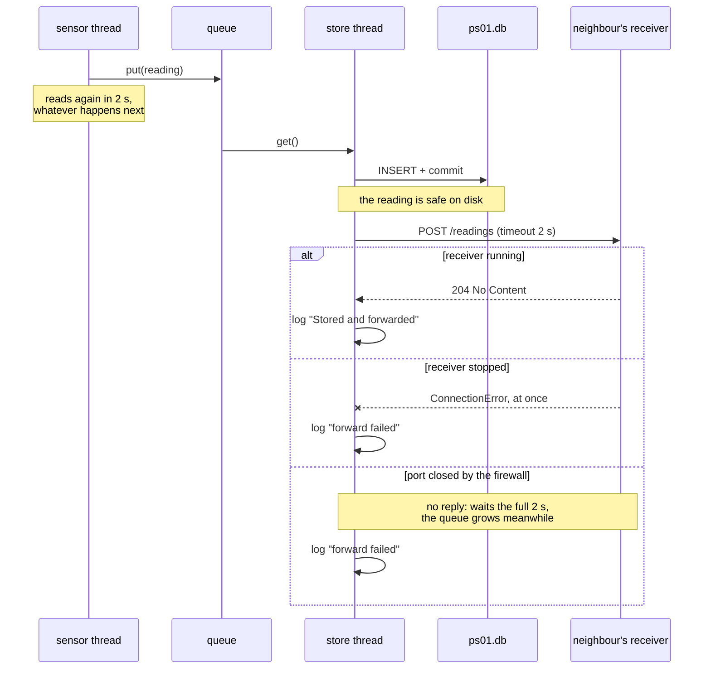

### 5.4 — Query the database

```bash
sudo apt install -y sqlite3
sqlite3 data/ps01.db "SELECT status, COUNT(*) FROM readings GROUP BY status;"
sqlite3 -header -column data/ps01.db "SELECT ts, tank_level_pct, pump_temp_c FROM readings ORDER BY ts DESC LIMIT 5;"
```

**Try it**
1. **Network down.** Ask your neighbour to stop their receiver (**Ctrl+C**). Your gateway logs `forward failed: ConnectionError`, but readings keep arriving every 2 seconds and keep landing in SQLite. Count them with the first query above.
2. **Network silently dropping.** Ask your neighbour to start the receiver again, then close the port: `sudo ufw delete allow in on wlan0 to any port 8080 proto tcp`. Now every POST waits the full 2-second timeout (`ReadTimeout` or `ConnectTimeout`). Watch the `queue:` number: the sensor thread keeps its rhythm while the store thread falls behind. Without threads, your readings would slow down instead.
3. **Put everything back:** your neighbour runs `sudo ufw allow in on wlan0 to any port 8080 proto tcp comment 'Day 1 receiver lab, plant side'`.

> **Recap:** readings that failed to forward are stored, but not resent. On Day 3 you add store-and-forward: the gateway resends what it missed once the link is back.

### 5.5 — Make the gateway the service

The gateway replaces the Topic 3 simulator.

1. Stop and disable the old service:
   ```bash
   sudo systemctl disable --now sim-sensor
   ```
2. Create `/etc/systemd/system/gateway.service` with `sudo nano` (or copy `code/day1/gateway.service`). It is the same as `sim-sensor.service`, with a new description and `gateway.py` in `ExecStart`:
   ```ini
   [Unit]
   Description=PS-01 edge gateway (read, store, forward)
   After=network.target

   [Service]
   User=pelatih
   WorkingDirectory=/home/pelatih/iiot
   ExecStart=/home/pelatih/iiot/.venv/bin/python /home/pelatih/iiot/gateway.py
   Restart=always
   RestartSec=3
   Environment=PYTHONUNBUFFERED=1

   [Install]
   WantedBy=multi-user.target
   ```
3. Enable it, and stop it once to see the clean shutdown in the journal:
   ```bash
   sudo systemctl daemon-reload
   sudo systemctl enable --now gateway
   sudo systemctl stop gateway
   journalctl -u gateway -n 5
   sudo systemctl start gateway
   ```
   The journal ends with `Gateway stopped cleanly`.

**Figure 5.3 — A clean stop**

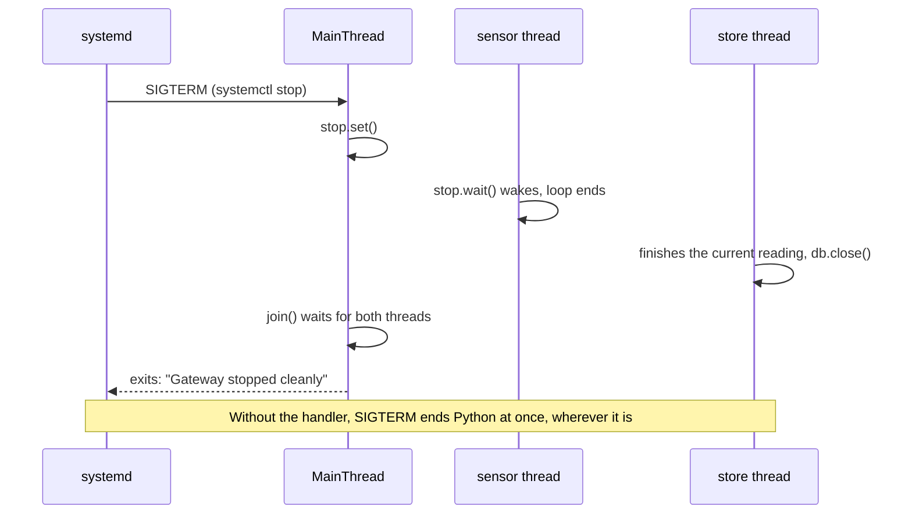

**Checkpoint ✅** `gateway` runs as a service, your neighbour's receiver shows your readings, and when forwarding fails the readings still land in `ps01.db`.

---

## Topic 6 — GPIO: door switch, pump relay and interlock

**Goal:** read a digital input and switch a relay from Python, then combine them into an interlock that keeps the pump safe whatever happens to your program.

**Open:** VS Code on your Pi, and your relay module and jumper wires.

### 6.1 — The GPIO header, safely

1. Show the header layout on your Pi: `pinout`
2. These are the pins you use today:

| Signal | GPIO | Physical pin | Connect to |
|---|---|---|---|
| Door switch | GPIO17 | 11 | GND, pin 9 |
| START | GPIO22 | 15 | GND, pin 14 (touch briefly) |
| STOP | GPIO23 | 16 | GND, pin 20 (touch briefly) |
| Relay IN | GPIO27 | 13 | Relay module **IN** |
| Relay VCC | 5 V | 2 | Relay module **VCC** |
| Relay GND | GND | 6 | Relay module **GND** |

**Figure 6.1 — Wiring for the whole topic**

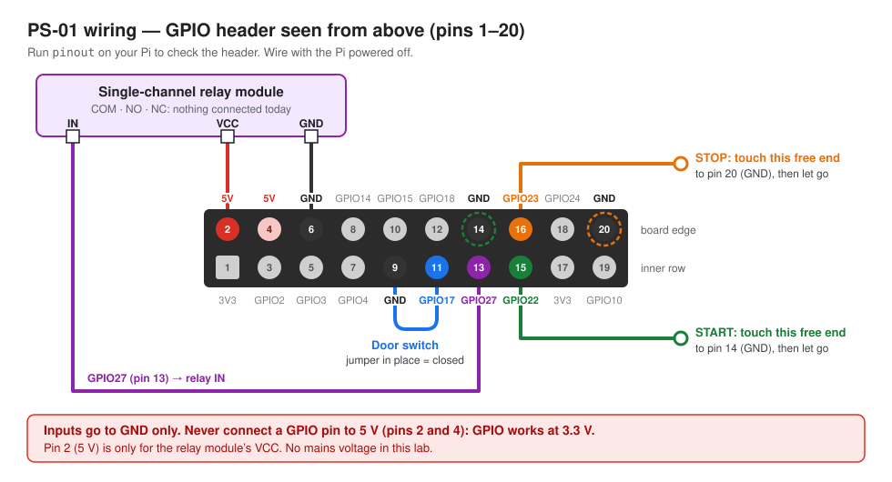

> **Three rules for the header:**
> 1. **Inputs go to GND only. Never connect a GPIO pin to 5 V** (pins 2 and 4). GPIO pins work at 3.3 V and are damaged by 5 V.
> 2. **Wire with the power off.** Shut down with `sudo poweroff`, wait for the green light to stop, then unplug.
> 3. **No mains voltage in this lab.** The relay switches nothing today; its click and its LED (light-emitting diode) are your output.

### 6.2 — Digital input: the door switch

A GPIO input reads **high** (3.3 V) or **low** (0 V). With the Pi's internal **pull-up** resistor switched on, an unconnected pin reads high. Connecting it to GND pulls it low.

**Figure 6.2 — The door switch circuit**


**Figure 6.3 — What the program sees**

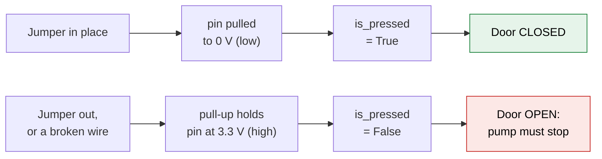

1. Shut down, connect a jumper from **pin 11** to **pin 9**, and power up. Jumper in place = door closed.
2. Create `~/iiot/door_switch.py` (or copy `code/day1/door_switch.py`):

```python
#!/usr/bin/env python3
"""Read the PS-01 door switch: jumper GPIO17 (pin 11) to GND (pin 9) = door closed."""
from signal import pause

from gpiozero import Button

door = Button(17, pull_up=True, bounce_time=0.05)
door.when_pressed = lambda: print("Door CLOSED")
door.when_released = lambda: print("Door OPEN")

print("Door is", "CLOSED" if door.is_pressed else "OPEN", "- Ctrl+C to stop")
pause()
```

3. Run it, then pull one end of the jumper off pin 9 and put it back a few times.

| Piece | What it does |
|---|---|
| `Button(17, pull_up=True)` | GPIO17 as an input with the internal pull-up on. Connected to GND = "pressed" |
| `bounce_time=0.05` | Ignore extra changes for 50 ms after each change |
| `when_pressed` / `when_released` | Functions that run on a change, so you do not check the pin in a loop |
| `pause()` | Keep the program alive, waiting for events |

> **The door switch is fail-safe already.** Jumper in place means closed. A broken wire or a pulled connector reads exactly like an open door, so the plant stops instead of carrying on blind. Real safety circuits are wired the same way.

### 6.3 — Digital output: the pump relay

A relay is a switch worked by an electromagnet. The Pi's 3.3 V pin cannot drive the electromagnet directly; the relay **module** has the extra electronics to do it.

**Figure 6.4 — Inside the relay module**

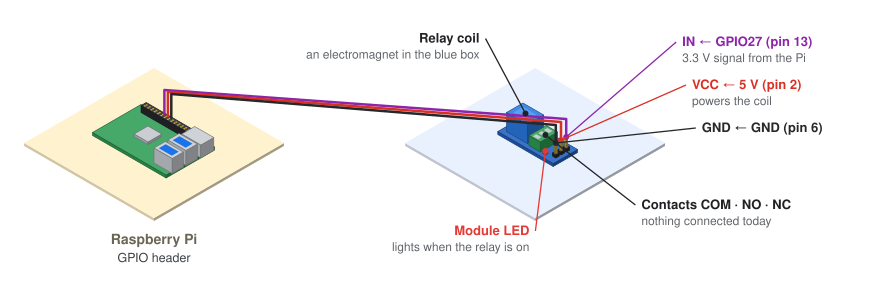

1. Shut down. Connect the relay module: **VCC → pin 2**, **GND → pin 6**, **IN → pin 13**. Power up.
2. Create `~/iiot/relay_test.py` (or copy `code/day1/relay_test.py`):

```python
#!/usr/bin/env python3
"""Click the pump relay on GPIO27 (pin 13) three times."""
from time import sleep

from gpiozero import OutputDevice

RELAY_ACTIVE_HIGH = True  # set to False if the relay is ON while this says OFF

pump = OutputDevice(27, active_high=RELAY_ACTIVE_HIGH, initial_value=False)
print("Relay should be OFF now. Starting in 3 seconds...")
sleep(3)

for _ in range(3):
    pump.on()
    print("ON")
    sleep(1)
    pump.off()
    print("OFF")
    sleep(1)
```

3. Run it, and watch the relay's LED during the 3-second wait.
   - LED **off** during the wait, then three clicks: your module is **active-high**. Keep `True`.
   - LED **on** during the wait: your module is **active-low** (IN pulled low switches it on). Set `RELAY_ACTIVE_HIGH = False` and run again.

> **Relay never switches off, even with the setting right?** Some 5 V active-low modules do not see the Pi's 3.3 V as "high". This is a hardware mismatch, not your code. Tell the trainer.

> **Why `initial_value=False`?** The moment your program starts, the pump must be off, whatever state the pin was left in. Starting a machine should always be a deliberate act.

### 6.4 — The interlock

Now put it together. The pump may only run when someone presses START **and** the door is closed. STOP or an opening door switches it off at once. STOP always wins.

**Figure 6.5 — The interlock: how the pump gets to ON, and every way back to OFF**

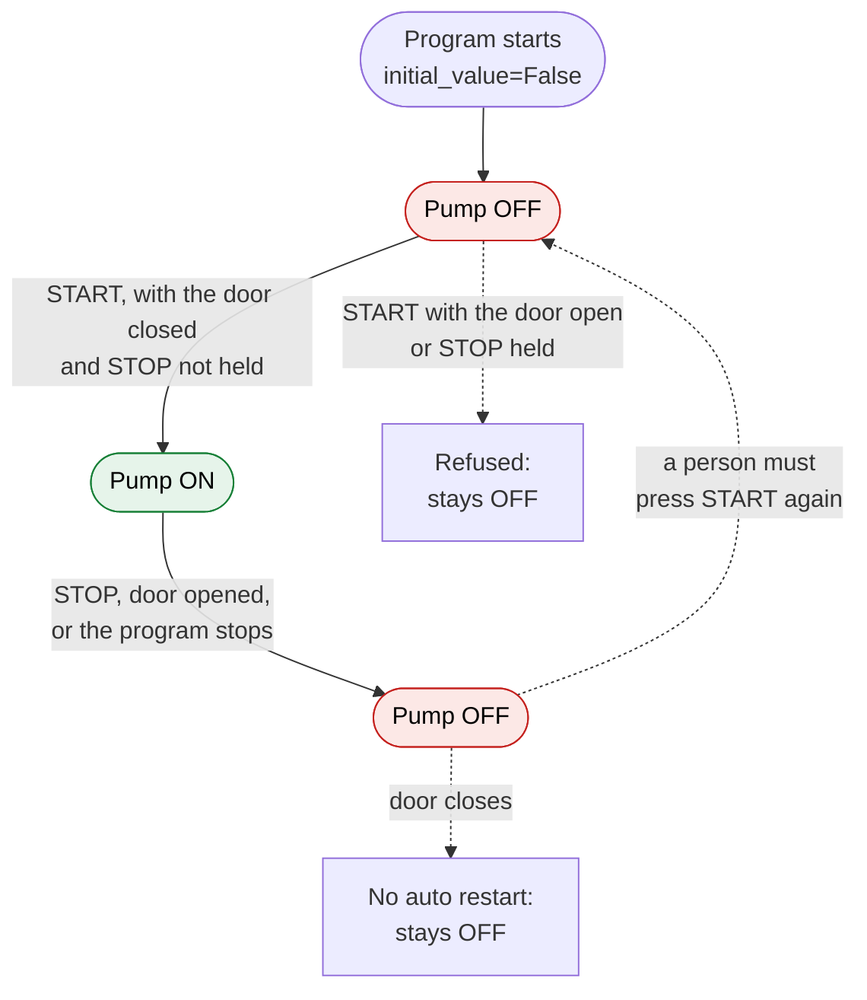

1. Shut down and add two jumpers for the buttons: one on **pin 15** (START) and one on **pin 16** (STOP), with their other ends free. Touch a free end briefly onto a GND pin (14 for START, 20 for STOP) to "press" it. Power up.
2. Create `~/iiot/pump_control.py` (or copy `code/day1/pump_control.py`). Use the `RELAY_ACTIVE_HIGH` value you found in 6.3:

```python
#!/usr/bin/env python3
"""PS-01 pump control: START/STOP with a door interlock, fail-safe by design.

Wiring (jumpers go to GND only):
  door switch  GPIO17 (pin 11)  -> GND (pin 9)   jumper in place = door closed
  START        GPIO22 (pin 15)  -> GND (pin 14)  touch briefly
  STOP         GPIO23 (pin 16)  -> GND (pin 20)  touch briefly
  relay IN     GPIO27 (pin 13); relay VCC -> 5V (pin 2); relay GND -> GND (pin 6)
"""
import logging
import signal
import sys
from signal import pause

from gpiozero import Button, OutputDevice

RELAY_ACTIVE_HIGH = True  # set to False if your relay switches ON when the program starts

logging.basicConfig(level=logging.INFO, format="%(asctime)s %(levelname)s %(message)s")
log = logging.getLogger("pump_control")

door = Button(17, pull_up=True, bounce_time=0.05)
start_button = Button(22, pull_up=True, bounce_time=0.05)
stop_button = Button(23, pull_up=True, bounce_time=0.05)
pump = OutputDevice(27, active_high=RELAY_ACTIVE_HIGH, initial_value=False)


def start() -> None:
    if not door.is_pressed:
        log.warning("START refused: door is open")
        return
    if stop_button.is_pressed:
        log.warning("START refused: STOP is held")
        return
    if not pump.is_active:
        pump.on()
        log.info("Pump ON")


def stop(reason: str) -> None:
    if pump.is_active:
        pump.off()
        log.info("Pump OFF (%s)", reason)


def door_opened() -> None:
    log.warning("Door OPEN")
    stop("door opened")


start_button.when_pressed = start
stop_button.when_pressed = lambda: stop("STOP pressed")
door.when_released = door_opened
door.when_pressed = lambda: log.info("Door closed")

signal.signal(signal.SIGTERM, lambda *_: sys.exit(0))

log.info("Pump control ready. Door is %s, pump is OFF", "closed" if door.is_pressed else "OPEN")
try:
    pause()
finally:
    pump.off()
    log.info("Pump control stopped, pump OFF")
```

3. Run `python pump_control.py` and work through this test sheet. Tick each line only when the relay does what the log says.

| # | Do this | Expected |
|---|---|---|
| 1 | Door closed, touch START | Pump ON, relay clicks |
| 2 | Touch STOP | Pump OFF |
| 3 | Open the door (pull the pin 9 end), touch START | `START refused: door is open`, relay stays off |
| 4 | Close the door, touch START, then open the door | Pump OFF (door opened) |
| 5 | Close the door. Hold STOP on GND and touch START with the other jumper | `START refused: STOP is held` |
| 6 | Close the door. Pump ON, then press **Ctrl+C** | `Pump control stopped, pump OFF` |

> **Closing the door does not restart the pump.** After a stop, a person must press START again. A machine that restarts by itself when a guard closes can injure the person who just closed it.

**Try it**
1. **Kill it the hard way.** Start the pump, then from a second terminal: `pkill -9 -f pump_control.py`. `-9` gives the program no chance to run its `finally` block. **Watch the relay** and write down what it did. Whatever happened was decided by the relay module's hardware, not by your code.
2. **Power cut.** Start the pump, then pull the Pi's power. The relay must drop out, because the module loses its supply.
3. **Put everything back:** power up, run `pump_control.py` again, and confirm the pump starts OFF.

**Figure 6.6 — Who decides the relay state when things go wrong**

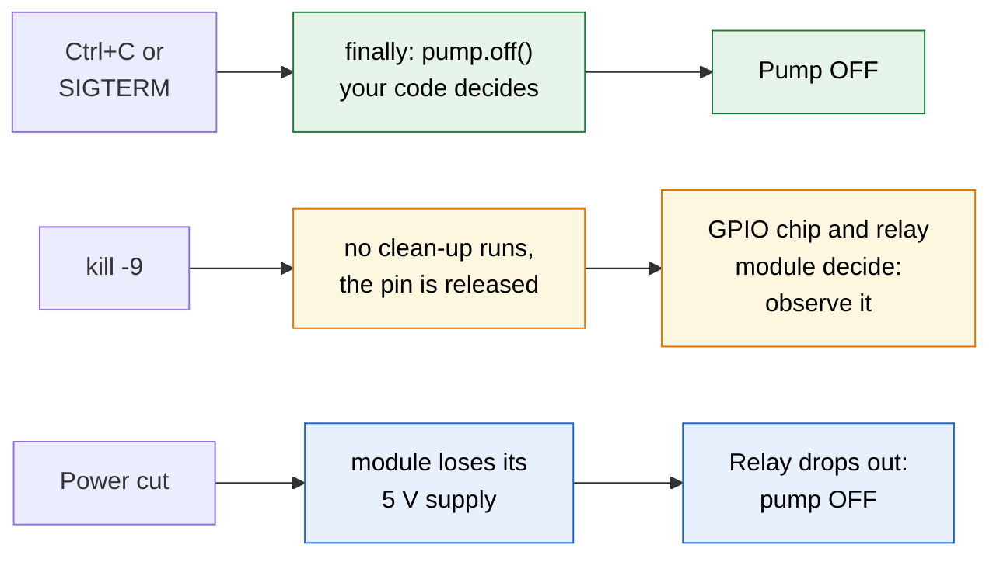

> **Later, in production:** never rely on software alone for safety. Real plants put a hardware interlock (the door switch wired in series with the contactor coil) and a watchdog in front of the program, so a crash or a frozen Pi always ends with the pump off.

**Checkpoint ✅** All six lines of the test sheet pass, and you can say what your relay did when the program was killed with `-9`.

---

## End of Day 1 — what you should have

- A Raspberry Pi named `pi01` / `pi02`, updated, reachable from VS Code with an SSH key
- On two networks: internet and SSH through your laptop's cable (`eth0`), the plant through `PS01-PLANT` (`wlan0`, `192.168.4.11` / `.12`)
- Password login off, and a firewall allowing only SSH and mDNS from the cable side, and port 8080 from the plant side
- `~/iiot/.venv` with `requests`, `pymodbus` and `paho-mqtt`, and `requirements.txt`
- `~/iiot/gateway.py` running as the `gateway` service: reading, storing to `data/ps01.db` and forwarding to your neighbour
- `~/iiot/pump_control.py` passing the interlock test sheet, with the relay wired to pin 13

**Security recap**
- Your private key never leaves your laptop. Anyone with it, and its passphrase, can switch your pump.
- Every open port is a promise to keep it safe. You opened 8080 for a lab; on Day 2 you will close what you no longer need.
- Your programs run as `pelatih`, not root. Only use `sudo` for system tasks.

**Extra, if you finish early**
1. **A normally-closed STOP.** Real STOP buttons are wired so a broken wire stops the machine. Leave the STOP jumper connected from pin 16 to pin 20 all the time, and treat *removing* it as pressing STOP: change `stop_button.when_pressed` to `when_released`, and the START check to refuse when the STOP jumper is *not* in place. Then cut the "wire" and see the pump stop.
2. Run `pump_control.py` as a service called `pump-control`, then repeat the `-9` kill test. What does systemd do, and is a pump that comes back OFF after a restart safe?

**Tomorrow (Day 2):** the gateway meets the plant. You read a real field device over Modbus, publish readings and pump commands over secure MQTT, and build an operator dashboard in Node-RED, where a remote command must still obey your local interlock.
