# Day 2 — Interfacing with the Physical World

> **Today the gateway meets the plant:** you learn how field devices really connect, talk to the PS-01 plant over Modbus by hand, then teach your gateway to read it and raise an alarm, before moving the data over MQTT to an operator dashboard.
> **Carry-over:** from Day 1 you need your Pi on both networks (Topic 2), the `gateway` service running, and `pump_control.py` passing its test sheet.

## Before you start

- [ ] Your Pi answers on the cable side: `ssh pelatih@pi01.local`
- [ ] Your Pi reaches the plant: `ping -c 3 192.168.4.1`
- [ ] The ESP32 plant's screen shows `PS-01  plant running`
- [ ] Get today's files onto your Pi:
  ```bash
  sudo apt install -y git
  git clone https://github.com/luqmanyusof/industrial-iot-raspberry-pi.git ~/course
  ```
- [ ] Make sure your venv has the Modbus version these notes use:
  ```bash
  source ~/iiot/.venv/bin/activate
  pip install pymodbus==3.16.2
  ```

---

## Topic 7 — How field devices connect (concept)

**Goal:** understand why the gateway talks to *field devices* instead of to sensors, and learn the Modbus model well enough to read the PS-01 register map on your own.

### 7.1 — Sensors live inside field devices

Every sensor has its own way of being wired and read:

| Interface | Wires | Typical distance | Example in this course |
|---|---|---|---|
| Analog voltage (read by an **ADC**, analog-to-digital converter) | 1 signal + ground | Centimetres; noise creeps in | The plant's tank-level knob |
| Single-wire digital | 1 data + power | A few metres | The DHT11 temperature sensor |
| **I2C** (Inter-Integrated Circuit) | 2 + power, many devices by address | On one board | The plant's OLED screen |
| **SPI** (Serial Peripheral Interface) | 4 + power, fast | On one board | SD cards, fast displays |
| 4–20 mA current loop | 2 | Hundreds of metres | Industrial pressure and level transmitters |
| **RS-485** | 2 (differential) | Up to about 1.2 km, many devices on one cable | Modbus RTU field buses |

> **4–20 mA is fail-safe too.** The signal never goes below 4 mA, so 0 mA can only mean a broken wire. Same idea as your door switch on Day 1: the failure looks different from every real value.

A gateway that had to speak all of these would be fragile and full of special cases. So industry puts the sensors inside **field devices** (PLCs, meters, drives, remote I/O), and every field device speaks a **standard protocol** upwards. Your gateway only has to speak that one protocol.

**Figure 7.1 — The field device reads its sensors; the gateway reads the field device**

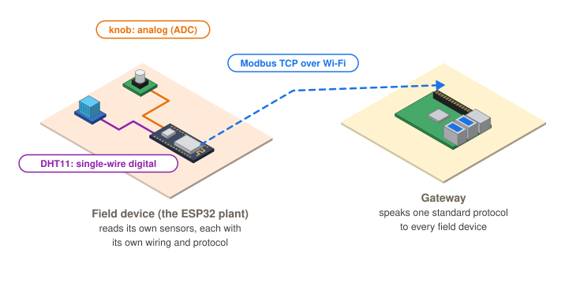

### 7.2 — Modbus in ten minutes

**Modbus** (1979) is the most widely used industrial protocol in the world. It is simple, open, and supported by almost every PLC, meter and drive.

- A **client** sends a request; a **server** (the field device) answers. Older documents say *master* and *slave*.
- The server never speaks first. The client **polls**: it asks again and again, for example every 2 seconds.
- **Modbus TCP** runs over Ethernet or Wi-Fi on TCP port **502**. **Modbus RTU** carries the same requests over RS-485 serial cable.

Everything a Modbus server offers sits in four tables:

**Figure 7.2 — The four Modbus tables**

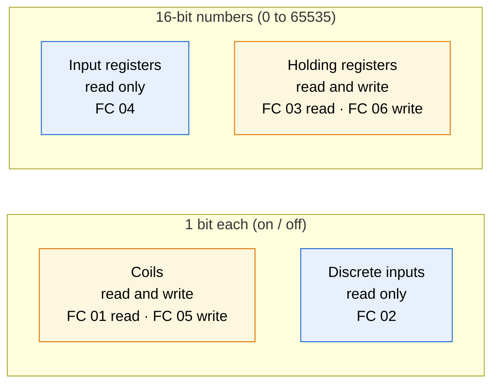

| Table | Size | Who changes it | Typical use |
|---|---|---|---|
| Coils | 1 bit | Client writes | Switch something on or off: a horn, a pump |
| Discrete inputs | 1 bit | Device only | A switch or alarm state: e-stop pressed |
| Input registers | 16 bits | Device only | A measurement: level, temperature |
| Holding registers | 16 bits | Client writes | A setting or command: a valve position |

**FC** means **function code**: the number in each request that says which table to read or write.

> **Two traps in every Modbus datasheet**
> 1. **Addresses.** Many documents number registers from 1 with a table prefix: `30001` is input register 0, `40001` is holding register 0. In code you use the plain address starting at 0.
> 2. **Scaling.** Registers hold whole numbers only. A temperature of 28.5 °C is sent as `285`, with "× 10" written in the datasheet. Forget to divide and your pump room is at 285 °C.

> **Modbus has no security at all.** No password, no encryption: anyone who can reach port 502 can read every value and write every output. This is why the plant has its own network and your gateway is the only machine on both sides. You will secure the data that leaves the gateway in Topic 11.

### 7.3 — The PS-01 register map

This is the datasheet for our plant. Keep it open all day.

| Address | Table | Name | Scaling | Meaning |
|---|---|---|---|---|
| IR0 | Input register | `tank_level` | ÷ 10 → % | Tank level, 0.0–100.0 % (the knob) |
| IR1 | Input register | `room_temp` | ÷ 10 → °C | Pump room temperature (DHT11) |
| IR2 | Input register | `room_humidity` | ÷ 10 → % | Pump room humidity (DHT11) |
| IR3 | Input register | `uptime` | seconds | Time since the plant started; jumps back to 0 after a restart |
| DI0 | Discrete input | `e_stop` | — | 1 = emergency stop active (red button on the plant) |
| DI1 | Discrete input | `sensor_fault` | — | 1 = the DHT11 did not answer |
| C0 | Coil | `alarm_horn` | — | 1 = horn sounds |
| HR0 | Holding register | `stack_light` | 0–3 | 0 off, 1 green, 2 amber, 3 red |
| HR1 | Holding register | `valve` | % | Outlet valve, 0 (shut) to 100 (fully open) |

The plant has one rule of its own: **while the e-stop is active, it shuts the valve, flashes red and sounds the horn, whatever the gateways write.** The local safety function wins over every remote command.

**Figure 7.3 — One poll, one command, and what silence looks like**

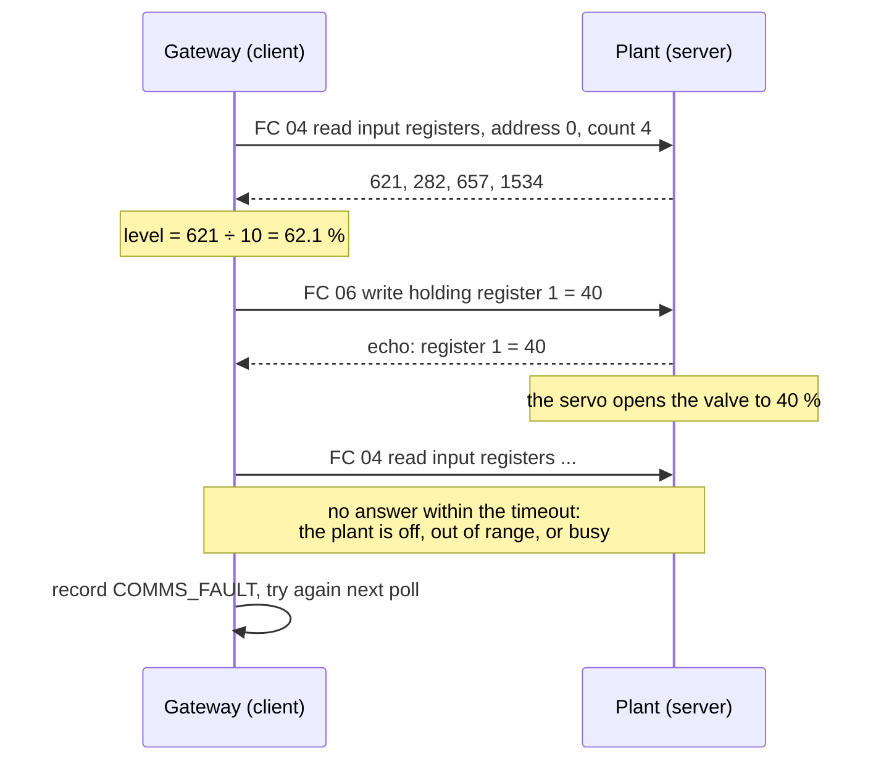

**Try it**

Using only the register map, write down the function code, table and address you would use to:
1. Read the tank level.
2. Check whether someone pressed the e-stop.
3. Open the valve halfway.
4. Silence the horn.

<details>
<summary>Answers</summary>

1. FC 04, input register 0 (then divide by 10).
2. FC 02, discrete input 0.
3. FC 06, holding register 1, value 50.
4. FC 05, coil 0, value off.

</details>

**Checkpoint ✅** You can explain why the four tables exist, and turn any line of the register map into a function code and an address.

---

## Topic 8 — Modbus by hand

**Goal:** read and write the plant's registers from Python, first on a simulator of your own, then on the real plant, and see what happens when two clients disagree.

**Open:** two VS Code terminals on your Pi, both with the venv active, in `~/iiot`.

1. Copy today's first three programs:
   ```bash
   cp ~/course/code/day2/{plant_sim,modbus_read,modbus_write}.py ~/iiot/
   ```

### 8.1 — A plant of your own: the simulator

`plant_sim.py` is a complete Modbus TCP server with the same register map as the ESP32, written in plain Python. The tank level rises and falls on its own, and now and then the temperature sensor fails. Nobody else can disturb it, so it is the safe place to experiment.

1. In terminal 1, start it and leave it running:
   ```bash
   python plant_sim.py
   ```
   It listens on port **5020**: ports below 1024, like 502, need root.

### 8.2 — Read every register

`modbus_read.py` reads all four tables once and prints them raw and scaled:

```python
#!/usr/bin/env python3
"""Read every PS-01 register once and print it, raw and scaled."""
import argparse
import sys

from pymodbus.client import ModbusTcpClient

LIGHTS = {0: "off", 1: "green", 2: "amber", 3: "red"}


def main() -> None:
    parser = argparse.ArgumentParser(description=__doc__)
    parser.add_argument("--host", default="192.168.4.1")
    parser.add_argument("--port", type=int, default=502)
    args = parser.parse_args()

    client = ModbusTcpClient(args.host, port=args.port, timeout=2)
    if not client.connect():
        sys.exit(f"Cannot connect to {args.host}:{args.port}")

    ir = client.read_input_registers(0, count=4)       # FC 04
    di = client.read_discrete_inputs(0, count=2)       # FC 02
    co = client.read_coils(0, count=1)                 # FC 01
    hr = client.read_holding_registers(0, count=2)     # FC 03
    client.close()

    for name, resp in (("input registers", ir), ("discrete inputs", di), ("coils", co), ("holding registers", hr)):
        if resp.isError():
            sys.exit(f"Reading {name} failed: {resp}")

    level, temp, hum, uptime = ir.registers
    print(f"{'Register':<6} {'Name':<14} {'Raw':>6}  Value")
    print(f"{'IR0':<6} {'tank_level':<14} {level:>6}  {level / 10:.1f} %")
    print(f"{'IR1':<6} {'room_temp':<14} {temp:>6}  {temp / 10:.1f} °C")
    print(f"{'IR2':<6} {'room_humidity':<14} {hum:>6}  {hum / 10:.1f} %")
    print(f"{'IR3':<6} {'uptime':<14} {uptime:>6}  {uptime} s")
    print(f"{'DI0':<6} {'e_stop':<14} {int(di.bits[0]):>6}  {'ACTIVE' if di.bits[0] else 'clear'}")
    print(f"{'DI1':<6} {'sensor_fault':<14} {int(di.bits[1]):>6}  {'FAULT' if di.bits[1] else 'ok'}")
    print(f"{'C0':<6} {'alarm_horn':<14} {int(co.bits[0]):>6}  {'ON' if co.bits[0] else 'off'}")
    print(f"{'HR0':<6} {'stack_light':<14} {hr.registers[0]:>6}  {LIGHTS.get(hr.registers[0], '?')}")
    print(f"{'HR1':<6} {'valve':<14} {hr.registers[1]:>6}  {hr.registers[1]} % open")


if __name__ == "__main__":
    main()
```

| Piece | What it does |
|---|---|
| `ModbusTcpClient(host, port, timeout=2)` | One TCP connection to the server; give up on an answer after 2 seconds |
| `read_input_registers(0, count=4)` | FC 04: four input registers starting at address 0 |
| `read_discrete_inputs` / `read_coils` | FC 02 / FC 01: the answer is in `.bits` |
| `read_holding_registers` | FC 03: the answer is in `.registers` |
| `resp.isError()` | The server can answer with an error instead of data, for example for an address that does not exist |

1. In terminal 2, read the simulator:
   ```bash
   python modbus_read.py --host 127.0.0.1 --port 5020
   ```
2. Run it a few times. `tank_level` and `uptime` change; everything else stays put.

### 8.3 — Read the real plant

All three Pis now poll the same ESP32 at the same time. A Modbus TCP server keeps one connection per client and answers the requests one by one.

**Figure 8.1 — Every Pi is a client of the one plant**

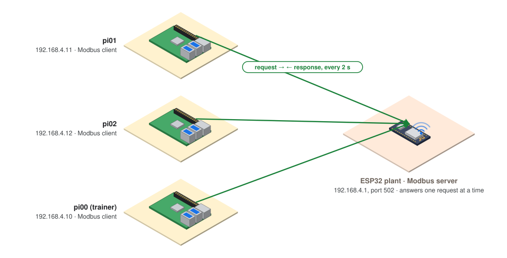

1. Read the plant (the defaults are `192.168.4.1` and port `502`):
   ```bash
   python modbus_read.py
   ```
2. Ask someone to turn the plant's knob, and read again. `tank_level` follows it.

### 8.4 — Write commands

`modbus_write.py` sets the stack light, the valve and the horn:

```python
#!/usr/bin/env python3
"""Command the PS-01 plant: stack light, outlet valve, alarm horn.

Examples:
  python modbus_write.py --light red
  python modbus_write.py --valve 40
  python modbus_write.py --horn on
"""
import argparse
import sys

from pymodbus.client import ModbusTcpClient

LIGHTS = {"off": 0, "green": 1, "amber": 2, "red": 3}


def main() -> None:
    parser = argparse.ArgumentParser(description=__doc__, formatter_class=argparse.RawDescriptionHelpFormatter)
    parser.add_argument("--host", default="192.168.4.1")
    parser.add_argument("--port", type=int, default=502)
    parser.add_argument("--light", choices=LIGHTS)
    parser.add_argument("--valve", type=int, metavar="0-100")
    parser.add_argument("--horn", choices=["on", "off"])
    args = parser.parse_args()

    client = ModbusTcpClient(args.host, port=args.port, timeout=2)
    if not client.connect():
        sys.exit(f"Cannot connect to {args.host}:{args.port}")

    results = []
    if args.light:
        results.append(("stack light", client.write_register(0, LIGHTS[args.light])))     # FC 06, HR0
    if args.valve is not None:
        results.append(("valve", client.write_register(1, args.valve)))                   # FC 06, HR1
    if args.horn:
        results.append(("horn", client.write_coil(0, args.horn == "on")))                 # FC 05, C0
    client.close()

    for name, resp in results:
        print(f"{name}: {'FAILED ' + str(resp) if resp.isError() else 'written'}")


if __name__ == "__main__":
    main()
```

1. Change the stack light and open the valve. Watch the plant: the light changes and the servo turns.
   ```bash
   python modbus_write.py --light amber
   python modbus_write.py --valve 40
   ```
2. Read everything back with `python modbus_read.py`.
3. Put the plant back: `python modbus_write.py --light green --valve 0`

**Try it**
1. **Local safety wins.** Open the valve to 60 %, then ask the trainer to press the plant's **E-STOP** button (D34). Read the registers: `e_stop` is `ACTIVE` and `valve` still says `60`, but the servo has shut and the horn sounds. Write `--valve 80`: the register changes, the servo does not move. Now press **RESET** (D35): the valve opens to 80 %. The plant obeys the gateways only while its own safety allows it.
2. **Who has control?** With your neighbour, take turns writing different valve positions (`--valve 20`, `--valve 80`) and watch the servo. The plant obeys whoever wrote last; it has no idea there are two of you. In a real plant, each output has exactly one controller. Discuss: how would you decide who that is, and how would you hand over control?
3. **A value out of range.** `python modbus_write.py --valve 140`, then read it back. The plant clamped it to 100. Well-behaved field devices check what they are given; never rely on it.
4. **Nobody home.** `python modbus_read.py --host 192.168.4.99`. After the 2-second timeout you get `Cannot connect`. This is what a dead or out-of-range device looks like to a gateway.
5. **Put everything back:** `python modbus_write.py --light green --valve 0 --horn off`

**Checkpoint ✅** You can read the plant's tank level and write its valve from Python, and explain why the valve stays shut during an e-stop.

---

## Topic 9 — Modbus in the gateway

**Goal:** swap the simulated sensors in your Day 1 gateway for the real plant, add a high-level alarm that drives the stack light and the horn, and make sure a lost plant becomes a recorded fault, not a crash.

**Open:** VS Code on your Pi, folder `~/iiot`.

### 9.1 — Only the plant class changes

On Day 1 you built the gateway around a `PumpStationSimulator` class with one `read()` method, and promised that a real plant would slot in later. This is that moment.

**Figure 9.1 — The Day 1 gateway with a real plant behind it**

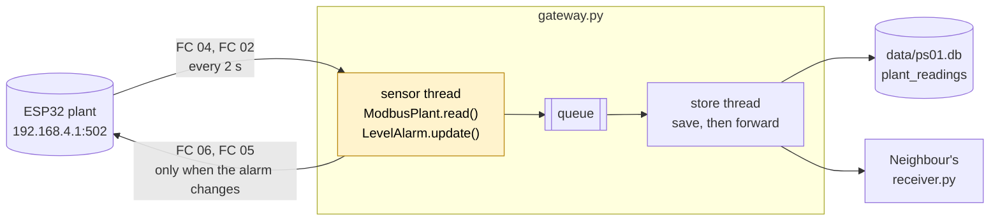

1. Stop the Day 1 gateway and keep a copy of it:
   ```bash
   sudo systemctl stop gateway
   cp gateway.py gateway_day1.py
   ```
2. Copy the new files:
   ```bash
   cp ~/course/code/day2/{plant,gateway}.py ~/iiot/
   ```

`plant.py` holds the new plant class and the alarm:

```python
#!/usr/bin/env python3
"""The PS-01 plant over Modbus TCP: one class that reads it and one that decides the alarm."""
import logging
import socket
from dataclasses import dataclass
from datetime import datetime, timezone

from pymodbus.client import ModbusTcpClient
from pymodbus.exceptions import ModbusException

log = logging.getLogger("plant")

LIGHT_OFF, LIGHT_GREEN, LIGHT_AMBER, LIGHT_RED = 0, 1, 2, 3


@dataclass
class Reading:
    ts: str
    station: str
    gateway: str
    tank_level_pct: float | None
    room_temp_c: float | None
    room_humidity_pct: float | None
    e_stop: bool | None
    status: str                 # OK, SENSOR_FAULT or COMMS_FAULT


class ModbusPlant:
    """Reads the plant's registers and writes its outputs. Same read() as Day 1's simulator."""

    def __init__(self, host: str, port: int = 502, station: str = "PS-01"):
        self.station = station
        self.gateway = socket.gethostname()
        self.client = ModbusTcpClient(host, port=port, timeout=1, retries=1)

    def _now(self) -> str:
        return datetime.now(timezone.utc).isoformat(timespec="seconds")

    def read(self) -> Reading:
        try:
            if not self.client.connected:
                self.client.connect()
            ir = self.client.read_input_registers(0, count=4)      # level, temp, humidity, uptime
            di = self.client.read_discrete_inputs(0, count=2)      # e-stop, sensor fault
            if ir.isError() or di.isError():
                raise ModbusException(f"plant answered with an error: {ir if ir.isError() else di}")
        except (ModbusException, OSError) as err:
            log.warning("Plant not answering: %s", err)
            self.client.close()                                    # start clean next time
            return Reading(self._now(), self.station, self.gateway, None, None, None, None, "COMMS_FAULT")

        level, temp, hum, _uptime = ir.registers
        e_stop, sensor_fault = di.bits[0], di.bits[1]
        return Reading(
            ts=self._now(),
            station=self.station,
            gateway=self.gateway,
            tank_level_pct=level / 10,
            room_temp_c=None if sensor_fault else temp / 10,
            room_humidity_pct=None if sensor_fault else hum / 10,
            e_stop=e_stop,
            status="SENSOR_FAULT" if sensor_fault else "OK",
        )

    def set_outputs(self, light: int, horn: bool) -> bool:
        """Write the stack light and the horn. Returns False if the plant did not accept it."""
        try:
            r1 = self.client.write_register(0, light)               # HR0
            r2 = self.client.write_coil(0, horn)                    # C0
            return not (r1.isError() or r2.isError())
        except (ModbusException, OSError) as err:
            log.warning("Could not write outputs: %s", err)
            return False


class LevelAlarm:
    """High-level alarm with hysteresis, so the light does not flicker at the limit."""

    HIGH_ON, HIGH_OFF = 90.0, 85.0
    WARN_ON, WARN_OFF = 80.0, 75.0

    def __init__(self):
        self.state = "NORMAL"

    def update(self, level: float) -> str:
        if level >= self.HIGH_ON or (self.state == "HIGH" and level >= self.HIGH_OFF):
            self.state = "HIGH"
        elif level >= self.WARN_ON or (self.state in ("HIGH", "WARN") and level >= self.WARN_OFF):
            self.state = "WARN"
        else:
            self.state = "NORMAL"
        return self.state

    @staticmethod
    def outputs(state: str) -> tuple[int, bool]:
        """(stack light, horn) for each alarm state."""
        return {"NORMAL": (LIGHT_GREEN, False), "WARN": (LIGHT_AMBER, False), "HIGH": (LIGHT_RED, True)}[state]
```

| Piece | What it does |
|---|---|
| `Reading` | Same idea as Day 1, with the plant's fields. A value the plant could not give is `None`, never a made-up number |
| `ModbusPlant.read()` | Two requests (FC 04 and FC 02), scaled. Any Modbus or network error becomes a `COMMS_FAULT` reading |
| `self.client.close()` after an error | Drop the broken connection, so the next poll starts clean |
| `set_outputs()` | FC 06 for the light, FC 05 for the horn; returns `False` if the plant did not accept it |
| `LevelAlarm` | Decides NORMAL, WARN or HIGH from the level, with hysteresis (9.2) |

In `gateway.py`, the threads, queue, SQLite and HTTP forwarding are exactly as on Day 1. These parts changed:

```python
PLANT_HOST, PLANT_PORT = "192.168.4.1", 502      # simulator: "127.0.0.1", 5020
```

```python
def sensor_loop(plant: ModbusPlant, q: queue.Queue, stop: threading.Event) -> None:
    alarm = LevelAlarm()
    written = None                          # outputs last accepted by the plant; None = unknown
    while not stop.is_set():
        reading = plant.read()
        if reading.status == "COMMS_FAULT":
            written = None                  # rewrite the outputs once the plant is back
        else:
            state = alarm.update(reading.tank_level_pct)
            wanted = alarm.outputs(state)
            if wanted != written:
                if plant.set_outputs(*wanted):
                    log.info("Alarm %s: light %d, horn %s", state, wanted[0], "ON" if wanted[1] else "off")
                    written = wanted
        q.put(reading)
        stop.wait(INTERVAL_S)
```

| Piece | What it does |
|---|---|
| `written` | The outputs the plant last accepted. Write only when they need to change, not every 2 seconds |
| `written = None` on `COMMS_FAULT` | After an outage nobody knows what the plant is showing, so write the outputs again when it is back |
| Reading and writing in the same thread | A Modbus client must not be used by two threads at once |

> **Error about `plant_readings`?** The table is new today, created on the first run. The Day 1 `readings` table is still in the same file, untouched.

### 9.2 — An alarm that does not flicker

A level hovering around 90 % would switch the alarm on and off every few seconds if there were only one limit. Operators stop trusting a flickering alarm. **Hysteresis** uses two limits: one to raise the alarm, a lower one to clear it.

| State | Raised at | Cleared below | Stack light | Horn |
|---|---|---|---|---|
| NORMAL | — | — | green | off |
| WARN | 80 % | 75 % | amber | off |
| HIGH | 90 % | 85 % | red | **on** |

**Figure 9.2 — The level alarm**


### 9.3 — Run it

1. **Simulator first.** With `plant_sim.py` still running in terminal 1, set `PLANT_HOST, PLANT_PORT = "127.0.0.1", 5020` in `gateway.py` and run `python gateway.py`. The simulated tank rises and falls on its own: within a few minutes you see `Alarm WARN` and `Alarm HIGH` in the log, and the simulator shows the light and horn your gateway wrote. Stop both with **Ctrl+C**.
2. **The real plant.** Set `PLANT_HOST, PLANT_PORT = "192.168.4.1", 502` again, then start the service:
   ```bash
   sudo systemctl start gateway
   journalctl -u gateway -f
   ```

> **Three gateways, one stack light.** All three Pis run the same alarm on the same level, so they write the same outputs and agree. Change one gateway's limits and they start fighting, exactly like the valve in Topic 8.

**Try it**
1. **Raise the alarm.** Ask for the knob to be turned slowly up past 90 %. The light goes amber at 80, red at 90 with the horn (use the plant's mute switch if it gets too much). Turn it back to 87 %: still red. Below 85: amber. Below 75: green.
2. **Lose the plant.** Ask the trainer to unplug the ESP32 for 10 seconds. Your journal shows `Plant not answering` and readings arrive as `COMMS_FAULT`; the gateway keeps running. When the plant is back, the log shows the alarm outputs written again.
3. **A broken contract.** Look at your neighbour's `receiver.py` (start it again if needed): it prints `temp None`. The receiver still looks for `pump_temp_c`, but the gateway now sends `room_temp_c`. Nothing crashed and nothing warned you; the data just went missing. A message format is a **contract** between two programs: change it on one side only and the other side silently breaks. Fix the receiver to print `room_temp_c`.
4. **Ask the database.**
   ```bash
   sqlite3 -header -column data/ps01.db "SELECT status, COUNT(*) FROM plant_readings GROUP BY status;"
   sqlite3 -header -column data/ps01.db "SELECT ts, tank_level_pct, room_temp_c, e_stop FROM plant_readings ORDER BY ts DESC LIMIT 5;"
   ```

**Checkpoint ✅** The `gateway` service reads the real plant every 2 seconds, the stack light follows the level with hysteresis, and an unplugged plant shows up as `COMMS_FAULT` instead of stopping the gateway.

---

## Topic 10 — MQTT

**Goal:** replace the gateway's HTTP forwarding with **MQTT**, the publish-subscribe protocol most IIoT systems use to move data upwards, and let the pump take remote commands without giving up its local interlock.

**Open:** VS Code on your Pi, folder `~/iiot`, two terminals with the venv active.

### 10.1 — Publish and subscribe

With HTTP on Day 1, your gateway had to know exactly who to send each reading to. **MQTT** (Message Queuing Telemetry Transport) puts a **broker** in the middle:

- A **publisher** sends a message to a **topic**, a name like `ps01/pi01/telemetry`. It does not know or care who is listening.
- A **subscriber** tells the broker which topics it wants, and gets every message on them.
- Adding a dashboard, a historian or an alarm system means adding a subscriber. The gateway does not change.

**Figure 10.1 — Everything talks through the broker on your Pi**

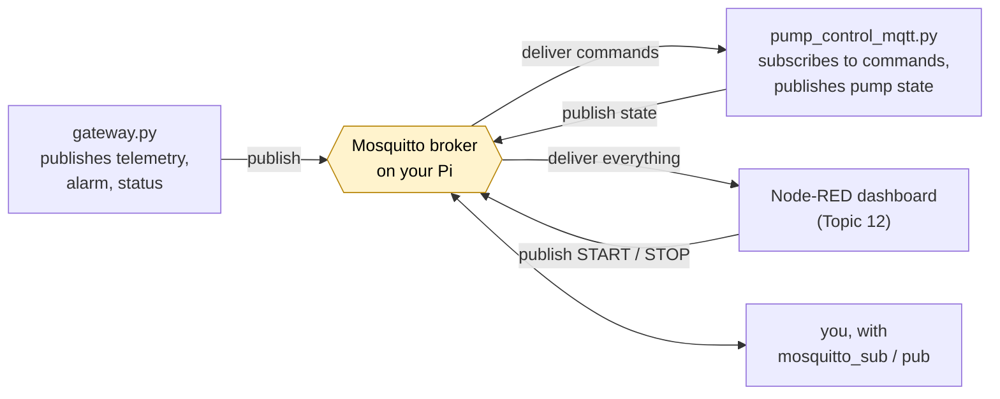

| Idea | What it means | Where you use it today |
|---|---|---|
| **Topic** | A path-like name; `+` matches one level, `#` matches everything below | `ps01/+/telemetry`, `ps01/#` |
| **QoS** (Quality of Service) | 0 = at most once (fire and forget), 1 = at least once (acknowledged), 2 = exactly once | Telemetry QoS 0 (the next reading is 2 s away); commands and state QoS 1 |
| **Retained message** | The broker keeps the last message on a topic and hands it to every new subscriber at once | Alarm state, pump state, gateway status |
| **Last will** | A message the broker publishes *for* a client that vanishes without saying goodbye | `ps01/pi01/status` → `offline` |
| **Keep-alive** | The client pings the broker; after 1.5 × keep-alive of silence the broker declares it dead | 10 seconds |

> **MQTT or DDS?** Many defence and naval combat systems use **DDS** (Data Distribution Service) instead. DDS has no broker: publishers and subscribers find each other directly, with detailed quality-of-service and real-time options. It suits tightly coupled systems on fast local networks. MQTT's single broker is simpler to secure and manage, and suits many small devices over unreliable links, which is why it dominates IIoT.

### 10.2 — The PS-01 topic tree

Design topics before writing code; changing them later breaks every subscriber (remember the receiver in Topic 9).

| Topic | Payload | Published by | QoS | Retained |
|---|---|---|---|---|
| `ps01/<gateway>/status` | `online` / `offline` | `gateway.py` (`offline` also as last will) | 1 | yes |
| `ps01/<gateway>/telemetry` | JSON reading | `gateway.py` | 0 | no |
| `ps01/<gateway>/alarm` | `NORMAL` / `WARN` / `HIGH` | `gateway.py` | 1 | yes |
| `ps01/<gateway>/pump/cmd` | `START` / `STOP` | dashboard, or you | 1 | no |
| `ps01/<gateway>/pump/state` | JSON: pump, door, reason | `pump_control_mqtt.py` | 1 | yes |

`<gateway>` is your Pi's hostname, for example `pi01`.

> **Never retain a command.** A retained `START` would be replayed to the pump every time it reconnects, perhaps hours later. Retain *state*, never *commands*.

### 10.3 — Install the broker and try it by hand

1. Install Mosquitto and its command-line tools:
   ```bash
   sudo apt install -y mosquitto mosquitto-clients
   sudo systemctl enable --now mosquitto
   ```
   Out of the box, Mosquitto 2 accepts connections **only from this Pi** and without a login. That is enough for now; Topic 11 locks it down.
2. In terminal 1, subscribe to everything under `ps01`:
   ```bash
   mosquitto_sub -h localhost -t 'ps01/#' -v
   ```
3. In terminal 2, publish:
   ```bash
   mosquitto_pub -h localhost -t ps01/test/hello -m "Selamat pagi"
   mosquitto_pub -h localhost -t ps01/test/state -m "I am retained" -r
   ```
4. Stop the subscriber (**Ctrl+C**) and start it again. `hello` is gone; the retained `state` arrives straight away.
5. Clear the retained message by publishing an empty one: `mosquitto_pub -h localhost -t ps01/test/state -r -n`

### 10.4 — The gateway publishes over MQTT

All MQTT settings live in one small module, `mqtt_link.py`, which reads `~/iiot/mqtt.json`. In Topic 11 you secure the broker by changing that file only.

1. Copy the files and create the settings file:
   ```bash
   cp ~/course/code/day2/{mqtt_link,pump_control_mqtt}.py ~/iiot/
   cp ~/course/code/day2/gateway_mqtt.py ~/iiot/gateway.py
   echo '{"host": "localhost", "port": 1883}' > ~/iiot/mqtt.json
   ```

```python
#!/usr/bin/env python3
"""One place for MQTT settings. Every program connects the same way, from ~/iiot/mqtt.json.

Securing the broker (Topic 11) changes only that file, never the programs.
"""
import json
import logging
import socket
from pathlib import Path
from typing import Callable

import paho.mqtt.client as mqtt

CONFIG_FILE = Path.home() / "iiot" / "mqtt.json"
GATEWAY = socket.gethostname()
BASE = f"ps01/{GATEWAY}"                 # every topic this Pi publishes starts here

log = logging.getLogger("mqtt")


def make_client(role: str, will: tuple[str, str] | None = None,
                on_connect: Callable[[mqtt.Client], None] | None = None) -> mqtt.Client:
    """Create, configure and start an MQTT client for one program (role = gateway, pump, ...)."""
    cfg = json.loads(CONFIG_FILE.read_text())
    client = mqtt.Client(mqtt.CallbackAPIVersion.VERSION2, client_id=f"{GATEWAY}-{role}")

    login = cfg.get("logins", {}).get(role)
    if login:
        client.username_pw_set(login["username"], login["password"])
    if cfg.get("ca_file"):
        client.tls_set(ca_certs=cfg["ca_file"])            # encrypt, and check the broker's certificate
    if will:
        client.will_set(will[0], will[1], qos=1, retain=True)

    def _on_connect(c, userdata, flags, reason_code, properties):
        if reason_code.is_failure:
            log.warning("MQTT broker refused us: %s", reason_code)
            return
        log.info("MQTT connected to %s:%s as %s", cfg["host"], cfg["port"], login["username"] if login else "anonymous")
        if on_connect:
            on_connect(c)

    def _on_disconnect(c, userdata, flags, reason_code, properties):
        log.warning("MQTT disconnected: %s", reason_code)

    client.on_connect = _on_connect
    client.on_disconnect = _on_disconnect
    client.reconnect_delay_set(min_delay=1, max_delay=10)
    client.connect_async(cfg["host"], cfg["port"], keepalive=10)
    client.loop_start()                                        # network traffic runs in its own thread
    return client
```

| Piece | What it does |
|---|---|
| `BASE = f"ps01/{GATEWAY}"` | Every topic starts with your hostname, so three Pis never collide |
| `CallbackAPIVersion.VERSION2` | paho-mqtt 2.x needs you to say which callback style you use |
| `will_set(...)` | Registers the last will with the broker when connecting |
| `connect_async` + `loop_start` | Connects in the background and reconnects by itself (1 to 10 s apart) |
| `on_connect` | Runs after every (re)connect: the place to publish `online` and to subscribe |

In `gateway.py`, the HTTP forward became an MQTT publish; everything else is as in Topic 9:

```python
        if client.is_connected():
            client.publish(f"{BASE}/telemetry", json.dumps(asdict(reading)), qos=0)
            log.info("Stored and published %s %s (queue: %d)", reading.ts, reading.status, q.qsize())
        else:
            log.warning("Stored locally, broker not connected (queue: %d)", q.qsize())
```

```python
    client = make_client("gateway", will=(f"{BASE}/status", "offline"),
                         on_connect=lambda c: c.publish(f"{BASE}/status", "online", qos=1, retain=True))
```

2. Restart the service, and watch the topics in your subscriber terminal:
   ```bash
   sudo systemctl restart gateway
   mosquitto_sub -h localhost -t 'ps01/#' -v
   ```
   You see `status online`, the current `alarm`, and a `telemetry` message every 2 seconds.

### 10.5 — Remote commands, local authority

`pump_control_mqtt.py` is your Day 1 `pump_control.py` with MQTT added. A remote `START` goes through **exactly the same checks** as touching the START jumper.

1. Stop Day 1's version if it is still running, set `RELAY_ACTIVE_HIGH` to the value you found on Day 1, then run:
   ```bash
   python pump_control_mqtt.py
   ```

```python
#!/usr/bin/env python3
"""PS-01 pump control with remote commands over MQTT. The local interlock still decides.

Same wiring as Day 1. Subscribes to  ps01/<gateway>/pump/cmd    (START or STOP)
                  publishes        ps01/<gateway>/pump/state  (JSON, retained)
A remote START goes through exactly the same checks as the START jumper.
"""
import json
import logging
import signal
import sys
import threading
from datetime import datetime, timezone

from gpiozero import Button, OutputDevice

from mqtt_link import BASE, make_client

RELAY_ACTIVE_HIGH = True  # use the value you found on Day 1

logging.basicConfig(level=logging.INFO, format="%(asctime)s %(levelname)s %(message)s")
log = logging.getLogger("pump_control")

door = Button(17, pull_up=True, bounce_time=0.05)
start_button = Button(22, pull_up=True, bounce_time=0.05)
stop_button = Button(23, pull_up=True, bounce_time=0.05)
pump = OutputDevice(27, active_high=RELAY_ACTIVE_HIGH, initial_value=False)
lock = threading.Lock()                 # GPIO events and MQTT messages arrive on different threads
client = None


def publish_state(reason: str):
    state = {
        "ts": datetime.now(timezone.utc).isoformat(timespec="seconds"),
        "pump": "ON" if pump.is_active else "OFF",
        "door": "closed" if door.is_pressed else "open",
        "reason": reason,
    }
    if client:
        return client.publish(f"{BASE}/pump/state", json.dumps(state), qos=1, retain=True)
    return None


def start(source: str) -> None:
    with lock:
        if not door.is_pressed:
            reason = f"START from {source} refused: door is open"
        elif stop_button.is_pressed:
            reason = f"START from {source} refused: STOP is held"
        elif pump.is_active:
            reason = "already running"
        else:
            pump.on()
            reason = f"START from {source}"
        log.info("%s -> pump %s", reason, "ON" if pump.is_active else "OFF")
        publish_state(reason)


def stop(reason: str) -> None:
    with lock:
        if pump.is_active:
            pump.off()
        log.info("%s -> pump OFF", reason)
        publish_state(reason)


def door_opened() -> None:
    log.warning("Door OPEN")
    stop("door opened")


def on_command(c, userdata, msg) -> None:
    command = msg.payload.decode(errors="replace").strip().upper()
    if command == "START":
        start("remote")
    elif command == "STOP":
        stop("STOP from remote")
    else:
        log.warning("Ignored unknown command %r on %s", command, msg.topic)


def on_connect(c) -> None:
    c.subscribe(f"{BASE}/pump/cmd", qos=1)
    publish_state("pump control started")


start_button.when_pressed = lambda: start("local jumper")
stop_button.when_pressed = lambda: stop("STOP from local jumper")
door.when_released = door_opened
door.when_pressed = lambda: (log.info("Door closed"), publish_state("door closed"))

client = make_client("pump", will=(f"{BASE}/pump/state", json.dumps({"pump": "UNKNOWN",
                                                                   "reason": "pump control offline"})),
                     on_connect=on_connect)
client.message_callback_add(f"{BASE}/pump/cmd", on_command)

signal.signal(signal.SIGTERM, lambda *_: sys.exit(0))

log.info("Pump control ready. Door is %s, pump is OFF", "closed" if door.is_pressed else "OPEN")
try:
    while True:
        threading.Event().wait(1)       # wake every second, so Ctrl+C and SIGTERM are handled promptly
finally:
    pump.off()
    info = publish_state("pump control stopped")
    try:
        info.wait_for_publish(2)
    except (AttributeError, RuntimeError, ValueError):
        pass
    client.disconnect()
    client.loop_stop()
    log.info("Pump control stopped, pump OFF")
```

| Piece | What it does |
|---|---|
| `start(source)` | The Day 1 interlock, now reporting *why* it refused, and who asked |
| `lock` | GPIO events and MQTT messages arrive on different threads; only one may switch the pump at a time |
| `publish_state()` | Retained JSON, so a dashboard that opens later sees the pump at once |
| Last will on `pump/state` | If this program dies, subscribers see `UNKNOWN`, not a stale `ON` |
| `threading.Event().wait(1)` | Waits a second at a time instead of `pause()`, so **Ctrl+C** and `systemctl stop` are always noticed, even with the MQTT thread running |

**Figure 10.2 — A remote START meets the interlock**

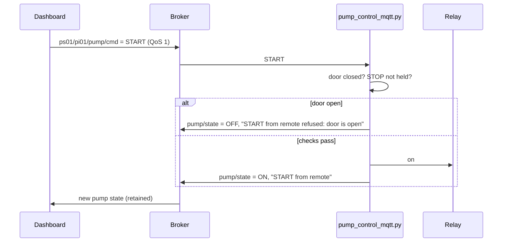

**Try it**
1. **Refused from afar.** Remove the door jumper, then from terminal 2: `mosquitto_pub -h localhost -t ps01/pi01/pump/cmd -m START -q 1`. The relay does not click, and your subscriber shows `pump/state` with `refused: door is open`.
2. **Allowed.** Put the door jumper back and send `START` again: the relay clicks. Send `STOP`.
3. **The last will.** Kill the gateway the hard way: `sudo systemctl kill -s SIGKILL gateway`. The subscriber prints `ps01/pi01/status offline` at once: the broker saw the connection drop without a goodbye and published the last will on the gateway's behalf. Three seconds later systemd restarts the gateway and `online` follows. (If the network dies silently instead, the broker only notices after 1.5 × keep-alive, about 15 seconds.)
4. **Retained state.** Stop and start your subscriber: the latest `status`, `alarm` and `pump/state` arrive at once, before any new reading.
5. **Never retain a command.** Send `mosquitto_pub -h localhost -t ps01/pi01/pump/cmd -m START -r`, then restart `pump_control_mqtt.py`: the pump starts by itself on reconnect. Clear it at once with `mosquitto_pub -h localhost -t ps01/pi01/pump/cmd -r -n`. This is exactly why commands are never retained.

**Checkpoint ✅** `mosquitto_sub -t 'ps01/#'` shows your gateway's telemetry, alarm and status, a remote START is refused with the door open and accepted with it closed, and a killed gateway shows up as `offline`.

---

## Topic 11 — Securing MQTT

**Goal:** see for yourself that an open broker leaks everything, then close it in two steps: logins with per-user permissions, then encryption with TLS.

**Open:** two terminals on your Pi.

### 11.1 — Logins and permissions

Each program gets its own username, and an **ACL** (Access Control List) says exactly which topics it may read or write.

| User | Used by | May read | May write |
|---|---|---|---|
| `gateway` | `gateway.py` | — | `status`, `telemetry`, `alarm` |
| `pump` | `pump_control_mqtt.py` | `pump/cmd` | `pump/state` |
| `dashboard` | Node-RED, and you with `mosquitto_sub` | `ps01/#` | `pump/cmd` |

1. Create the three users. Each command asks for a password twice; write them down.
   ```bash
   sudo mosquitto_passwd -c /etc/mosquitto/passwd gateway
   sudo mosquitto_passwd /etc/mosquitto/passwd pump
   sudo mosquitto_passwd /etc/mosquitto/passwd dashboard
   ```
   `-c` creates the file: use it for the first user only, or it wipes the others.
2. Install the access list and step 1 of the broker settings:
   ```bash
   sudo cp ~/course/code/day2/mosquitto/acl /etc/mosquitto/acl
   sudo cp ~/course/code/day2/mosquitto/ps01-step1-passwords.conf /etc/mosquitto/conf.d/ps01.conf
   sudo chown mosquitto:mosquitto /etc/mosquitto/passwd /etc/mosquitto/acl
   sudo chmod 600 /etc/mosquitto/passwd /etc/mosquitto/acl
   sudo systemctl restart mosquitto
   ```

```conf
# Topic 11, step 1: logins and per-user topic rules. Still plain text, and only on this Pi.
listener 1883 127.0.0.1
allow_anonymous false
password_file /etc/mosquitto/passwd
acl_file /etc/mosquitto/acl
```

```conf
# Who may do what. Anything not listed is refused.

# gateway.py publishes readings, alarm state and its own online/offline status
user gateway
topic write ps01/+/status
topic write ps01/+/telemetry
topic write ps01/+/alarm

# pump_control_mqtt.py takes commands and reports the pump state
user pump
topic read ps01/+/pump/cmd
topic write ps01/+/pump/state

# Node-RED dashboard (and you, with mosquitto_sub): sees everything, may only send pump commands
user dashboard
topic read ps01/#
topic write ps01/+/pump/cmd
```

> **Mosquitto will not start?** Run `journalctl -u mosquitto -n 20`. `Unable to open pwfile` means the file is not owned by the `mosquitto` user: the broker reads it *after* dropping its root rights.

3. Give your programs their logins. Copy the template and put in the passwords you chose:
   ```bash
   cp ~/course/code/day2/mosquitto/mqtt-step1.json ~/iiot/mqtt.json
   chmod 600 ~/iiot/mqtt.json
   nano ~/iiot/mqtt.json
   ```
4. Restart the gateway and pump control. Their logs say `MQTT connected to localhost:1883 as gateway` (and `as pump`).
5. From now on, watch with the dashboard login: `mosquitto_sub -h localhost -t 'ps01/#' -v -u dashboard -P '<dashboard password>'`

### 11.2 — Look at what the network sees

Logins stop strangers. They do not stop someone *watching*.

1. In terminal 1, capture the broker's traffic and print it as text:
   ```bash
   sudo apt install -y tcpdump
   sudo tcpdump -i lo -A -n port 1883
   ```
2. In terminal 2, subscribe briefly with the dashboard login, then press **Ctrl+C**.
3. Scroll back through terminal 1. Your username **and password** are there in plain text, and so is every reading.

You captured on `lo` (this Pi talking to itself), so only someone already on your Pi could do this. But the moment a broker listens on a real network, anyone on the path sees the same. On a military network, that is your plant's state and the credentials to command it.

### 11.3 — Encrypt with TLS

**TLS** (Transport Layer Security, the "S" in HTTPS) encrypts the connection and lets each client check it is talking to the real broker. That check needs a **certificate** for the broker, signed by a **certificate authority (CA)** the clients trust. You will be your own CA.

**Figure 11.1 — Who trusts whom**

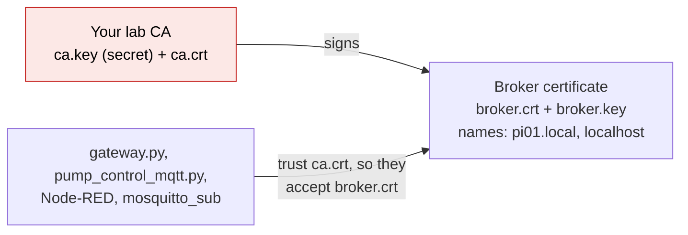

1. Create the CA and the broker certificate. Replace `pi01` with your hostname in both places.
   ```bash
   mkdir -p ~/iiot/certs && cd ~/iiot/certs
   openssl req -x509 -newkey rsa:2048 -nodes -days 365 -keyout ca.key -out ca.crt -subj "/CN=PS-01 lab CA"
   openssl req -newkey rsa:2048 -nodes -keyout broker.key -out broker.csr -subj "/CN=pi01.local"
   printf "subjectAltName=DNS:pi01.local,DNS:localhost,IP:127.0.0.1\n" > broker.ext
   openssl x509 -req -in broker.csr -CA ca.crt -CAkey ca.key -CAcreateserial -days 365 -out broker.crt -extfile broker.ext
   openssl verify -CAfile ca.crt broker.crt
   ```
   The last line must say `broker.crt: OK`.

| File | What it is | Who may see it |
|---|---|---|
| `ca.key` | The CA's private key: whoever has it can make certificates you trust | Nobody. In production it lives offline |
| `ca.crt` | The CA's public certificate | Every client |
| `broker.key` | The broker's private key | The broker only |
| `broker.crt` | The broker's certificate, signed by your CA | Anyone |
| `subjectAltName` | The names the certificate is valid for | Clients check the name they connected to is on this list |

2. Give the broker its files and switch to step 2 of the settings:
   ```bash
   sudo cp ca.crt broker.crt broker.key /etc/mosquitto/certs/
   sudo chown mosquitto:mosquitto /etc/mosquitto/certs/broker.key
   sudo chmod 600 /etc/mosquitto/certs/broker.key
   sudo cp ~/course/code/day2/mosquitto/ps01-step2-tls.conf /etc/mosquitto/conf.d/ps01.conf
   sudo systemctl restart mosquitto
   ```

```conf
# Topic 11, step 2: the same logins and rules, now encrypted with TLS on port 8883.
listener 8883
cafile /etc/mosquitto/certs/ca.crt
certfile /etc/mosquitto/certs/broker.crt
keyfile /etc/mosquitto/certs/broker.key
allow_anonymous false
password_file /etc/mosquitto/passwd
acl_file /etc/mosquitto/acl
```

3. Point your programs at port 8883 and the CA. Copy your passwords over from the old file first:
   ```bash
   cp ~/course/code/day2/mosquitto/mqtt-step2.json ~/iiot/mqtt.new.json
   nano ~/iiot/mqtt.new.json
   mv ~/iiot/mqtt.new.json ~/iiot/mqtt.json && chmod 600 ~/iiot/mqtt.json
   ```
   No program changed: only `mqtt.json`. Restart the gateway and pump control; their logs now say `localhost:8883`.
4. Subscribe over TLS:
   ```bash
   mosquitto_sub -h localhost -p 8883 --cafile ~/iiot/certs/ca.crt -t 'ps01/#' -v -u dashboard -P '<dashboard password>'
   ```
5. Tidy the firewall: the Day 1 receiver is gone, so close its port.
   ```bash
   sudo ufw delete allow in on wlan0 to any port 8080 proto tcp
   ```
   The broker serves only programs on this Pi, so it needs no firewall rule at all.

**Try it**
1. **Sniff again.** `sudo tcpdump -i lo -A -n port 8883` while you subscribe: no password, no readings, only scrambled bytes.
2. **Port 1883 is gone.** `mosquitto_pub -h localhost -p 1883 -t x -m y` → `Connection refused`.
3. **No login.** `mosquitto_sub -h localhost -p 8883 --cafile ~/iiot/certs/ca.crt -t 'ps01/#'` → `not authorised`.
4. **Wrong permissions.** As `dashboard`, try to fake a reading: `mosquitto_pub -h localhost -p 8883 --cafile ~/iiot/certs/ca.crt -u dashboard -P '<password>' -t ps01/pi01/telemetry -m fake`. It seems to work, but nothing arrives at your subscriber, and `journalctl -u mosquitto -n 5` shows `Denied PUBLISH`. A client is not told it was refused, so it learns nothing.
5. **Wrong CA.** Connect with `--cafile /etc/ssl/certs/ca-certificates.crt` (the public internet CAs) instead of yours: refused. The client trusts *your* CA only, so an impostor broker cannot fool it.

> **Later, in production:** give each device its own client certificate too (mutual TLS, `require_certificate true`), keep `ca.key` off the network, and set certificates to expire and be renewed. Today's 365-day self-made CA is right for a lab and nowhere else.

**Checkpoint ✅** Your broker accepts only TLS on port 8883, only with a login, and only for the topics in the ACL; `tcpdump` shows nothing readable.

---

## Topic 12 — Node-RED operator dashboard

**Goal:** give the operator a live view of PS-01 and START/STOP buttons, using **Node-RED**, without giving up any of the security or safety you built.

**Figure 12.1 — Where everything runs**

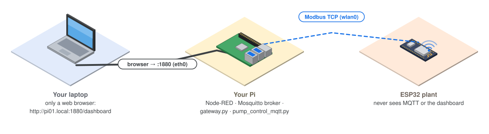

### 12.1 — Install Node-RED

**Node-RED** is a visual programming tool: you wire **nodes** (an MQTT input, a function, a gauge) into **flows** in a web editor. It is widely used on IIoT gateways because operators and engineers can read a flow at a glance.

1. Run the official installer. It installs Node.js and Node-RED, and takes about 10 minutes on a Pi 4.
   ```bash
   bash <(curl -sL https://github.com/node-red/linux-installers/releases/latest/download/install-update-nodered-deb)
   ```
2. Answer its questions:

| Question (wording may differ) | Answer |
|---|---|
| Are you really sure you want to do this? | `y` |
| Would you like to install the Pi-specific nodes? | `N` (your Python programs own the GPIO) |
| Customise the settings now? | `y` |
| Setup user security? | **Yes**: username `admin`, a strong password, full access |
| Enable Projects? | No |
| Flows file / credentials | Keep the defaults, and set a passphrase to encrypt credentials |
| Allow Function nodes to load external modules? | No |

3. Start it now and at every boot, and open its port on the cable side only:
   ```bash
   sudo systemctl enable --now nodered
   sudo ufw allow in on eth0 to any port 1880 proto tcp comment 'Node-RED, office side'
   ```
4. Add Dashboard 2.0, at the version these notes were tested with:
   ```bash
   cd ~/.node-red && npm install @flowfuse/node-red-dashboard@1.36.1
   sudo systemctl restart nodered
   ```
5. On your laptop, open `http://pi01.local:1880` and log in as `admin`.

> **Never leave the editor without a login.** Anyone who reaches an open Node-RED editor can run any code on your Pi as `pelatih`, including switching the pump. The firewall rule keeps it off the plant side; the login keeps it off the rest.

### 12.2 — Import the PS-01 flow

1. On your laptop, open the course repository on GitHub, go to `code/day2/ps01-dashboard-flow.json`, and click **Copy raw file**.
2. In Node-RED: menu **☰ → Import**, paste, then **Import**.
3. Double-click the **PS-01 broker (TLS)** node (any purple MQTT node → the pencil next to *Server*). On the **Security** tab enter the `dashboard` username and password. The TLS settings already point at `/home/pelatih/iiot/certs/ca.crt`.
4. Click **Deploy**. Under every MQTT node a green **connected** appears within a few seconds.

**Figure 12.2 — The flow, simplified**

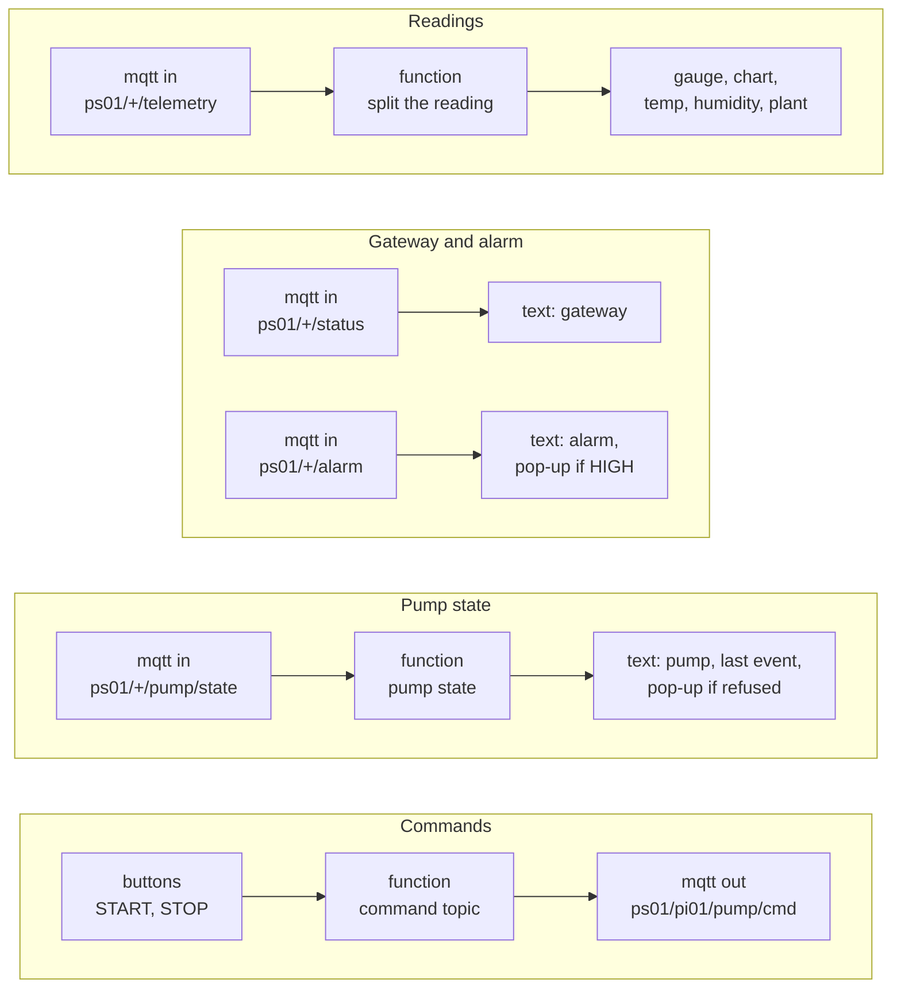

| Node | What it does |
|---|---|
| `mqtt in` with `ps01/+/…` | The `+` matches your hostname, so the same flow works on every Pi |
| *split the reading* | Turns one JSON reading into five messages, one per widget; a missing value shows as `—` |
| *command topic* | Builds `ps01/<gateway>/pump/cmd` from the gateway name it saw in the telemetry |
| `mqtt out` | QoS 1, **not retained**: a command, not a state |
| *notification* | Pops up on the operator's screen for a HIGH alarm or a refused START |

### 12.3 — Operate the plant

Open `http://pi01.local:1880/dashboard` on your laptop.

**Figure 12.3 — A remote START refused by the door interlock**

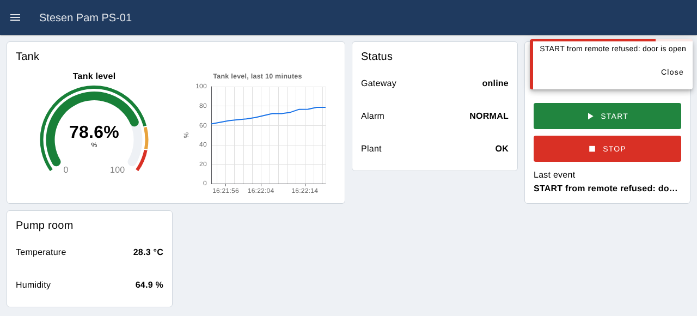

**Figure 12.4 — Door closed, pump running, level rising into WARN**

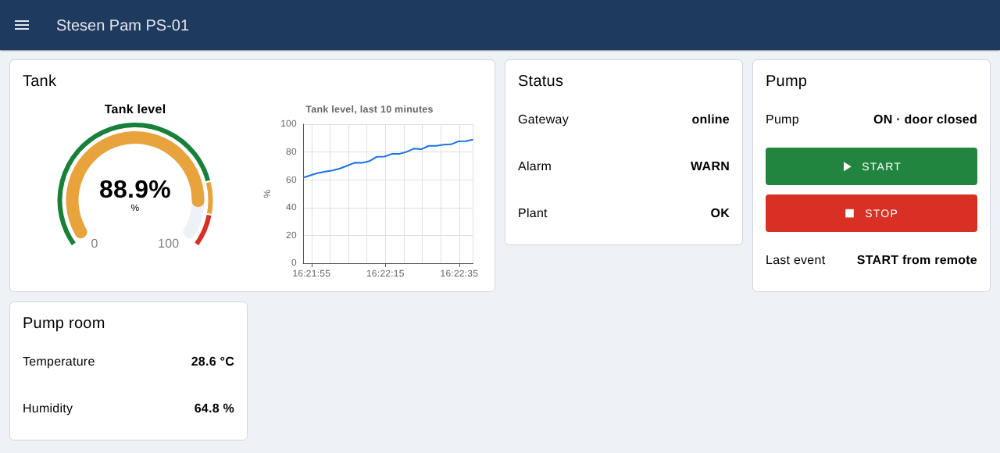

**Try it**
1. **The final test.** Remove the door jumper and press **START** on the dashboard. The pop-up says `START from remote refused: door is open` and the relay stays silent. Replace the jumper, press **START**: the relay clicks and the dashboard shows `ON · door closed`. Now pull the door jumper: the pump stops and *Last event* says `door opened`.
2. **The alarm reaches the operator.** Ask for the plant's knob to go past 90 %: the gauge turns red, *Alarm* shows `HIGH`, and a pop-up appears.
3. **Lose the gateway.** `sudo systemctl stop gateway`: *Gateway* turns `offline` and the gauge freezes. A frozen value next to `offline` is honest; a frozen value with no status would be a lie. Start it again.
4. **Lose the plant.** Ask the trainer to unplug the ESP32: *Plant* shows `COMMS_FAULT`. Plug it back in.
5. **Break it on purpose.** In Node-RED, change the broker password to a wrong one and deploy: the MQTT nodes show **disconnected** and the dashboard stops updating. Put the right one back.

> **Same rule as Day 1.** The dashboard is just one more way to *ask* for START. The decision stays in `pump_control_mqtt.py`, next to the hardware, and the plant's own e-stop overrides everything above it.

**Checkpoint ✅** From your laptop, the dashboard shows live tank level, temperature, alarm and gateway status, and a START pressed with the door open is refused and explained on screen.

---

## End of Day 2 — what you should have

- The `gateway` service reading the real plant over Modbus every 2 seconds and running the level alarm with hysteresis
- Mosquitto on your Pi accepting only TLS on port 8883, with a login per program and an ACL
- `gateway.py` publishing `telemetry`, `alarm` and `status` (with a last will) under `ps01/<your Pi>/`
- `pump_control_mqtt.py` taking START/STOP over MQTT, still governed by the door interlock
- Node-RED with a login, reachable only from the cable side, showing the PS-01 dashboard

**Security recap**
- Modbus has no security: it stays on the plant network, and only the gateway crosses over.
- `~/iiot/mqtt.json` and `/etc/mosquitto/passwd` hold credentials: `chmod 600`, never in Git.
- `ca.key` can mint certificates your whole system trusts. Guard it like a master key.
- Firewall today: SSH, mDNS and Node-RED on `eth0`; nothing at all on the plant side.

**Extra, if you finish early**
1. Run `pump_control_mqtt.py` as a systemd service, like the gateway.
2. Add a **Silence horn** button to the dashboard. Which user needs permission to write the horn, and should that go over MQTT to the gateway or straight to the plant over Modbus? Decide, and defend your choice.

**Tomorrow (Day 3):** the gateway becomes a complete edge node: it buffers data while the network is down and sends it when it returns, spots unusual readings on its own, and shows everything on one dashboard.
