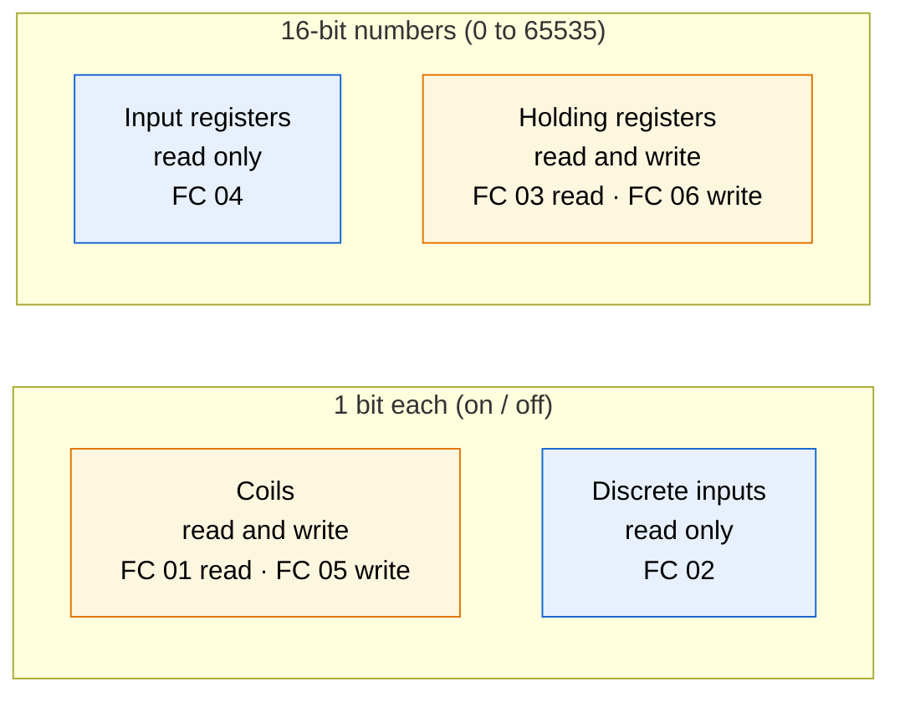
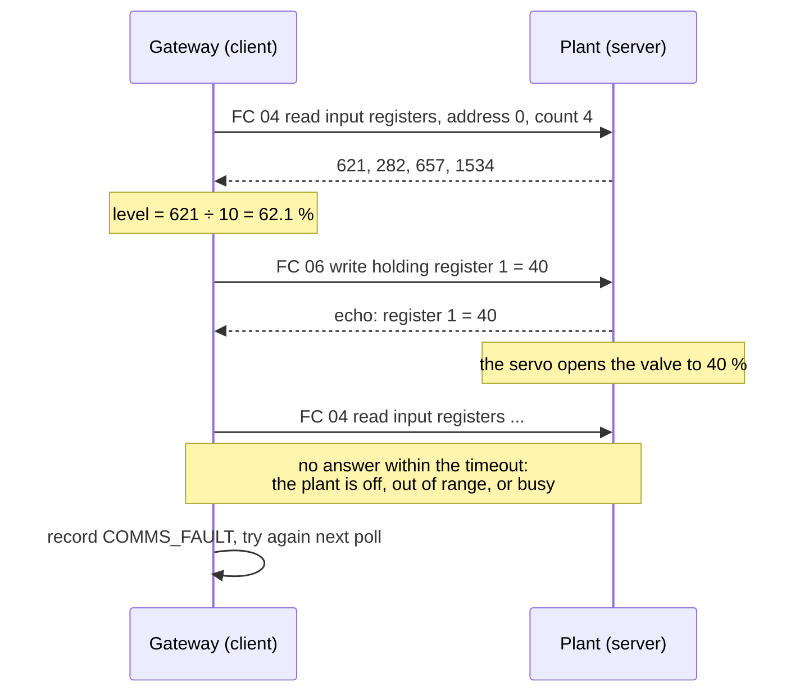
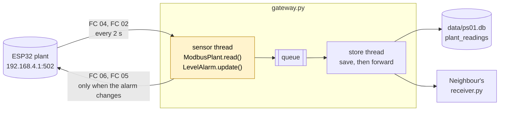

# Day 2 — Interfacing with the Physical World

> **Today the gateway meets the plant:** you learn how field devices really connect, talk to the PS-01 plant over Modbus by hand, then teach your gateway to read it and raise an alarm, before moving the data over MQTT to an operator dashboard.
> **Carry-over:** from Day 1 you need your Pi on both networks (Topic 2), the `gateway` service running, and `pump_control.py` passing its test sheet.

## Before you start

- [ ] Your Pi answers on the cable side: `ssh pelatih@pi01.local`
- [ ] Your Pi reaches the plant: `ping -c 3 192.168.4.1`
- [ ] The ESP32 plant's screen shows `PS-01  plant running`
- [ ] Get today's files onto your Pi:
  ```bash
  sudo apt install -y git
  git clone https://github.com/luqmanyusof/industrial-iot-raspberry-pi.git ~/course
  ```
- [ ] Make sure your venv has the Modbus version these notes use:
  ```bash
  source ~/iiot/.venv/bin/activate
  pip install pymodbus==3.16.2
  ```

---

## Topic 7 — How field devices connect (concept)

**Goal:** understand why the gateway talks to *field devices* instead of to sensors, and learn the Modbus model well enough to read the PS-01 register map on your own.

### 7.1 — Sensors live inside field devices

Every sensor has its own way of being wired and read:

| Interface | Wires | Typical distance | Example in this course |
|---|---|---|---|
| Analog voltage (read by an **ADC**, analog-to-digital converter) | 1 signal + ground | Centimetres; noise creeps in | The plant's tank-level knob |
| Single-wire digital | 1 data + power | A few metres | The DHT11 temperature sensor |
| **I2C** (Inter-Integrated Circuit) | 2 + power, many devices by address | On one board | The plant's OLED screen |
| **SPI** (Serial Peripheral Interface) | 4 + power, fast | On one board | SD cards, fast displays |
| 4–20 mA current loop | 2 | Hundreds of metres | Industrial pressure and level transmitters |
| **RS-485** | 2 (differential) | Up to about 1.2 km, many devices on one cable | Modbus RTU field buses |

> **4–20 mA is fail-safe too.** The signal never goes below 4 mA, so 0 mA can only mean a broken wire. Same idea as your door switch on Day 1: the failure looks different from every real value.

A gateway that had to speak all of these would be fragile and full of special cases. So industry puts the sensors inside **field devices** (PLCs, meters, drives, remote I/O), and every field device speaks a **standard protocol** upwards. Your gateway only has to speak that one protocol.

**Figure 7.1 — The field device reads its sensors; the gateway reads the field device**


### 7.2 — Modbus in ten minutes

**Modbus** (1979) is the most widely used industrial protocol in the world. It is simple, open, and supported by almost every PLC, meter and drive.

- A **client** sends a request; a **server** (the field device) answers. Older documents say *master* and *slave*.
- The server never speaks first. The client **polls**: it asks again and again, for example every 2 seconds.
- **Modbus TCP** runs over Ethernet or Wi-Fi on TCP port **502**. **Modbus RTU** carries the same requests over RS-485 serial cable.

Everything a Modbus server offers sits in four tables:

**Figure 7.2 — The four Modbus tables**



| Table | Size | Who changes it | Typical use |
|---|---|---|---|
| Coils | 1 bit | Client writes | Switch something on or off: a horn, a pump |
| Discrete inputs | 1 bit | Device only | A switch or alarm state: e-stop pressed |
| Input registers | 16 bits | Device only | A measurement: level, temperature |
| Holding registers | 16 bits | Client writes | A setting or command: a valve position |

**FC** means **function code**: the number in each request that says which table to read or write.

> **Two traps in every Modbus datasheet**
> 1. **Addresses.** Many documents number registers from 1 with a table prefix: `30001` is input register 0, `40001` is holding register 0. In code you use the plain address starting at 0.
> 2. **Scaling.** Registers hold whole numbers only. A temperature of 28.5 °C is sent as `285`, with "× 10" written in the datasheet. Forget to divide and your pump room is at 285 °C.

> **Modbus has no security at all.** No password, no encryption: anyone who can reach port 502 can read every value and write every output. This is why the plant has its own network and your gateway is the only machine on both sides. You will secure the data that leaves the gateway in Topic 11.

### 7.3 — The PS-01 register map

This is the datasheet for our plant. Keep it open all day.

| Address | Table | Name | Scaling | Meaning |
|---|---|---|---|---|
| IR0 | Input register | `tank_level` | ÷ 10 → % | Tank level, 0.0–100.0 % (the knob) |
| IR1 | Input register | `room_temp` | ÷ 10 → °C | Pump room temperature (DHT11) |
| IR2 | Input register | `room_humidity` | ÷ 10 → % | Pump room humidity (DHT11) |
| IR3 | Input register | `uptime` | seconds | Time since the plant started; jumps back to 0 after a restart |
| DI0 | Discrete input | `e_stop` | — | 1 = emergency stop active (red button on the plant) |
| DI1 | Discrete input | `sensor_fault` | — | 1 = the DHT11 did not answer |
| C0 | Coil | `alarm_horn` | — | 1 = horn sounds |
| HR0 | Holding register | `stack_light` | 0–3 | 0 off, 1 green, 2 amber, 3 red |
| HR1 | Holding register | `valve` | % | Outlet valve, 0 (shut) to 100 (fully open) |

The plant has one rule of its own: **while the e-stop is active, it shuts the valve, flashes red and sounds the horn, whatever the gateways write.** The local safety function wins over every remote command.

**Figure 7.3 — One poll, one command, and what silence looks like**



**Try it**

Using only the register map, write down the function code, table and address you would use to:
1. Read the tank level.
2. Check whether someone pressed the e-stop.
3. Open the valve halfway.
4. Silence the horn.

<details>
<summary>Answers</summary>

1. FC 04, input register 0 (then divide by 10).
2. FC 02, discrete input 0.
3. FC 06, holding register 1, value 50.
4. FC 05, coil 0, value off.

</details>

**Checkpoint ✅** You can explain why the four tables exist, and turn any line of the register map into a function code and an address.

---

## Topic 8 — Modbus by hand

**Goal:** read and write the plant's registers from Python, first on a simulator of your own, then on the real plant, and see what happens when two clients disagree.

**Open:** two VS Code terminals on your Pi, both with the venv active, in `~/iiot`.

1. Copy today's first three programs:
   ```bash
   cp ~/course/code/day2/{plant_sim,modbus_read,modbus_write}.py ~/iiot/
   ```

### 8.1 — A plant of your own: the simulator

`plant_sim.py` is a complete Modbus TCP server with the same register map as the ESP32, written in plain Python. The tank level rises and falls on its own, and now and then the temperature sensor fails. Nobody else can disturb it, so it is the safe place to experiment.

1. In terminal 1, start it and leave it running:
   ```bash
   python plant_sim.py
   ```
   It listens on port **5020**: ports below 1024, like 502, need root.

### 8.2 — Read every register

`modbus_read.py` reads all four tables once and prints them raw and scaled:

```python
#!/usr/bin/env python3
"""Read every PS-01 register once and print it, raw and scaled."""
import argparse
import sys

from pymodbus.client import ModbusTcpClient

LIGHTS = {0: "off", 1: "green", 2: "amber", 3: "red"}


def main() -> None:
    parser = argparse.ArgumentParser(description=__doc__)
    parser.add_argument("--host", default="192.168.4.1")
    parser.add_argument("--port", type=int, default=502)
    args = parser.parse_args()

    client = ModbusTcpClient(args.host, port=args.port, timeout=2)
    if not client.connect():
        sys.exit(f"Cannot connect to {args.host}:{args.port}")

    ir = client.read_input_registers(0, count=4)       # FC 04
    di = client.read_discrete_inputs(0, count=2)       # FC 02
    co = client.read_coils(0, count=1)                 # FC 01
    hr = client.read_holding_registers(0, count=2)     # FC 03
    client.close()

    for name, resp in (("input registers", ir), ("discrete inputs", di), ("coils", co), ("holding registers", hr)):
        if resp.isError():
            sys.exit(f"Reading {name} failed: {resp}")

    level, temp, hum, uptime = ir.registers
    print(f"{'Register':<6} {'Name':<14} {'Raw':>6}  Value")
    print(f"{'IR0':<6} {'tank_level':<14} {level:>6}  {level / 10:.1f} %")
    print(f"{'IR1':<6} {'room_temp':<14} {temp:>6}  {temp / 10:.1f} °C")
    print(f"{'IR2':<6} {'room_humidity':<14} {hum:>6}  {hum / 10:.1f} %")
    print(f"{'IR3':<6} {'uptime':<14} {uptime:>6}  {uptime} s")
    print(f"{'DI0':<6} {'e_stop':<14} {int(di.bits[0]):>6}  {'ACTIVE' if di.bits[0] else 'clear'}")
    print(f"{'DI1':<6} {'sensor_fault':<14} {int(di.bits[1]):>6}  {'FAULT' if di.bits[1] else 'ok'}")
    print(f"{'C0':<6} {'alarm_horn':<14} {int(co.bits[0]):>6}  {'ON' if co.bits[0] else 'off'}")
    print(f"{'HR0':<6} {'stack_light':<14} {hr.registers[0]:>6}  {LIGHTS.get(hr.registers[0], '?')}")
    print(f"{'HR1':<6} {'valve':<14} {hr.registers[1]:>6}  {hr.registers[1]} % open")


if __name__ == "__main__":
    main()
```

| Piece | What it does |
|---|---|
| `ModbusTcpClient(host, port, timeout=2)` | One TCP connection to the server; give up on an answer after 2 seconds |
| `read_input_registers(0, count=4)` | FC 04: four input registers starting at address 0 |
| `read_discrete_inputs` / `read_coils` | FC 02 / FC 01: the answer is in `.bits` |
| `read_holding_registers` | FC 03: the answer is in `.registers` |
| `resp.isError()` | The server can answer with an error instead of data, for example for an address that does not exist |

1. In terminal 2, read the simulator:
   ```bash
   python modbus_read.py --host 127.0.0.1 --port 5020
   ```
2. Run it a few times. `tank_level` and `uptime` change; everything else stays put.

### 8.3 — Read the real plant

All three Pis now poll the same ESP32 at the same time. A Modbus TCP server keeps one connection per client and answers the requests one by one.

**Figure 8.1 — Every Pi is a client of the one plant**


1. Read the plant (the defaults are `192.168.4.1` and port `502`):
   ```bash
   python modbus_read.py
   ```
2. Ask someone to turn the plant's knob, and read again. `tank_level` follows it.

### 8.4 — Write commands

`modbus_write.py` sets the stack light, the valve and the horn:

```python
#!/usr/bin/env python3
"""Command the PS-01 plant: stack light, outlet valve, alarm horn.

Examples:
  python modbus_write.py --light red
  python modbus_write.py --valve 40
  python modbus_write.py --horn on
"""
import argparse
import sys

from pymodbus.client import ModbusTcpClient

LIGHTS = {"off": 0, "green": 1, "amber": 2, "red": 3}


def main() -> None:
    parser = argparse.ArgumentParser(description=__doc__, formatter_class=argparse.RawDescriptionHelpFormatter)
    parser.add_argument("--host", default="192.168.4.1")
    parser.add_argument("--port", type=int, default=502)
    parser.add_argument("--light", choices=LIGHTS)
    parser.add_argument("--valve", type=int, metavar="0-100")
    parser.add_argument("--horn", choices=["on", "off"])
    args = parser.parse_args()

    client = ModbusTcpClient(args.host, port=args.port, timeout=2)
    if not client.connect():
        sys.exit(f"Cannot connect to {args.host}:{args.port}")

    results = []
    if args.light:
        results.append(("stack light", client.write_register(0, LIGHTS[args.light])))     # FC 06, HR0
    if args.valve is not None:
        results.append(("valve", client.write_register(1, args.valve)))                   # FC 06, HR1
    if args.horn:
        results.append(("horn", client.write_coil(0, args.horn == "on")))                 # FC 05, C0
    client.close()

    for name, resp in results:
        print(f"{name}: {'FAILED ' + str(resp) if resp.isError() else 'written'}")


if __name__ == "__main__":
    main()
```

1. Change the stack light and open the valve. Watch the plant: the light changes and the servo turns.
   ```bash
   python modbus_write.py --light amber
   python modbus_write.py --valve 40
   ```
2. Read everything back with `python modbus_read.py`.
3. Put the plant back: `python modbus_write.py --light green --valve 0`

**Try it**
1. **Local safety wins.** Open the valve to 60 %, then ask the trainer to press the plant's **E-STOP** button (D34). Read the registers: `e_stop` is `ACTIVE` and `valve` still says `60`, but the servo has shut and the horn sounds. Write `--valve 80`: the register changes, the servo does not move. Now press **RESET** (D35): the valve opens to 80 %. The plant obeys the gateways only while its own safety allows it.
2. **Who has control?** With your neighbour, take turns writing different valve positions (`--valve 20`, `--valve 80`) and watch the servo. The plant obeys whoever wrote last; it has no idea there are two of you. In a real plant, each output has exactly one controller. Discuss: how would you decide who that is, and how would you hand over control?
3. **A value out of range.** `python modbus_write.py --valve 140`, then read it back. The plant clamped it to 100. Well-behaved field devices check what they are given; never rely on it.
4. **Nobody home.** `python modbus_read.py --host 192.168.4.99`. After the 2-second timeout you get `Cannot connect`. This is what a dead or out-of-range device looks like to a gateway.
5. **Put everything back:** `python modbus_write.py --light green --valve 0 --horn off`

**Checkpoint ✅** You can read the plant's tank level and write its valve from Python, and explain why the valve stays shut during an e-stop.

---

## Topic 9 — Modbus in the gateway

**Goal:** swap the simulated sensors in your Day 1 gateway for the real plant, add a high-level alarm that drives the stack light and the horn, and make sure a lost plant becomes a recorded fault, not a crash.

**Open:** VS Code on your Pi, folder `~/iiot`.

### 9.1 — Only the plant class changes

On Day 1 you built the gateway around a `PumpStationSimulator` class with one `read()` method, and promised that a real plant would slot in later. This is that moment.

**Figure 9.1 — The Day 1 gateway with a real plant behind it**



1. Stop the Day 1 gateway and keep a copy of it:
   ```bash
   sudo systemctl stop gateway
   cp gateway.py gateway_day1.py
   ```
2. Copy the new files:
   ```bash
   cp ~/course/code/day2/{plant,gateway}.py ~/iiot/
   ```

`plant.py` holds the new plant class and the alarm:

```python
#!/usr/bin/env python3
"""The PS-01 plant over Modbus TCP: one class that reads it and one that decides the alarm."""
import logging
import socket
from dataclasses import dataclass
from datetime import datetime, timezone

from pymodbus.client import ModbusTcpClient
from pymodbus.exceptions import ModbusException

log = logging.getLogger("plant")

LIGHT_OFF, LIGHT_GREEN, LIGHT_AMBER, LIGHT_RED = 0, 1, 2, 3


@dataclass
class Reading:
    ts: str
    station: str
    gateway: str
    tank_level_pct: float | None
    room_temp_c: float | None
    room_humidity_pct: float | None
    e_stop: bool | None
    status: str                 # OK, SENSOR_FAULT or COMMS_FAULT


class ModbusPlant:
    """Reads the plant's registers and writes its outputs. Same read() as Day 1's simulator."""

    def __init__(self, host: str, port: int = 502, station: str = "PS-01"):
        self.station = station
        self.gateway = socket.gethostname()
        self.client = ModbusTcpClient(host, port=port, timeout=1, retries=1)

    def _now(self) -> str:
        return datetime.now(timezone.utc).isoformat(timespec="seconds")

    def read(self) -> Reading:
        try:
            if not self.client.connected:
                self.client.connect()
            ir = self.client.read_input_registers(0, count=4)      # level, temp, humidity, uptime
            di = self.client.read_discrete_inputs(0, count=2)      # e-stop, sensor fault
            if ir.isError() or di.isError():
                raise ModbusException(f"plant answered with an error: {ir if ir.isError() else di}")
        except (ModbusException, OSError) as err:
            log.warning("Plant not answering: %s", err)
            self.client.close()                                    # start clean next time
            return Reading(self._now(), self.station, self.gateway, None, None, None, None, "COMMS_FAULT")

        level, temp, hum, _uptime = ir.registers
        e_stop, sensor_fault = di.bits[0], di.bits[1]
        return Reading(
            ts=self._now(),
            station=self.station,
            gateway=self.gateway,
            tank_level_pct=level / 10,
            room_temp_c=None if sensor_fault else temp / 10,
            room_humidity_pct=None if sensor_fault else hum / 10,
            e_stop=e_stop,
            status="SENSOR_FAULT" if sensor_fault else "OK",
        )

    def set_outputs(self, light: int, horn: bool) -> bool:
        """Write the stack light and the horn. Returns False if the plant did not accept it."""
        try:
            r1 = self.client.write_register(0, light)               # HR0
            r2 = self.client.write_coil(0, horn)                    # C0
            return not (r1.isError() or r2.isError())
        except (ModbusException, OSError) as err:
            log.warning("Could not write outputs: %s", err)
            return False


class LevelAlarm:
    """High-level alarm with hysteresis, so the light does not flicker at the limit."""

    HIGH_ON, HIGH_OFF = 90.0, 85.0
    WARN_ON, WARN_OFF = 80.0, 75.0

    def __init__(self):
        self.state = "NORMAL"

    def update(self, level: float) -> str:
        if level >= self.HIGH_ON or (self.state == "HIGH" and level >= self.HIGH_OFF):
            self.state = "HIGH"
        elif level >= self.WARN_ON or (self.state in ("HIGH", "WARN") and level >= self.WARN_OFF):
            self.state = "WARN"
        else:
            self.state = "NORMAL"
        return self.state

    @staticmethod
    def outputs(state: str) -> tuple[int, bool]:
        """(stack light, horn) for each alarm state."""
        return {"NORMAL": (LIGHT_GREEN, False), "WARN": (LIGHT_AMBER, False), "HIGH": (LIGHT_RED, True)}[state]
```

| Piece | What it does |
|---|---|
| `Reading` | Same idea as Day 1, with the plant's fields. A value the plant could not give is `None`, never a made-up number |
| `ModbusPlant.read()` | Two requests (FC 04 and FC 02), scaled. Any Modbus or network error becomes a `COMMS_FAULT` reading |
| `self.client.close()` after an error | Drop the broken connection, so the next poll starts clean |
| `set_outputs()` | FC 06 for the light, FC 05 for the horn; returns `False` if the plant did not accept it |
| `LevelAlarm` | Decides NORMAL, WARN or HIGH from the level, with hysteresis (9.2) |

In `gateway.py`, the threads, queue, SQLite and HTTP forwarding are exactly as on Day 1. These parts changed:

```python
PLANT_HOST, PLANT_PORT = "192.168.4.1", 502      # simulator: "127.0.0.1", 5020
```

```python
def sensor_loop(plant: ModbusPlant, q: queue.Queue, stop: threading.Event) -> None:
    alarm = LevelAlarm()
    written = None                          # outputs last accepted by the plant; None = unknown
    while not stop.is_set():
        reading = plant.read()
        if reading.status == "COMMS_FAULT":
            written = None                  # rewrite the outputs once the plant is back
        else:
            state = alarm.update(reading.tank_level_pct)
            wanted = alarm.outputs(state)
            if wanted != written:
                if plant.set_outputs(*wanted):
                    log.info("Alarm %s: light %d, horn %s", state, wanted[0], "ON" if wanted[1] else "off")
                    written = wanted
        q.put(reading)
        stop.wait(INTERVAL_S)
```

| Piece | What it does |
|---|---|
| `written` | The outputs the plant last accepted. Write only when they need to change, not every 2 seconds |
| `written = None` on `COMMS_FAULT` | After an outage nobody knows what the plant is showing, so write the outputs again when it is back |
| Reading and writing in the same thread | A Modbus client must not be used by two threads at once |

> **Error about `plant_readings`?** The table is new today, created on the first run. The Day 1 `readings` table is still in the same file, untouched.

### 9.2 — An alarm that does not flicker

A level hovering around 90 % would switch the alarm on and off every few seconds if there were only one limit. Operators stop trusting a flickering alarm. **Hysteresis** uses two limits: one to raise the alarm, a lower one to clear it.

| State | Raised at | Cleared below | Stack light | Horn |
|---|---|---|---|---|
| NORMAL | — | — | green | off |
| WARN | 80 % | 75 % | amber | off |
| HIGH | 90 % | 85 % | red | **on** |

**Figure 9.2 — The level alarm**


### 9.3 — Run it

1. **Simulator first.** With `plant_sim.py` still running in terminal 1, set `PLANT_HOST, PLANT_PORT = "127.0.0.1", 5020` in `gateway.py` and run `python gateway.py`. The simulated tank rises and falls on its own: within a few minutes you see `Alarm WARN` and `Alarm HIGH` in the log, and the simulator shows the light and horn your gateway wrote. Stop both with **Ctrl+C**.
2. **The real plant.** Set `PLANT_HOST, PLANT_PORT = "192.168.4.1", 502` again, then start the service:
   ```bash
   sudo systemctl start gateway
   journalctl -u gateway -f
   ```

> **Three gateways, one stack light.** All three Pis run the same alarm on the same level, so they write the same outputs and agree. Change one gateway's limits and they start fighting, exactly like the valve in Topic 8.

**Try it**
1. **Raise the alarm.** Ask for the knob to be turned slowly up past 90 %. The light goes amber at 80, red at 90 with the horn (use the plant's mute switch if it gets too much). Turn it back to 87 %: still red. Below 85: amber. Below 75: green.
2. **Lose the plant.** Ask the trainer to unplug the ESP32 for 10 seconds. Your journal shows `Plant not answering` and readings arrive as `COMMS_FAULT`; the gateway keeps running. When the plant is back, the log shows the alarm outputs written again.
3. **A broken contract.** Look at your neighbour's `receiver.py` (start it again if needed): it prints `temp None`. The receiver still looks for `pump_temp_c`, but the gateway now sends `room_temp_c`. Nothing crashed and nothing warned you; the data just went missing. A message format is a **contract** between two programs: change it on one side only and the other side silently breaks. Fix the receiver to print `room_temp_c`.
4. **Ask the database.**
   ```bash
   sqlite3 -header -column data/ps01.db "SELECT status, COUNT(*) FROM plant_readings GROUP BY status;"
   sqlite3 -header -column data/ps01.db "SELECT ts, tank_level_pct, room_temp_c, e_stop FROM plant_readings ORDER BY ts DESC LIMIT 5;"
   ```

**Checkpoint ✅** The `gateway` service reads the real plant every 2 seconds, the stack light follows the level with hysteresis, and an unplugged plant shows up as `COMMS_FAULT` instead of stopping the gateway.

---

*Topics 10–12 (MQTT, securing MQTT, and the Node-RED operator dashboard) are being drafted.*
