# Day 2 — Interfacing with the Physical World

> **Today the gateway meets the plant:** you learn how field devices really connect, talk to the PS-01 plant over Modbus by hand, then teach your gateway to read it and raise an alarm, before moving the data over MQTT to an operator dashboard.
> **Carry-over:** from Day 1 you need your Pi on both networks (Topic 2) and the `gateway` service running.

## Before you start

- [ ] Your Pi answers on the cable side: `ssh student01@student01.local`
- [ ] Your Pi reaches the plant: `ping -c 3 192.168.4.1`
- [ ] The ESP32 plant's screen shows `PS-01  plant running`
- [ ] Get today's files onto your Pi:
  ```bash
  sudo apt install -y git
  git clone https://github.com/luqmanyusof/industrial-iot-raspberry-pi.git ~/course
  ```
- [ ] Make sure your venv has the Modbus version these notes use:
  ```bash
  source ~/iiot/.venv/bin/activate
  pip install pymodbus==3.16.2
  ```

---

## Topic 7 — How field devices connect (concept)

**Goal:** understand why the gateway talks to *field devices* instead of to sensors, and learn the Modbus model well enough to read the PS-01 register map on your own.

### 7.1 — Sensors live inside field devices

Every sensor has its own way of being wired and read:

| Interface | Wires | Typical distance | Example in this course |
|---|---|---|---|
| Analog voltage (read by an **ADC**, analog-to-digital converter) | 1 signal + ground | Centimetres; noise creeps in | The plant's tank-level knob |
| Single-wire digital | 1 data + power | A few metres | The DHT11 temperature sensor |
| **I2C** (Inter-Integrated Circuit) | 2 + power, many devices by address | On one board | The plant's OLED screen |
| **SPI** (Serial Peripheral Interface) | 4 + power, fast | On one board | SD cards, fast displays |
| 4–20 mA current loop | 2 | Hundreds of metres | Industrial pressure and level transmitters |
| **RS-485** | 2 (differential) | Up to about 1.2 km, many devices on one cable | Modbus RTU field buses |

> **4–20 mA is fail-safe too.** The signal never goes below 4 mA, so 0 mA can only mean a broken wire. Same idea as your door switch on Day 1: the failure looks different from every real value.

A gateway that had to speak all of these would be fragile and full of special cases. So industry puts the sensors inside **field devices** (PLCs, meters, drives, remote I/O), and every field device speaks a **standard protocol** upwards. Your gateway only has to speak that one protocol.

**Figure 7.1 — The field device reads its sensors; the gateway reads the field device**

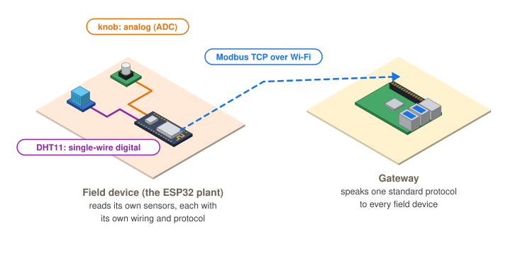

### 7.2 — Modbus in ten minutes

**Modbus** (1979) is the most widely used industrial protocol in the world. It is simple, open, and supported by almost every PLC, meter and drive.

- A **client** sends a request; a **server** (the field device) answers. Older documents say *master* and *slave*.
- The server never speaks first. The client **polls**: it asks again and again, for example every 2 seconds.
- **Modbus TCP** runs over Ethernet or Wi-Fi on TCP port **502**. **Modbus RTU** carries the same requests over RS-485 serial cable.

Everything a Modbus server offers sits in four tables:

**Figure 7.2 — The four Modbus tables**

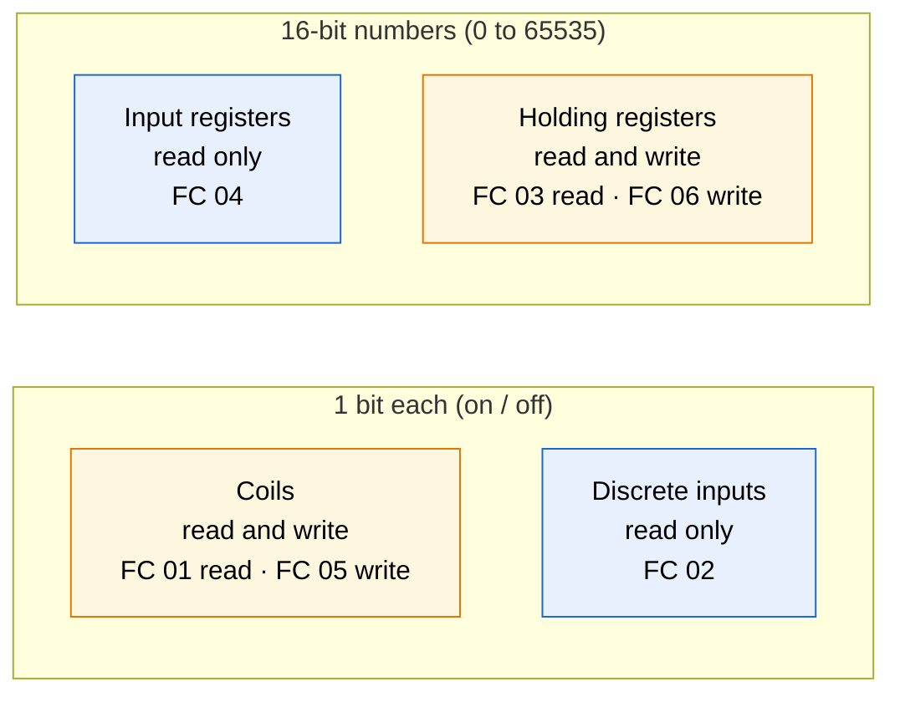

| Table | Size | Who changes it | Typical use |
|---|---|---|---|
| Coils | 1 bit | Client writes | Switch something on or off: a horn, a pump |
| Discrete inputs | 1 bit | Device only | A switch or alarm state: e-stop pressed |
| Input registers | 16 bits | Device only | A measurement: level, temperature |
| Holding registers | 16 bits | Client writes | A setting or command: a valve position |

**FC** means **function code**: the number in each request that says which table to read or write.

> **Two traps in every Modbus datasheet**
> 1. **Addresses.** Many documents number registers from 1 with a table prefix: `30001` is input register 0, `40001` is holding register 0. In code you use the plain address starting at 0.
> 2. **Scaling.** Registers hold whole numbers only. A temperature of 28.5 °C is sent as `285`, with "× 10" written in the datasheet. Forget to divide and your pump room is at 285 °C.

> **Modbus has no security at all.** No password, no encryption: anyone who can reach port 502 can read every value and write every output. This is why the plant has its own network and your gateway is the only machine on both sides.

### 7.3 — The PS-01 register map

This is the datasheet for our plant. Keep it open all day.

| Address | Table | Name | Scaling | Meaning |
|---|---|---|---|---|
| IR0 | Input register | `tank_level` | ÷ 10 → % | Tank level, 0.0–100.0 % (the knob) |
| IR1 | Input register | `room_temp` | ÷ 10 → °C | Pump room temperature (DHT11) |
| IR2 | Input register | `room_humidity` | ÷ 10 → % | Pump room humidity (DHT11) |
| IR3 | Input register | `uptime` | seconds | Time since the plant started; jumps back to 0 after a restart |
| DI0 | Discrete input | `e_stop` | — | 1 = emergency stop active (the plant's E-STOP button, D34) |
| DI1 | Discrete input | `sensor_fault` | — | 1 = the DHT11 did not answer |
| C0 | Coil | `alarm_horn` | — | 1 = horn sounds |
| C1 | Coil | `pump1` | — | 1 = pump 1 running: the plant's LED 0 turns **blue** (red = stopped) |
| C2 | Coil | `pump2` | — | 1 = pump 2 running: the plant's LED 1 turns **blue** (red = stopped) |
| HR0 | Holding register | `alarm` | 0–2 | Alarm state written by the gateway: 0 NORMAL, 1 WARN, 2 HIGH. The plant shows it on its OLED screen |
| HR1 | Holding register | `valve` | % | Outlet valve, 0 (shut) to 100 (fully open) |

The plant has one rule of its own: **while the e-stop is active, it shuts the valve and sounds the horn, whatever the gateways write.** The local safety function wins over every remote command.

**Figure 7.3 — One poll, one command, and what silence looks like**

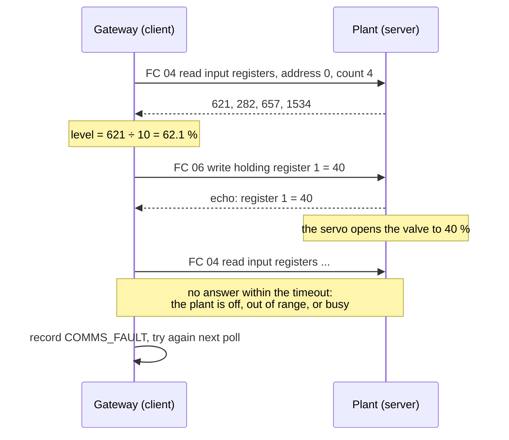

**Try it**

Using only the register map, write down the function code, table and address you would use to:
1. Read the tank level.
2. Check whether someone pressed the e-stop.
3. Open the valve halfway.
4. Silence the horn.
5. Start pump 2.

<details>
<summary>Answers</summary>

1. FC 04, input register 0 (then divide by 10).
2. FC 02, discrete input 0.
3. FC 06, holding register 1, value 50.
4. FC 05, coil 0, value off.
5. FC 05, coil 2, value on.

</details>

**Checkpoint ✅** You can explain why the four tables exist, and turn any line of the register map into a function code and an address.

---

## Topic 8 — Modbus by hand

**Goal:** read and write the plant's registers from Python, first on a simulator of your own, then on the real plant, and see what happens when two clients disagree.

**Open:** two VS Code terminals on your Pi, both with the venv active, in `~/iiot`.

1. Copy today's first three programs:
   ```bash
   cp ~/course/code/day2/{plant_sim,modbus_read,modbus_write}.py ~/iiot/
   ```

### 8.1 — A plant of your own: the simulator

`plant_sim.py` is a complete Modbus TCP server with the same register map as the ESP32, written in plain Python. The tank level rises and falls on its own, and now and then the temperature sensor fails. Nobody else can disturb it, so it is the safe place to experiment.

1. In terminal 1, start it and leave it running:
   ```bash
   python plant_sim.py
   ```
   It listens on port **5020**: ports below 1024, like 502, need root.

### 8.2 — Read every register

`modbus_read.py` reads all four tables once and prints them raw and scaled:

```python
#!/usr/bin/env python3
"""Read every PS-01 register once and print it, raw and scaled."""
import argparse
import sys

from pymodbus.client import ModbusTcpClient

ALARMS = {0: "NORMAL", 1: "WARN", 2: "HIGH"}


def main() -> None:
    parser = argparse.ArgumentParser(description=__doc__)
    parser.add_argument("--host", default="192.168.4.1")
    parser.add_argument("--port", type=int, default=502)
    args = parser.parse_args()

    client = ModbusTcpClient(args.host, port=args.port, timeout=2)
    if not client.connect():
        sys.exit(f"Cannot connect to {args.host}:{args.port}")

    ir = client.read_input_registers(0, count=4)       # FC 04
    di = client.read_discrete_inputs(0, count=2)       # FC 02
    co = client.read_coils(0, count=3)                 # FC 01
    hr = client.read_holding_registers(0, count=2)     # FC 03
    client.close()

    for name, resp in (("input registers", ir), ("discrete inputs", di), ("coils", co), ("holding registers", hr)):
        if resp.isError():
            sys.exit(f"Reading {name} failed: {resp}")

    level, temp, hum, uptime = ir.registers
    print(f"{'Register':<6} {'Name':<14} {'Raw':>6}  Value")
    print(f"{'IR0':<6} {'tank_level':<14} {level:>6}  {level / 10:.1f} %")
    print(f"{'IR1':<6} {'room_temp':<14} {temp:>6}  {temp / 10:.1f} °C")
    print(f"{'IR2':<6} {'room_humidity':<14} {hum:>6}  {hum / 10:.1f} %")
    print(f"{'IR3':<6} {'uptime':<14} {uptime:>6}  {uptime} s")
    print(f"{'DI0':<6} {'e_stop':<14} {int(di.bits[0]):>6}  {'ACTIVE' if di.bits[0] else 'clear'}")
    print(f"{'DI1':<6} {'sensor_fault':<14} {int(di.bits[1]):>6}  {'FAULT' if di.bits[1] else 'ok'}")
    print(f"{'C0':<6} {'alarm_horn':<14} {int(co.bits[0]):>6}  {'ON' if co.bits[0] else 'off'}")
    print(f"{'C1':<6} {'pump1':<14} {int(co.bits[1]):>6}  {'RUNNING (blue)' if co.bits[1] else 'stopped (red)'}")
    print(f"{'C2':<6} {'pump2':<14} {int(co.bits[2]):>6}  {'RUNNING (blue)' if co.bits[2] else 'stopped (red)'}")
    print(f"{'HR0':<6} {'alarm':<14} {hr.registers[0]:>6}  {ALARMS.get(hr.registers[0], '?')}")
    print(f"{'HR1':<6} {'valve':<14} {hr.registers[1]:>6}  {hr.registers[1]} % open")


if __name__ == "__main__":
    main()
```

| Piece | What it does |
|---|---|
| `ModbusTcpClient(host, port, timeout=2)` | One TCP connection to the server; give up on an answer after 2 seconds |
| `read_input_registers(0, count=4)` | FC 04: four input registers starting at address 0 |
| `read_discrete_inputs` / `read_coils` | FC 02 / FC 01: the answer is in `.bits` |
| `read_holding_registers` | FC 03: the answer is in `.registers` |
| `resp.isError()` | The server can answer with an error instead of data, for example for an address that does not exist |

1. In terminal 2, read the simulator:
   ```bash
   python modbus_read.py --host 127.0.0.1 --port 5020
   ```
2. Run it a few times. `tank_level` and `uptime` change; everything else stays put.

### 8.3 — Read the real plant

All three Pis now poll the same ESP32 at the same time. A Modbus TCP server keeps one connection per client and answers the requests one by one.

**Figure 8.1 — Every Pi is a client of the one plant**

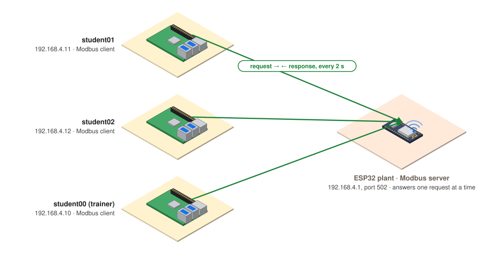

1. Read the plant (the defaults are `192.168.4.1` and port `502`):
   ```bash
   python modbus_read.py
   ```
2. Ask someone to turn the plant's knob, and read again. `tank_level` follows it.

### 8.4 — Write commands

`modbus_write.py` switches the two pumps, sets the valve and sounds the horn:

```python
#!/usr/bin/env python3
"""Command the PS-01 plant: pump 1, pump 2, outlet valve, alarm horn.

Examples:
  python modbus_write.py --pump1 on
  python modbus_write.py --pump2 off
  python modbus_write.py --valve 40
  python modbus_write.py --horn on
"""
import argparse
import sys

from pymodbus.client import ModbusTcpClient


def main() -> None:
    parser = argparse.ArgumentParser(description=__doc__, formatter_class=argparse.RawDescriptionHelpFormatter)
    parser.add_argument("--host", default="192.168.4.1")
    parser.add_argument("--port", type=int, default=502)
    parser.add_argument("--pump1", choices=["on", "off"])
    parser.add_argument("--pump2", choices=["on", "off"])
    parser.add_argument("--valve", type=int, metavar="0-100")
    parser.add_argument("--horn", choices=["on", "off"])
    args = parser.parse_args()

    client = ModbusTcpClient(args.host, port=args.port, timeout=2)
    if not client.connect():
        sys.exit(f"Cannot connect to {args.host}:{args.port}")

    results = []
    if args.pump1:
        results.append(("pump 1", client.write_coil(1, args.pump1 == "on")))             # FC 05, C1
    if args.pump2:
        results.append(("pump 2", client.write_coil(2, args.pump2 == "on")))             # FC 05, C2
    if args.valve is not None:
        results.append(("valve", client.write_register(1, args.valve)))                  # FC 06, HR1
    if args.horn:
        results.append(("horn", client.write_coil(0, args.horn == "on")))                # FC 05, C0
    client.close()

    for name, resp in results:
        print(f"{name}: {'FAILED ' + str(resp) if resp.isError() else 'written'}")


if __name__ == "__main__":
    main()
```

1. Start pump 1 and open the valve. Watch the plant: LED 0 turns from red to blue, and the servo turns.
   ```bash
   python modbus_write.py --pump1 on
   python modbus_write.py --valve 40
   ```
2. Start pump 2 as well (`--pump2 on`), then read everything back with `python modbus_read.py`.
3. Put the plant back: `python modbus_write.py --pump1 off --pump2 off --valve 0`

**Try it**
1. **Local safety wins.** Open the valve to 60 %, then ask the trainer to press the plant's **E-STOP** button (D34). Read the registers: `e_stop` is `ACTIVE` and `valve` still says `60`, but the servo has shut and the horn sounds. Write `--valve 80`: the register changes, the servo does not move. Now press **RESET** (D35): the valve opens to 80 %. The plant obeys the gateways only while its own safety allows it.
2. **Who has control?** With your neighbour, take turns writing different valve positions (`--valve 20`, `--valve 80`) and watch the servo. The plant obeys whoever wrote last; it has no idea there are two of you. In a real plant, each output has exactly one controller. Discuss: how would you decide who that is, and how would you hand over control?
3. **A value out of range.** `python modbus_write.py --valve 140`, then read it back. The plant clamped it to 100. Well-behaved field devices check what they are given; never rely on it.
4. **Nobody home.** `python modbus_read.py --host 192.168.4.99`. After the 2-second timeout you get `Cannot connect`. This is what a dead or out-of-range device looks like to a gateway.
5. **Put everything back:** `python modbus_write.py --pump1 off --pump2 off --valve 0 --horn off`

**Checkpoint ✅** You can read the plant's tank level and write its valve from Python, and explain why the valve stays shut during an e-stop.

---

## Topic 9 — Modbus in the gateway

**Goal:** swap the simulated sensors in your Day 1 gateway for the real plant, add a high-level alarm that the plant shows on its screen and sounds on its horn, and make sure a lost plant becomes a recorded fault, not a crash.

**Open:** VS Code on your Pi, folder `~/iiot`.

### 9.1 — Only the plant class changes

On Day 1 you built the gateway around a `PumpStationSimulator` class with one `read()` method, and promised that a real plant would slot in later. This is that moment.

**Figure 9.1 — The Day 1 gateway with a real plant behind it**

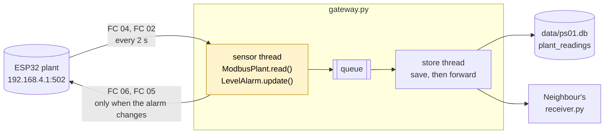

1. Stop the Day 1 gateway and keep a copy of it:
   ```bash
   sudo systemctl stop gateway
   cp gateway.py gateway_day1.py
   ```
2. Copy the new files:
   ```bash
   cp ~/course/code/day2/{plant,gateway}.py ~/iiot/
   ```

`plant.py` holds the new plant class and the alarm:

```python
#!/usr/bin/env python3
"""The PS-01 plant over Modbus TCP: one class that reads and commands it, one that decides the alarm."""
import logging
import socket
import threading
from dataclasses import dataclass
from datetime import datetime, timezone

from pymodbus.client import ModbusTcpClient
from pymodbus.exceptions import ModbusException

log = logging.getLogger("plant")

ALARM_CODES = {"NORMAL": 0, "WARN": 1, "HIGH": 2}   # HR0: shown on the plant's OLED


@dataclass
class Reading:
    ts: str
    station: str
    gateway: str
    tank_level_pct: float | None
    room_temp_c: float | None
    room_humidity_pct: float | None
    e_stop: bool | None
    pump1_on: bool | None
    pump2_on: bool | None
    status: str                 # OK, SENSOR_FAULT or COMMS_FAULT


class ModbusPlant:
    """Reads the plant's registers and writes its outputs. Same read() as Day 1's simulator.

    One Modbus connection, used by two threads (polling, and pump commands from MQTT): a lock
    makes sure only one of them talks to the plant at a time.
    """

    def __init__(self, host: str, port: int = 502, station: str = "PS-01"):
        self.station = station
        self.gateway = socket.gethostname()
        self.client = ModbusTcpClient(host, port=port, timeout=1, retries=1)
        self.lock = threading.Lock()

    def _now(self) -> str:
        return datetime.now(timezone.utc).isoformat(timespec="seconds")

    def read(self) -> Reading:
        try:
            with self.lock:
                if not self.client.connected:
                    self.client.connect()
                ir = self.client.read_input_registers(0, count=4)  # level, temp, humidity, uptime
                di = self.client.read_discrete_inputs(0, count=2)  # e-stop, sensor fault
                co = self.client.read_coils(0, count=3)            # horn, pump 1, pump 2
            for resp in (ir, di, co):
                if resp.isError():
                    raise ModbusException(f"plant answered with an error: {resp}")
        except (ModbusException, OSError) as err:
            log.warning("Plant not answering: %s", err)
            self.client.close()                                    # start clean next time
            return Reading(self._now(), self.station, self.gateway, None, None, None, None, None, None,
                           "COMMS_FAULT")

        level, temp, hum, _uptime = ir.registers
        e_stop, sensor_fault = di.bits[0], di.bits[1]
        return Reading(
            ts=self._now(),
            station=self.station,
            gateway=self.gateway,
            tank_level_pct=level / 10,
            room_temp_c=None if sensor_fault else temp / 10,
            room_humidity_pct=None if sensor_fault else hum / 10,
            e_stop=e_stop,
            pump1_on=co.bits[1],
            pump2_on=co.bits[2],
            status="SENSOR_FAULT" if sensor_fault else "OK",
        )

    def set_outputs(self, alarm_code: int, horn: bool) -> bool:
        """Write the alarm state and the horn. Returns False if the plant did not accept it."""
        try:
            with self.lock:
                r1 = self.client.write_register(0, alarm_code)     # HR0
                r2 = self.client.write_coil(0, horn)               # C0
            return not (r1.isError() or r2.isError())
        except (ModbusException, OSError) as err:
            log.warning("Could not write outputs: %s", err)
            return False

    def set_pump(self, pump: int, on: bool) -> bool:
        """Start (on=True) or stop pump 1 or 2. Returns False if the plant did not accept it."""
        try:
            with self.lock:
                if not self.client.connected:
                    self.client.connect()
                resp = self.client.write_coil(pump, on)            # C1 = pump 1, C2 = pump 2
            return not resp.isError()
        except (ModbusException, OSError) as err:
            log.warning("Could not switch pump %d: %s", pump, err)
            return False


class LevelAlarm:
    """High-level alarm with hysteresis, so the light does not flicker at the limit."""

    HIGH_ON, HIGH_OFF = 90.0, 85.0
    WARN_ON, WARN_OFF = 80.0, 75.0

    def __init__(self):
        self.state = "NORMAL"

    def update(self, level: float) -> str:
        if level >= self.HIGH_ON or (self.state == "HIGH" and level >= self.HIGH_OFF):
            self.state = "HIGH"
        elif level >= self.WARN_ON or (self.state in ("HIGH", "WARN") and level >= self.WARN_OFF):
            self.state = "WARN"
        else:
            self.state = "NORMAL"
        return self.state

    @staticmethod
    def outputs(state: str) -> tuple[int, bool]:
        """(alarm code for HR0, horn) for each alarm state. Only HIGH sounds the horn."""
        return ALARM_CODES[state], state == "HIGH"
```

| Piece | What it does |
|---|---|
| `Reading` | Same idea as Day 1, with the plant's fields. A value the plant could not give is `None`, never a made-up number |
| `ModbusPlant.read()` | Three requests (FC 04 measurements, FC 02 e-stop and fault, FC 01 pump states), scaled. Any Modbus or network error becomes a `COMMS_FAULT` reading |
| `self.client.close()` after an error | Drop the broken connection, so the next poll starts clean |
| `set_outputs()` | FC 06 for the alarm state, FC 05 for the horn; returns `False` if the plant did not accept it |
| `set_pump()` | FC 05 to coil 1 or 2. You use it from MQTT in Topic 10 |
| `self.lock` | From Topic 10 two threads share this one connection; the lock lets only one talk to the plant at a time |
| `LevelAlarm` | Decides NORMAL, WARN or HIGH from the level, with hysteresis (9.2) |

In `gateway.py`, the threads, queue, SQLite and HTTP forwarding are exactly as on Day 1. These parts changed:

```python
PLANT_HOST, PLANT_PORT = "192.168.4.1", 502      # simulator: "127.0.0.1", 5020
```

```python
def sensor_loop(plant: ModbusPlant, q: queue.Queue, stop: threading.Event) -> None:
    alarm = LevelAlarm()
    written = None                          # outputs last accepted by the plant; None = unknown
    while not stop.is_set():
        reading = plant.read()
        if reading.status == "COMMS_FAULT":
            written = None                  # rewrite the outputs once the plant is back
        else:
            state = alarm.update(reading.tank_level_pct)
            wanted = alarm.outputs(state)
            if wanted != written:
                if plant.set_outputs(*wanted):
                    log.info("Alarm %s: horn %s", state, "ON" if wanted[1] else "off")
                    written = wanted
        q.put(reading)
        stop.wait(INTERVAL_S)
```

| Piece | What it does |
|---|---|
| `written` | The outputs the plant last accepted. Write only when they need to change, not every 2 seconds |
| `written = None` on `COMMS_FAULT` | After an outage nobody knows what the plant is showing, so write the outputs again when it is back |
| Reading and writing in the same thread | A Modbus client must not be used by two threads at once |

> **Error about `plant_readings`?** The table is new today, created on the first run. The Day 1 `readings` table is still in the same file, untouched.

### 9.2 — An alarm that does not flicker

A level hovering around 90 % would switch the alarm on and off every few seconds if there were only one limit. Operators stop trusting a flickering alarm. **Hysteresis** uses two limits: one to raise the alarm, a lower one to clear it.

| State | Raised at | Cleared below | Plant's OLED | Horn |
|---|---|---|---|---|
| NORMAL | — | — | `NORMAL` | off |
| WARN | 80 % | 75 % | `WARN` | off |
| HIGH | 90 % | 85 % | `HIGH` | **on** |

**Figure 9.2 — The level alarm**


### 9.3 — Run it

1. **Simulator first.** With `plant_sim.py` still running in terminal 1, set `PLANT_HOST, PLANT_PORT = "127.0.0.1", 5020` in `gateway.py` and run `python gateway.py`. The simulated tank rises and falls on its own: within a few minutes you see `Alarm WARN` and `Alarm HIGH` in the log, and the simulator shows the alarm and horn your gateway wrote. Stop both with **Ctrl+C**.
2. **The real plant.** Set `PLANT_HOST, PLANT_PORT = "192.168.4.1", 502` again, then start the service:
   ```bash
   sudo systemctl start gateway
   journalctl -u gateway -f
   ```

> **Three gateways, one alarm.** All three Pis run the same alarm on the same level, so they write the same outputs and agree. Change one gateway's limits and they start fighting, exactly like the valve in Topic 8.

**Try it**
1. **Raise the alarm.** Ask for the knob to be turned slowly up past 90 %. The plant's OLED shows `WARN` at 80, `HIGH` at 90 with the horn (use the plant's mute switch if it gets too much). Turn it back to 87 %: still `HIGH`. Below 85: `WARN`. Below 75: `NORMAL`.
2. **Lose the plant.** Ask the trainer to unplug the ESP32 for 10 seconds. Your journal shows `Plant not answering` and readings arrive as `COMMS_FAULT`; the gateway keeps running. When the plant is back, the log shows the alarm outputs written again.
3. **A broken contract.** Look at your neighbour's `receiver.py` (start it again if needed): it prints `temp None`. The receiver still looks for `pump_temp_c`, but the gateway now sends `room_temp_c`. Nothing crashed and nothing warned you; the data just went missing. A message format is a **contract** between two programs: change it on one side only and the other side silently breaks. Fix the receiver to print `room_temp_c`.
4. **Ask the database.**
   ```bash
   sqlite3 -header -column data/ps01.db "SELECT status, COUNT(*) FROM plant_readings GROUP BY status;"
   sqlite3 -header -column data/ps01.db "SELECT ts, tank_level_pct, room_temp_c, pump1_on, pump2_on FROM plant_readings ORDER BY ts DESC LIMIT 5;"
   ```

**Checkpoint ✅** The `gateway` service reads the real plant every 2 seconds, the alarm on the plant's OLED follows the level with hysteresis, and an unplugged plant shows up as `COMMS_FAULT` instead of stopping the gateway.

---

## Topic 10 — MQTT

**Goal:** replace the gateway's HTTP forwarding with **MQTT**, the publish-subscribe protocol most IIoT systems use to move data, and let the gateway take pump commands from it.

**Open:** VS Code on your Pi, folder `~/iiot`, two terminals with the venv active.

### 10.1 — Publish and subscribe

With HTTP on Day 1, your gateway had to know exactly who to send each reading to. **MQTT** (Message Queuing Telemetry Transport) puts a **broker** in the middle:

- A **publisher** sends a message to a **topic**, a name like `ps01/student01/telemetry`. It does not know or care who is listening.
- A **subscriber** tells the broker which topics it wants, and gets every message on them.
- Adding a dashboard, a historian or an alarm system means adding a subscriber. The gateway does not change.

**Figure 10.1 — Everything talks through the broker on your Pi**

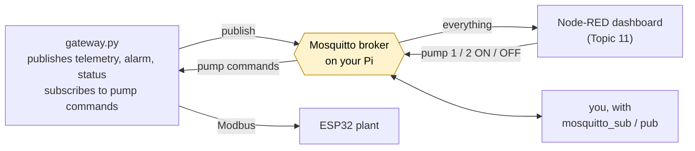

| Idea | What it means | Where you use it today |
|---|---|---|
| **Topic** | A path-like name; `+` matches one level, `#` matches everything below | `ps01/+/telemetry`, `ps01/#` |
| **QoS** (Quality of Service) | 0 = at most once (fire and forget), 1 = at least once (the broker confirms) | Telemetry QoS 0 (the next reading is 2 s away); commands, alarm and status QoS 1 |
| **Retained message** | The broker keeps the last message on a topic and hands it to every new subscriber at once | Alarm state and gateway status |
| **Last will** | A message the broker publishes *for* a client that vanishes without saying goodbye | `ps01/student01/status` → `offline` |

> **MQTT or DDS?** Many defence and naval combat systems use **DDS** (Data Distribution Service) instead. DDS has no broker: publishers and subscribers find each other directly, with detailed quality-of-service and real-time options. It suits tightly coupled systems on fast local networks. MQTT's single broker is simpler to secure and manage, and suits many small devices over unreliable links, which is why it dominates IIoT.

### 10.2 — The PS-01 topic tree

Design topics before writing code; changing them later breaks every subscriber (remember the receiver in Topic 9).

| Topic | Payload | Published by | QoS | Retained |
|---|---|---|---|---|
| `ps01/<gateway>/status` | `online` / `offline` | `gateway.py` (`offline` also as last will) | 1 | yes |
| `ps01/<gateway>/telemetry` | JSON reading, including `pump1_on` and `pump2_on` | `gateway.py` | 0 | no |
| `ps01/<gateway>/alarm` | `NORMAL` / `WARN` / `HIGH` | `gateway.py` | 1 | yes |
| `ps01/<gateway>/pump/1/cmd` | `ON` / `OFF` | dashboard, or you | 1 | **never** |
| `ps01/<gateway>/pump/2/cmd` | `ON` / `OFF` | dashboard, or you | 1 | **never** |

`<gateway>` is your Pi's hostname, for example `student01`.

> **Never retain a command.** A retained `ON` would be replayed to the gateway every time it reconnects, perhaps hours later, and start a pump nobody asked for. Retain *state*, never *commands*.

### 10.3 — Install the broker and try it by hand

1. Install Mosquitto and its command-line tools:
   ```bash
   sudo apt install -y mosquitto mosquitto-clients
   sudo systemctl enable --now mosquitto
   ```
   Out of the box, Mosquitto 2 accepts connections **only from this Pi**, without a login. That is all this course needs: the broker, the gateway and Node-RED all run on your Pi.
2. In terminal 1, subscribe to everything under `ps01`:
   ```bash
   mosquitto_sub -h localhost -t 'ps01/#' -v
   ```
3. In terminal 2, publish:
   ```bash
   mosquitto_pub -h localhost -t ps01/test/hello -m "Selamat pagi"
   mosquitto_pub -h localhost -t ps01/test/state -m "I am retained" -r
   ```
4. Stop the subscriber (**Ctrl+C**) and start it again. `hello` is gone; the retained `state` arrives straight away.
5. Clear the retained message by publishing an empty one: `mosquitto_pub -h localhost -t ps01/test/state -r -n`

> **Later, in production:** a broker that other machines can reach needs a login for every program, an access list saying who may publish and subscribe to which topics, and TLS (Transport Layer Security) encryption. Keeping the broker on `localhost` is what makes it acceptable to leave them out here.

### 10.4 — The gateway publishes, and takes pump commands

1. Install the MQTT library if it is not in your venv yet, and copy the new gateway over your Topic 9 one:
   ```bash
   pip install paho-mqtt==2.2.0
   cp ~/course/code/day2/gateway_mqtt.py ~/iiot/gateway.py
   ```

Everything from Topic 9 stays. These parts are new:

```python
BROKER = "localhost"                             # Mosquitto, on this Pi
BASE = f"ps01/{socket.gethostname()}"            # every topic this Pi uses starts here, e.g. ps01/student01
```

```python
def connect_mqtt(plant: ModbusPlant) -> mqtt.Client:
    """Connect to the broker. paho runs the network in its own thread, and reconnects by itself."""
    client = mqtt.Client(mqtt.CallbackAPIVersion.VERSION2, client_id=f"{socket.gethostname()}-gateway")
    client.will_set(f"{BASE}/status", "offline", qos=1, retain=True)    # the broker says this if we vanish

    def on_connect(c, userdata, flags, reason_code, properties):
        log.info("MQTT connected to %s: %s", BROKER, reason_code)
        c.publish(f"{BASE}/status", "online", qos=1, retain=True)
        c.subscribe(f"{BASE}/pump/+/cmd", qos=1)                      # + = any pump number

    def on_message(c, userdata, msg):
        pump_command(plant, msg)

    client.on_connect = on_connect
    client.on_message = on_message
    client.connect_async(BROKER, 1883, keepalive=10)
    client.loop_start()
    return client
```

```python
def pump_command(plant: ModbusPlant, msg: mqtt.MQTTMessage) -> None:
    """ps01/<gateway>/pump/<1 or 2>/cmd, payload ON or OFF: switch that pump on the plant."""
    pump = msg.topic.split("/")[3]
    command = msg.payload.decode(errors="replace").strip().upper()
    if pump not in ("1", "2") or command not in ("ON", "OFF"):
        log.warning("Ignored %r on %s", command, msg.topic)
        return
    ok = plant.set_pump(int(pump), command == "ON")
    log.info("Pump %s %s from remote: %s", pump, command, "done" if ok else "FAILED, plant not answering")
```

And in the store thread, the HTTP POST became an MQTT publish:

```python
        if client.is_connected():
            client.publish(f"{BASE}/telemetry", json.dumps(asdict(reading)), qos=0)
            log.info("Stored and published %s %s (queue: %d)", reading.ts, reading.status, q.qsize())
        else:
            log.warning("Stored locally, broker not connected (queue: %d)", q.qsize())
```

| Piece | What it does |
|---|---|
| `BASE = f"ps01/{socket.gethostname()}"` | Every topic starts with your hostname, so three Pis never collide |
| `CallbackAPIVersion.VERSION2` | paho-mqtt 2.x needs you to say which callback style you use |
| `will_set(...)` | Registers the last will with the broker when connecting |
| `connect_async` + `loop_start` | Connects in the background, in paho's own thread, and reconnects by itself |
| `on_connect` | Runs after every (re)connect: the place to publish `online` and to subscribe |
| `on_message` → `pump_command()` | Runs in paho's thread for every pump command. Bad topics or payloads are logged and ignored |
| `plant.set_pump()` | The MQTT thread and the sensor thread now share one Modbus connection; the lock in `ModbusPlant` lets one talk at a time |

**Figure 10.2 — A pump command, from the dashboard to the plant and back**

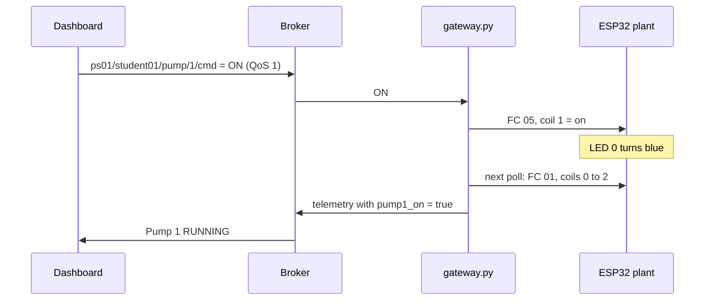

2. Restart the service, and watch the topics in terminal 1:
   ```bash
   sudo systemctl restart gateway
   mosquitto_sub -h localhost -t 'ps01/#' -v
   ```
   You see `status online`, the current `alarm`, and a `telemetry` message every 2 seconds.
3. Tidy the firewall: the gateway no longer posts to your neighbour's receiver, so close Day 1's port.
   ```bash
   sudo ufw delete allow in on wlan0 to any port 8080 proto tcp
   ```
4. In terminal 2, start pump 1:
   ```bash
   mosquitto_pub -h localhost -t ps01/student01/pump/1/cmd -m ON -q 1
   ```
   The plant's LED 0 turns blue, the gateway's journal says `Pump 1 ON from remote: done`, and the next telemetry shows `"pump1_on": true`. Send `OFF` to stop it.

**Try it**
1. **Pump 2.** Start and stop pump 2 the same way. Then send `-m START`: the gateway logs `Ignored 'START'` and nothing moves. A command the receiver does not understand must change nothing.
2. **The last will.** Kill the gateway the hard way: `sudo systemctl kill -s SIGKILL gateway`. The subscriber prints `ps01/student01/status offline` at once: the broker saw the connection drop without a goodbye and published the last will on the gateway's behalf. Three seconds later systemd restarts the gateway and `online` follows.
3. **Retained state.** Stop and start your subscriber: the latest `status` and `alarm` arrive at once, before any new reading.
4. **Never retain a command.** Send `mosquitto_pub -h localhost -t ps01/student01/pump/1/cmd -m ON -r`, then stop pump 1 with a normal `-m OFF`. Now `sudo systemctl restart gateway`: pump 1 starts by itself, because the broker replays the retained `ON` when the gateway subscribes. Clear it at once with `mosquitto_pub -h localhost -t ps01/student01/pump/1/cmd -r -n`, and stop the pump.
5. **Who has control?** Your neighbour starts pump 1 from their Pi while you stop it from yours. Both gateways write the same coil on the same plant; the last one wins. Discuss: which gateway should own the pumps?

**Checkpoint ✅** `mosquitto_sub -t 'ps01/#'` shows your gateway's telemetry, alarm and status, a `pump/1/cmd ON` turns the plant's LED 0 blue, and a killed gateway shows up as `offline`.

---

## Topic 11 — Node-RED operator dashboard

**Goal:** give the operator a live view of PS-01 and a button for each pump, using **Node-RED**. You import the readings part of the dashboard, then build the pump controls yourself, node by node.

**Figure 11.1 — Where everything runs**

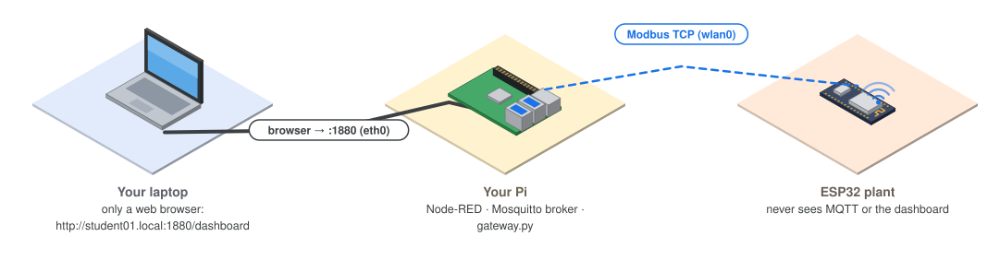

### 11.1 — Install Node-RED

**Node-RED** is a visual programming tool: you wire **nodes** (an MQTT input, a function, a gauge) into **flows** in a web editor. It is widely used on IIoT gateways because operators and engineers can read a flow at a glance.

1. Run the official installer. It installs Node.js and Node-RED, and takes about 10 minutes on a Pi 4.
   ```bash
   bash <(curl -sL https://github.com/node-red/linux-installers/releases/latest/download/install-update-nodered-deb)
   ```
2. Answer its questions:

| Question (wording may differ) | Answer |
|---|---|
| Are you really sure you want to do this? | `y` |
| Would you like to install the Pi-specific nodes? | `N` (your Python programs own the GPIO) |
| Customise the settings now? | `y` |
| Setup user security? | **Yes**: username `admin`, a strong password, full access |
| Enable Projects? | No |
| Flows file / credentials | Keep the defaults, and set a passphrase to encrypt credentials |
| Allow Function nodes to load external modules? | No |

3. Start it now and at every boot, and open its port on the cable side only:
   ```bash
   sudo systemctl enable --now nodered
   sudo ufw allow in on eth0 to any port 1880 proto tcp comment 'Node-RED, office side'
   ```
4. Add Dashboard 2.0, at the version these notes were tested with:
   ```bash
   cd ~/.node-red && npm install @flowfuse/node-red-dashboard@1.36.1
   sudo systemctl restart nodered
   ```
5. On your laptop, open `http://student01.local:1880` and log in as `admin`. If Node-RED asks about **update notifications**, either answer is fine.

> **Never leave the editor without a login.** Anyone who reaches an open Node-RED editor can run any code on your Pi as `student01`, including switching the pumps. The firewall rule keeps it off the plant side; the login keeps it off the rest.

### 11.2 — Import the starter flow

The starter flow shows the readings: tank level, alarm, gateway status and the pump room. The pump controls are yours to build in 11.3.

1. On your laptop, open the course repository on GitHub, go to `code/day2/ps01-dashboard-starter.json`, and click **Copy raw file**.
2. In Node-RED: menu **☰ → Import**, paste into the box, then click **Import**.

**Figure 11.2 — The Import dialog with the starter flow pasted in**

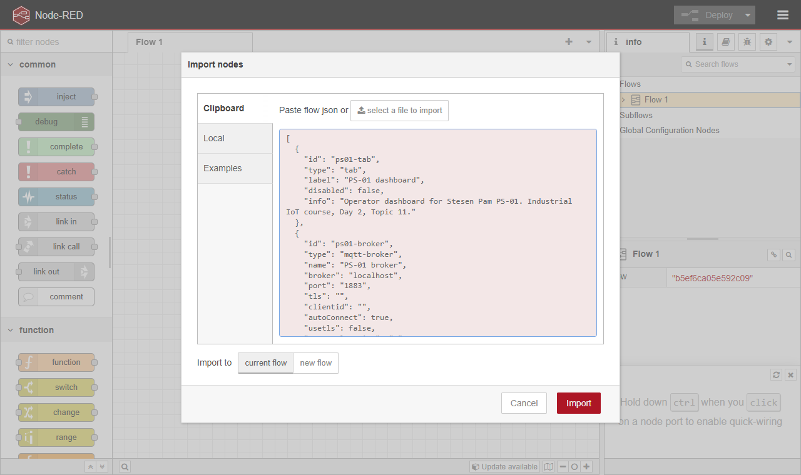

3. A new tab, **PS-01 dashboard**, appears next to the empty *Flow 1*. Click it.
4. Click **Deploy** (top right). Within a few seconds a green **connected** appears under every purple MQTT node.

**Figure 11.3 — The starter flow, deployed**


| Node | What it does |
|---|---|
| `mqtt in` with `ps01/+/…` | The `+` matches your hostname, so the same flow works on every Pi |
| *split the reading* | Turns one JSON reading into seven messages, one per widget; a missing value shows as `—`. Outputs 6 and 7 are *pump 1* and *pump 2*: still unwired |
| *HIGH?* → *alarm message* → *warning* | Pops up a notification on the operator's screen when the alarm turns HIGH |

5. Open `http://student01.local:1880/dashboard`. Tank, Status and Pump room show live values.

### 11.3 — Build the pump 1 controls

Four nodes: two buttons, one **mqtt out** that publishes their command, and one **text** that shows the pump's state. Node-RED's palette is the list of nodes on the left; type a name in **filter nodes** to find one fast.

1. **The ON button.** Drag a **button** (palette section *dashboard 2*) onto the canvas, below the alarm nodes, and double-click it.
   - **Group:** choose **Add new ui-group…** and click the pencil. Name `Pump 1`, Page `Stesen Pam PS-01`, then **Add**.
   - **Label:** `PUMP 1 ON`. **Icon:** `play`.
   - **Payload:** keep the `a-z` (string) type and type `ON`.
   - Further down, **Background:** `#1a73e8` (blue, the colour of a running pump on the plant).
   - Click **Done**.

**Figure 11.4 — The PUMP 1 ON button**

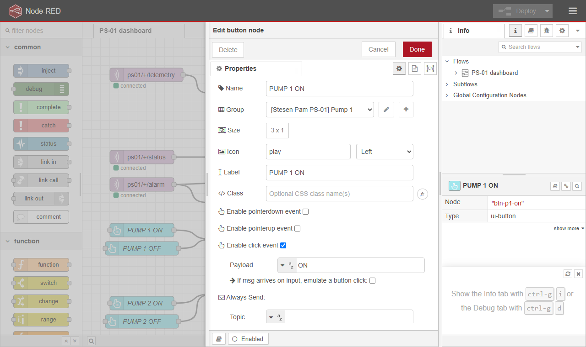

2. **The OFF button.** Select the ON button, press **Ctrl+C** then **Ctrl+V**, place the copy below it and double-click it: Label `PUMP 1 OFF`, Icon `stop`, Payload `OFF`, Background `#d93025` (red). **Done**.
3. **The state.** Drag a **text** node (*dashboard 2*) next to the right-hand column of text nodes. Group `Pump 1`, Label `Pump 1`, Name `Pump 1`. **Done**.

**Figure 11.5 — The Pump 1 text node**

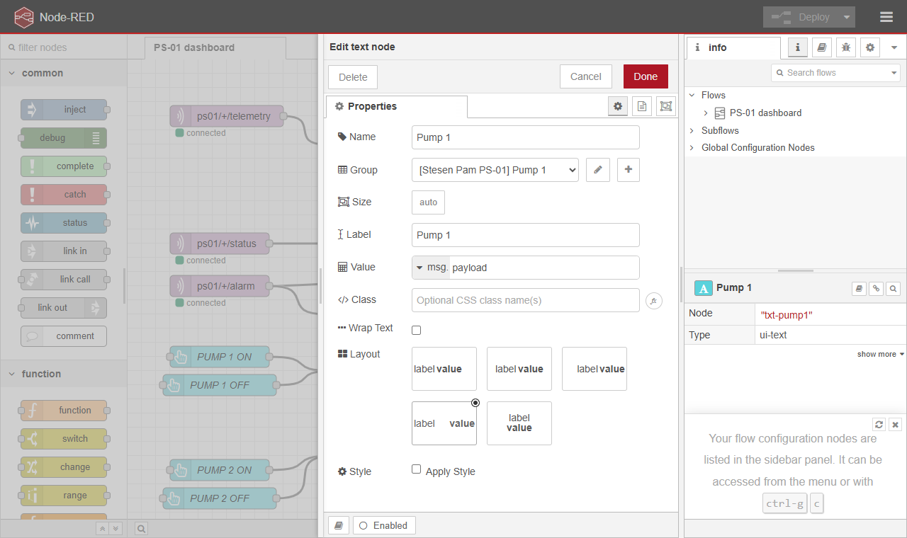

4. **Wire the state.** Hover over the outputs of *split the reading*: the sixth says **pump 1**. Drag from it to the input of the *Pump 1* text node.
5. **The command.** Drag an **mqtt out** node (palette section *network*) to the right of the buttons, and double-click it.
   - **Server:** `PS-01 broker` (it already exists: the starter flow brought it).
   - **Topic:** `ps01/student01/pump/1/cmd`.
   - **QoS:** `1`. **Retain:** `false`: a command, never a state.
   - **Name:** `pump 1 command`. **Done**.

**Figure 11.6 — The pump 1 command**

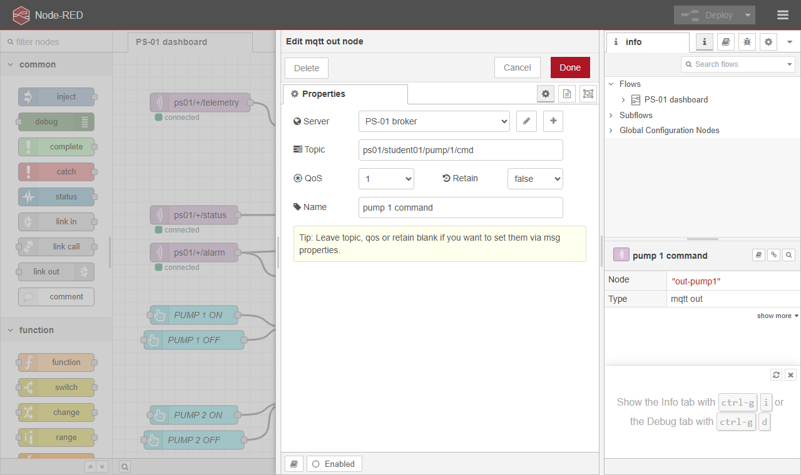

6. Wire **both** buttons to *pump 1 command*, then click **Deploy**.
7. **Pump 2.** Select your four new nodes (drag a box around them), copy and paste them, and change every `1` to `2`: group `Pump 2` (a new group again), labels, names and the topic `ps01/student01/pump/2/cmd`. Wire the seventh output of *split the reading* (**pump 2**) to the *Pump 2* text node. **Deploy**.

**Figure 11.7 — The finished flow**

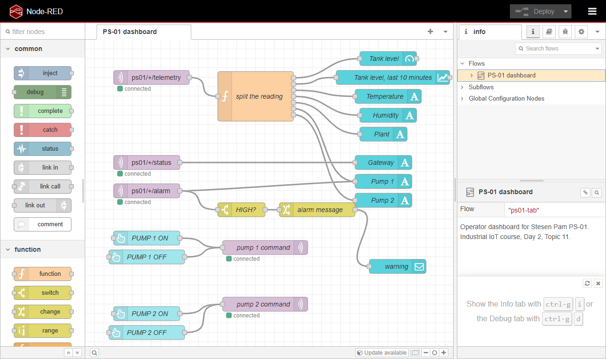

> **Stuck?** `code/day2/ps01-dashboard-flow.json` is the finished flow. Import it instead of the starter, and compare it with yours.

| Choice | Why |
|---|---|
| The topic is typed into the mqtt out node | The simplest way: one command node per pump, nothing computed |
| The button only *asks* | The dashboard publishes `ON`; the gateway writes the coil; the plant switches the pump |
| The state comes from telemetry, not from the button | The dashboard shows what the plant *reports*, not what someone pressed. If a command is lost, the screen does not lie |

### 11.4 — Operate the plant

Open `http://student01.local:1880/dashboard` on your laptop.

**Figure 11.8 — Pump 1 running, tank level in WARN**

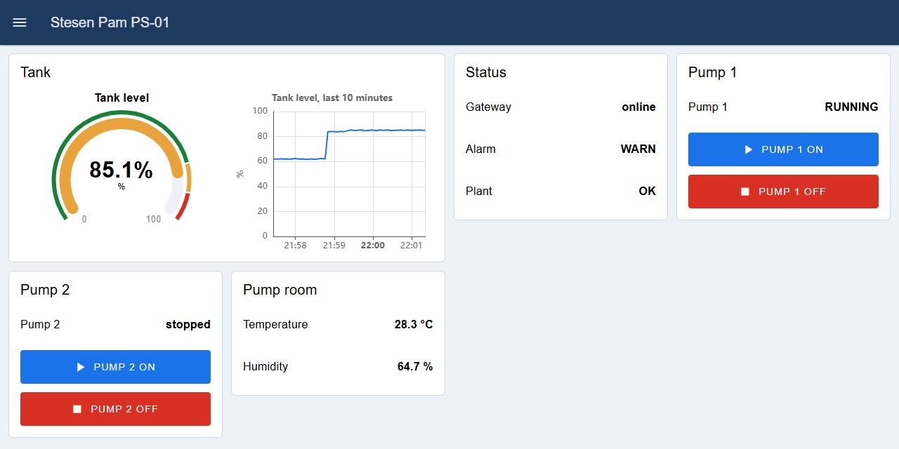

**Figure 11.9 — HIGH alarm: the gauge turns red and a pop-up warns the operator**

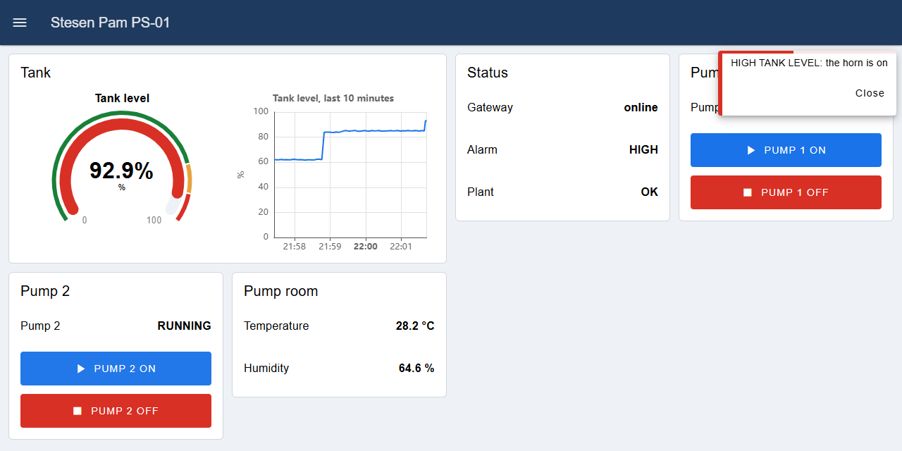

**Try it**
1. **The final test.** Press **PUMP 1 ON**: the plant's LED 0 turns blue, and within 2 seconds the dashboard says `RUNNING`. Press **PUMP 2 ON**, then both OFF buttons. Why can the dashboard lag up to 2 seconds behind the LED?
2. **The alarm reaches the operator.** Ask for the plant's knob to go past 90 %: the gauge turns red, *Alarm* shows `HIGH`, and a pop-up appears.
3. **Lose the gateway.** `sudo systemctl stop gateway`: *Gateway* turns `offline` and the gauge freezes. Press **PUMP 1 ON**: nothing happens, because nobody is listening for the command. A frozen value next to `offline` is honest; a frozen value with no status would be a lie. Start the gateway again.
4. **Lose the plant.** Ask the trainer to unplug the ESP32: *Plant* shows `COMMS_FAULT` and both pumps show `—`. Plug it back in.
5. **Break it on purpose.** `sudo systemctl stop mosquitto`: every MQTT node in the editor shows **disconnected** and the dashboard stops updating. Start it again: Node-RED and the gateway reconnect by themselves.

**Checkpoint ✅** From your laptop, the dashboard shows live tank level, alarm, gateway status and both pumps, and the pump buttons you built switch the plant's LEDs between red and blue.

---

## End of Day 2 — what you should have

- The `gateway` service reading the real plant over Modbus every 2 seconds and running the level alarm with hysteresis
- Mosquitto on your Pi, reachable only from the Pi itself
- `gateway.py` publishing `telemetry`, `alarm` and `status` (with a last will) under `ps01/<your Pi>/`, and switching pump 1 and pump 2 on `pump/<n>/cmd`
- Node-RED with a login, reachable only from the cable side, showing the PS-01 dashboard with the pump controls you built

**Security recap**
- Modbus has no security: it stays on the plant network, and only the gateway crosses over.
- The broker has no logins and carries plain MQTT. It is acceptable only because it never leaves the Pi; serve other machines, and it needs logins, an access list and TLS first.
- The Node-RED editor can run any code on your Pi: it has a login, and the firewall keeps it to the cable side.
- Firewall today: SSH, mDNS and Node-RED on `eth0`; nothing at all on the plant side.

**Extra, if you finish early**
1. Add a **Silence horn** button to the dashboard. Should it go over MQTT to the gateway, or straight to the plant over Modbus? Decide, and defend your choice.
2. Show each pump's state in colour: blue text for `RUNNING`, red for `stopped`, like the plant's LEDs.

**Tomorrow (Day 3):** the gateway becomes a complete edge node: it buffers data while the network is down and sends it when it returns, emails a person when something needs one, and is ready to run unattended.
