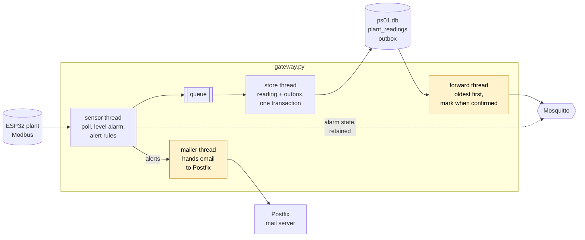
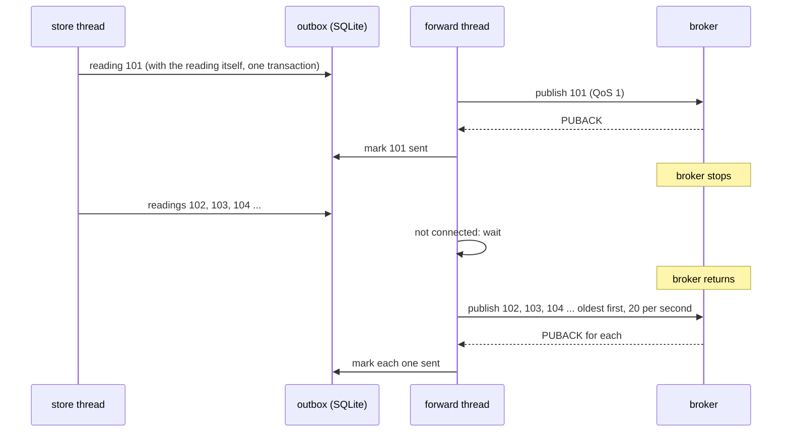
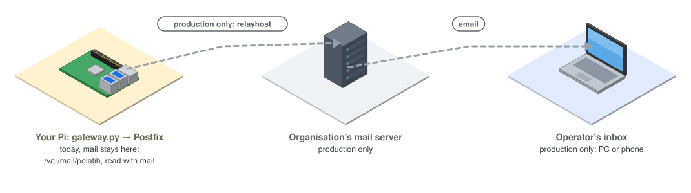
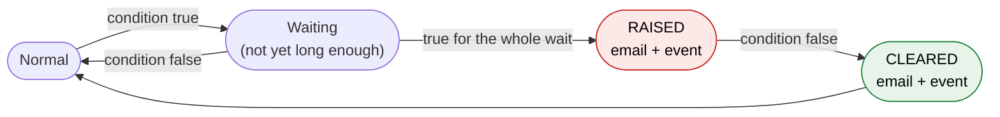
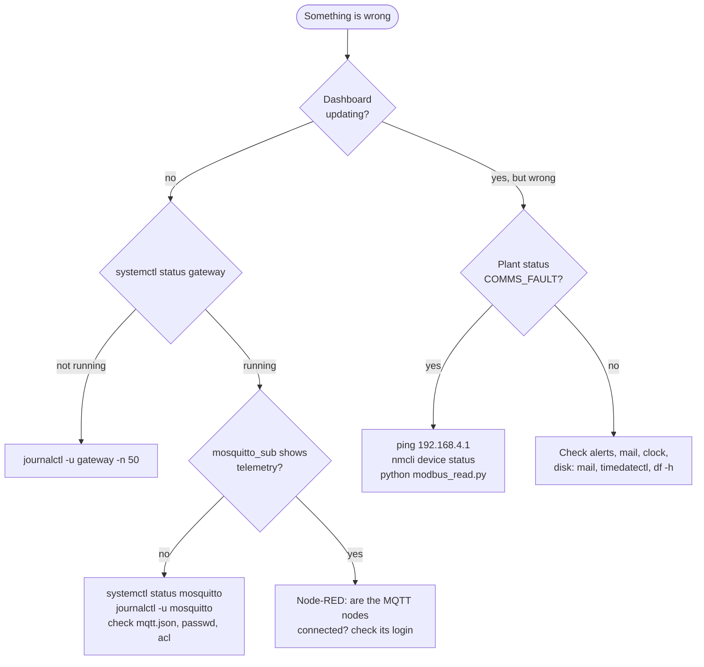

# Day 3 — Building a Smart Project

> **This morning your gateway becomes an edge node you could leave on a remote site:** it loses nothing when the network fails, emails a person when something needs one, and tells you when it has been restarted. **This afternoon** you put it all to work in **Op SENTINEL**.
> **Carry-over:** from Day 2 you need the `gateway` service reading the plant, Mosquitto with logins and the ACL (Topic 11), and the Node-RED dashboard.

## Before you start

- [ ] `systemctl status gateway mosquitto nodered` shows all three `active (running)`
- [ ] `mosquitto_sub -h localhost -t 'ps01/#' -v -u dashboard -P '<dashboard password>'` shows telemetry every 2 seconds
- [ ] Your copy of the course files is up to date: `cd ~/course && git pull`

---

## Topic 13 — Plan and design (concept)

**Goal:** design before you build: list what the edge node must do, draw how it does it, and decide in advance what happens when each part fails.

### 13.1 — What the edge node must do

| It must… | Built on |
|---|---|
| Poll the plant every 2 seconds and run the level alarm | Day 2, Topic 9 |
| Keep every reading, even while the broker is down, and send it later, in order | **Topic 14** |
| Email a person when something needs one, without email ever slowing the polling | **Topic 15** |
| Report when it was restarted, and whether the last stop was clean | Topics 14 and 15 |
| Run for months unattended: survive a frozen Pi, a full disk, a wrong clock | **Topic 16** |

The last row matters as much as the others. A gateway is usually installed somewhere nobody visits: if it needs a person to restart it, it has failed.

### 13.2 — The architecture

**Figure 13.1 — The Day 3 edge node**



Two kinds of message leave the gateway, and they travel differently:

| Kind | Examples | How it travels | Why |
|---|---|---|---|
| **History** | Every reading, every event | Through the **outbox**, never lost, sent in order | A missing reading is a hole in the record |
| **State** | Alarm `HIGH`, gateway `online` | Straight to the broker, **retained**, latest value only | After an outage only the current state matters; replaying old alarm states would mislead |

### 13.3 — Failure modes

**Try it**

Before reading on, copy this table onto paper and fill in the last three columns for each failure. Then compare with your neighbour.

| Failure | How does the node notice? | What does it do? | What does the operator see? |
|---|---|---|---|
| The plant is unplugged | | | |
| The broker stops | | | |
| The mail server stops | | | |
| `gateway.py` crashes | | | |
| The Pi loses power | | | |
| The Pi freezes completely | | | |
| The SD card fills up | | | |
| The clock is wrong after a reboot | | | |

<details>
<summary>The design you build today</summary>

| Failure | How does the node notice? | What does it do? | What does the operator see? |
|---|---|---|---|
| The plant is unplugged | Modbus timeout | Records `COMMS_FAULT`, keeps polling; after 60 s raises an alert | *Plant* `COMMS_FAULT` on the dashboard; an email after a minute |
| The broker stops | MQTT disconnect | Keeps polling and storing; the outbox grows | Dashboard freezes; on return the backlog arrives in order |
| The mail server stops | SMTP connection refused | The mailer retries every 30 s; polling is unaffected | The email arrives late, not never |
| `gateway.py` crashes | systemd sees the process exit | systemd restarts it; on start it finds its last stop was not clean | An email: *restarted after an unclean stop* |
| The Pi loses power | — (it is off) | On boot, every service starts; unsent messages are still in the outbox on disk | The restart email, then the backlog |
| The Pi freezes completely | The hardware watchdog stops being fed | The watchdog reboots the Pi | As for a power cut |
| The SD card fills up | Writes fail | Prevented: sent messages are deleted after 24 h and the journal is capped | Nothing, if prevention works |
| The clock is wrong after a reboot | `timedatectl` shows *not synchronized* | Readings carry wrong timestamps until the clock syncs | Wrong times: why gateways need a reliable time source |

</details>

**Checkpoint ✅** You can explain the difference between history and state, and say what the node does for each failure in the table.

---

## Topic 14 — Store-and-forward

**Goal:** make sure no reading is ever lost between the gateway and the broker, whatever happens to the link.

**Open:** VS Code on your Pi, folder `~/iiot`, and the Node-RED dashboard in a browser.

### 14.1 — The gap

Your Day 2 gateway stores every reading in SQLite, but only *publishes* it if the broker is connected at that moment. Readings taken during an outage stay on the Pi forever.

1. Watch the dashboard's tank chart, then stop the broker for 30 seconds:
   ```bash
   sudo systemctl stop mosquitto; sleep 30; sudo systemctl start mosquitto
   ```
2. The chart has a hole where those readings should be. The gateway's journal says `Stored locally, broker not connected`, and that is the last anyone hears of them.

### 14.2 — The outbox pattern

The fix used by almost every reliable system: put each message in an **outbox** table first, and send from the outbox.

**Figure 14.1 — An outage, with an outbox**



| Rule | Why |
|---|---|
| Write the reading and its outbox row in **one transaction** | Either both exist or neither: a power cut cannot leave one without the other |
| Send **oldest first** | Subscribers see events in the order they happened |
| Mark *sent* only after the broker's **PUBACK** (QoS 1) | Until the broker confirms, assume it did not arrive |
| Catch up at a **limited rate** | 3,000 queued readings should not flood the broker or the dashboard in one second |
| Give every message an **ID** | QoS 1 means *at least once*: after an outage a message can arrive twice, and the ID lets receivers ignore the copy |
| Delete sent rows after 24 hours | The SD card is not infinite |

### 14.3 — The code

1. Copy today's files. `outbox.py` and `alerts.py` are new; `gateway.py` replaces your Day 2 one.
   ```bash
   cp ~/course/code/day3/{outbox,alerts}.py ~/iiot/
   cp ~/iiot/gateway.py ~/iiot/gateway_day2.py
   cp ~/course/code/day3/gateway.py ~/iiot/gateway.py
   ```

```python
#!/usr/bin/env python3
"""Store-and-forward: every message waits in an SQLite outbox until the broker has confirmed it."""
import json
import logging
import sqlite3
import threading
import time
from datetime import datetime, timedelta, timezone
from pathlib import Path

import paho.mqtt.client as mqtt

from mqtt_link import GATEWAY

log = logging.getLogger("outbox")

BATCH = 20                 # messages read from the outbox at a time
RATE_PER_S = 20            # catch up after an outage, but do not flood the broker
KEEP_SENT = timedelta(hours=24)


def now_utc() -> str:
    return datetime.now(timezone.utc).isoformat(timespec="seconds")


def create_table(db: sqlite3.Connection) -> None:
    db.execute("PRAGMA journal_mode=WAL")          # readers and one writer can work at the same time
    db.execute(
        "CREATE TABLE IF NOT EXISTS outbox ("
        "id INTEGER PRIMARY KEY AUTOINCREMENT, created TEXT, topic TEXT, payload TEXT, "
        "qos INTEGER, retain INTEGER, sent_at TEXT)"
    )


def add(db: sqlite3.Connection, topic: str, payload: dict, qos: int = 1, retain: bool = False) -> None:
    """Queue a message. Call it inside the caller's transaction, then commit once."""
    db.execute("INSERT INTO outbox (created, topic, payload, qos, retain) VALUES (?, ?, ?, ?, ?)",
               (now_utc(), topic, json.dumps(payload), qos, int(retain)))


def pending(db: sqlite3.Connection) -> int:
    return db.execute("SELECT COUNT(*) FROM outbox WHERE sent_at IS NULL").fetchone()[0]


def forward_loop(db_file: Path, client: mqtt.Client, stop: threading.Event) -> None:
    """Send waiting messages, oldest first. Mark each one sent only after the broker has acknowledged it."""
    db = sqlite3.connect(db_file, timeout=10)
    create_table(db)
    last_cleanup = 0.0                                          # run housekeeping on the first quiet moment
    while not stop.is_set():
        if not client.is_connected():
            stop.wait(1)
            continue

        rows = db.execute("SELECT id, topic, payload, qos, retain FROM outbox WHERE sent_at IS NULL "
                          "ORDER BY id LIMIT ?", (BATCH,)).fetchall()
        if not rows:                                            # nothing waiting
            stop.wait(0.5)
            if time.monotonic() - last_cleanup > 3600:          # once an hour, keep the SD card tidy
                cutoff = (datetime.now(timezone.utc) - KEEP_SENT).isoformat(timespec="seconds")
                deleted = db.execute("DELETE FROM outbox WHERE sent_at IS NOT NULL AND sent_at < ?",
                                     (cutoff,)).rowcount
                db.commit()
                last_cleanup = time.monotonic()
                if deleted:
                    log.info("Housekeeping: removed %d sent messages older than 24 h", deleted)
            continue

        for row_id, topic, payload, qos, retain in rows:
            message = json.loads(payload)
            message["msg_id"] = f"{GATEWAY}-{row_id}"            # lets receivers spot duplicates
            info = client.publish(topic, json.dumps(message), qos=qos, retain=bool(retain))
            try:
                info.wait_for_publish(5)
            except (RuntimeError, ValueError):
                break                                           # not connected any more: try again later
            if not info.is_published():
                break
            db.execute("UPDATE outbox SET sent_at = ? WHERE id = ?", (now_utc(), row_id))
            db.commit()
            stop.wait(1 / RATE_PER_S)

        backlog = pending(db)
        if backlog > BATCH:
            log.info("Catching up: %d messages still waiting", backlog)
    db.close()
```

| Piece | What it does |
|---|---|
| `PRAGMA journal_mode=WAL` | Lets the forward thread read while the store thread writes, without "database is locked" |
| `add(db, …)` | Inserts the row but does not commit: the caller commits the reading and the message together |
| `wait_for_publish(5)` + `is_published()` | Waits for the broker's PUBACK; only then is the row marked sent |
| `break` on failure | Stop this batch and try again from the same message, so nothing is skipped |
| `msg_id` | Added when sending: `pi01-1234`, unique for this gateway |

In `gateway.py`, the store thread now writes both rows in one transaction:

```python
def store_loop(q: queue.Queue, stop: threading.Event) -> None:
    db = sqlite3.connect(DB_FILE, timeout=10)
    outbox.create_table(db)
    db.execute(
        "CREATE TABLE IF NOT EXISTS plant_readings (ts TEXT, station TEXT, gateway TEXT, "
        "tank_level_pct REAL, room_temp_c REAL, room_humidity_pct REAL, e_stop INTEGER, status TEXT)"
    )
    while not stop.is_set() or not q.empty():
        try:
            kind, item = q.get(timeout=1)
        except queue.Empty:
            continue
        with db:                                            # one transaction: both rows, or neither
            if kind == "telemetry":
                db.execute("INSERT INTO plant_readings VALUES (:ts, :station, :gateway, :tank_level_pct, "
                           ":room_temp_c, :room_humidity_pct, :e_stop, :status)", item)
            outbox.add(db, f"{BASE}/{kind}", item, qos=1)
    db.close()
```

2. The gateway now also publishes events (start-ups, alerts) on `ps01/<gateway>/events`. Your Day 2 ACL already allows it; check with `sudo grep events /etc/mosquitto/acl`.
3. Set `PLANT_HOST, PLANT_PORT` as on Day 2, and restart the gateway:
   ```bash
   sudo systemctl restart gateway
   journalctl -u gateway -f
   ```
   The first line says `Edge node started … previous stop: clean`.

> **Error in the journal: `Mail server not accepting`?** That is the mailer from Topic 15 trying to send an alert before Postfix is installed. It retries every 30 seconds and never blocks the polling. It stops once you finish Topic 15.

**Try it**
1. **The outage, again.** Count the waiting messages, stop the broker for two minutes, then count again:
   ```bash
   sqlite3 ~/iiot/data/ps01.db "SELECT COUNT(*) FROM outbox WHERE sent_at IS NULL;"
   sudo systemctl stop mosquitto
   ```
   Every 2 seconds one more row waits. Start the broker (`sudo systemctl start mosquitto`): the count drops back to 0 within seconds, and a subscriber sees the missing readings arrive, oldest first, with their original timestamps.
2. **Through a reboot.** Stop the broker, wait a minute, then `sudo reboot`. After the Pi is back, the backlog is still sent: the outbox lives on the SD card, not in memory.
3. **Spot the duplicate.** Save a subscriber's output to a file during an outage test: `mosquitto_sub … -t 'ps01/+/telemetry' > seen.txt`. Look at the `msg_id` values around the moment the broker returned. You may find one that appears twice. That is QoS 1 doing its job, and the reason every message has an ID.

> **Why does the dashboard draw a backlog as a spike?** The Node-RED chart plots each value at the moment it *arrives*. A historian would plot it at the reading's own `ts`. On the operator's live screen, arrival time is acceptable; in a historical record, it is not.

**Checkpoint ✅** A two-minute broker outage, or a reboot during one, leaves no hole: every reading reaches the broker, in order, with its `msg_id`.

---

## Topic 15 — Email alerts

**Goal:** tell a person, by email, when something needs a person, and only then.

### 15.1 — A mail server on the Pi

Programs rarely talk to a remote mail server themselves. They hand mail to a **local mail server** (an **MTA**, Mail Transfer Agent), which queues it, retries, and delivers it. That is store-and-forward again, for email. Your Pi runs **Postfix**, set to *local only*: it accepts mail from programs on this Pi and delivers it to mailboxes on this Pi, and nothing else.

**Figure 15.1 — Where an alert goes, today and in production**



1. Tell the installer the answers in advance, then install Postfix and the `mail` command:
   ```bash
   echo "postfix postfix/main_mailer_type select Local only" | sudo debconf-set-selections
   echo "postfix postfix/mailname string $(hostname).local" | sudo debconf-set-selections
   sudo DEBIAN_FRONTEND=noninteractive apt install -y postfix mailutils
   ```
2. Check what "local only" means:
   ```bash
   postconf inet_interfaces default_transport
   ```

| Setting | Value | Meaning |
|---|---|---|
| `inet_interfaces` | `loopback-only` | Postfix listens on `127.0.0.1` only: no firewall rule needed, nobody else can use it |
| `default_transport` | `error` | Mail for anywhere outside this Pi is refused, never sent |

3. Send yourself a test, then read it:
   ```bash
   echo "Test from $(hostname)" | mail -s "Hello" pelatih
   mail
   ```
   In `mail`: type a message number and **Enter** to read it, `d` to delete it, `q` to quit.

> **Later, in production:** one setting turns this into a real alert path. `sudo postconf -e 'relayhost = [mail.your-organisation.gov.my]:587'` (plus a login, if the server needs one) sends everything through the organisation's mail server, once `default_transport` and `relay_transport` are set back to `smtp`. The gateway's code does not change.

### 15.2 — Rules that do not cry wolf

An alert that fires too often is soon ignored, and then the real one is ignored too. Each rule must stay true for a while before it raises an alert, and a person gets one email when it starts and one when it ends.

| Alert | Raised when | Waits | Why the wait |
|---|---|---|---|
| High tank level | The level alarm is `HIGH` | 0 s | The alarm already has hysteresis (Topic 9) |
| Emergency stop active | The plant's e-stop is pressed | 0 s | Always worth knowing at once |
| Plant not answering | Readings are `COMMS_FAULT` | 60 s | Wi-Fi drops a reading now and then; a minute of silence is real |
| Temperature sensor fault | Readings are `SENSOR_FAULT` | 5 min | The DHT11 misses the odd reading |
| Gateway restarted after an unclean stop | At start-up, the last run did not stop cleanly | — | A crash or power cut deserves a look, even if it recovered |

**Figure 15.2 — The life of one alert**



One more rule: if the same alert is raised again within 10 minutes of its last email, it is recorded as an event but not emailed again, and neither is its clearing. A level hovering at the limit sends one email, not twenty.

### 15.3 — The code

```python
#!/usr/bin/env python3
"""Email alerts through the mail server on this Pi (Postfix on localhost:25)."""
import logging
import queue
import smtplib
import threading
import time
from dataclasses import dataclass
from email.message import EmailMessage
from typing import Callable

from mqtt_link import GATEWAY

log = logging.getLogger("alerts")

MAIL_TO = "pelatih"                         # a user on this Pi; Postfix delivers to /var/mail/pelatih
MAIL_FROM = f"ps01-{GATEWAY}@localhost"
REPEAT_GAP_S = 600                          # an alert that clears and returns within 10 min is not emailed again


@dataclass
class Rule:
    key: str
    title: str
    test: Callable                          # (reading, alarm_state) -> bool
    raise_after_s: float                    # must stay true this long before we alert
    detail: Callable                        # (reading) -> str


RULES = [
    Rule("HIGH_LEVEL", "High tank level", lambda r, a: a == "HIGH", 0,
         lambda r: f"Tank level {r.tank_level_pct:.1f} %. Red light and horn are on."),
    Rule("E_STOP", "Emergency stop active", lambda r, a: r.e_stop is True, 0,
         lambda r: "The plant's E-STOP is pressed: valve forced shut."),
    Rule("PLANT_LOST", "Plant not answering", lambda r, a: r.status == "COMMS_FAULT", 60,
         lambda r: "No Modbus answer from the plant for over a minute."),
    Rule("SENSOR_FAULT", "Temperature sensor fault", lambda r, a: r.status == "SENSOR_FAULT", 300,
         lambda r: "The DHT11 has not answered for 5 minutes."),
]


class Mailer:
    """Sends email from its own thread, so a slow or missing mail server never delays polling."""

    def __init__(self, stop: threading.Event):
        self.q: queue.Queue = queue.Queue()
        self.stop = stop
        self.thread = threading.Thread(target=self._run, name="mailer", daemon=True)
        self.thread.start()

    def send(self, subject: str, body: str) -> None:
        self.q.put((subject, body))

    def _run(self) -> None:
        while not self.stop.is_set():
            try:
                subject, body = self.q.get(timeout=1)
            except queue.Empty:
                continue
            msg = EmailMessage()
            msg["From"], msg["To"], msg["Subject"] = MAIL_FROM, MAIL_TO, subject
            msg.set_content(body)
            while not self.stop.is_set():
                try:
                    with smtplib.SMTP("localhost", 25, timeout=10) as smtp:
                        smtp.send_message(msg)
                    log.info("Email sent: %s", subject)
                    break
                except (OSError, smtplib.SMTPException) as err:
                    log.warning("Mail server not accepting (%s); retrying in 30 s", err)
                    self.stop.wait(30)


class AlertManager:
    """Raises an alert when a rule has been true long enough, and says when it clears."""

    def __init__(self, mailer: Mailer, on_event: Callable[[dict], None]):
        self.mailer = mailer
        self.on_event = on_event            # also record every alert as an event for the outbox
        self.true_since: dict[str, float] = {}
        self.raised: set[str] = set()
        self.last_email: dict[str, float] = {}
        self.emailed: set[str] = set()     # raised alerts whose RAISED email went out

    def check(self, reading, alarm_state: str) -> None:
        now = time.monotonic()
        for rule in RULES:
            active = bool(rule.test(reading, alarm_state))
            if active:
                self.true_since.setdefault(rule.key, now)
                if rule.key not in self.raised and now - self.true_since[rule.key] >= rule.raise_after_s:
                    self.raised.add(rule.key)
                    self._notify(rule, "RAISED", rule.detail(reading), reading.ts, now)
            else:
                self.true_since.pop(rule.key, None)
                if rule.key in self.raised:
                    self.raised.discard(rule.key)
                    self._notify(rule, "CLEARED", "Back to normal.", reading.ts, now)

    def _notify(self, rule: Rule, change: str, detail: str, ts: str, now: float) -> None:
        self.on_event({"ts": ts, "event": "alert", "alert": rule.key, "change": change, "detail": detail})
        if change == "RAISED":
            if now - self.last_email.get(rule.key, -1e9) < REPEAT_GAP_S:
                log.info("Alert %s raised again within 10 min: not emailed", rule.key)
                return
            self.last_email[rule.key] = now
            self.emailed.add(rule.key)
        elif rule.key in self.emailed:
            self.emailed.discard(rule.key)
        else:
            return                          # its RAISED was not emailed, so neither is its CLEARED
        self.mailer.send(f"[PS-01 {GATEWAY}] {change}: {rule.title}",
                         f"{rule.title}: {change}\n{detail}\n\nGateway: {GATEWAY}\nTime (UTC): {ts}\n")
```

| Piece | What it does |
|---|---|
| `Rule` | One alert: its name, its test, how long it must stay true, and the text for the email |
| `Mailer` | Its own thread and queue. If Postfix is down, it retries every 30 s; the sensor thread never waits for email |
| `smtplib.SMTP("localhost", 25)` | Plain SMTP to Postfix on this Pi |
| `AlertManager.check()` | Called after every poll; raises and clears alerts |
| `on_event` | Every alert change also goes into the outbox as an event on `ps01/<gateway>/events` |
| `emailed` | Remembers which raises were emailed, so a suppressed raise is not followed by a lonely "cleared" |

`gateway.py` checks how its last run ended. It writes `running` to `~/iiot/data/gateway.state` at start and `stopped` only after a clean stop, so finding `running` at start-up means the last run never got that far:

```python
    previous = RUN_STATE.read_text().strip() if RUN_STATE.exists() else "first start"
    RUN_STATE.write_text("running")

    # ... clients, mailer and alerts are created here ...

    if previous == "running":                       # we never wrote "stopped": the last run crashed
        log.warning("Previous run did not stop cleanly")
        mailer.send(f"[PS-01 {GATEWAY}] Gateway restarted after an unclean stop",
                    f"The gateway on {GATEWAY} started at {started['ts']} (UTC).\n"
                    "Its previous run ended without a clean shutdown: a crash, a kill or a power cut.\n"
                    "Check: journalctl -u gateway -b -1\n")

    # ... and at the very end of a clean stop:
    RUN_STATE.write_text("stopped")
```

**Try it**
1. **High level.** Ask for the plant's knob to go past 90 %. Within seconds: `mail` shows *RAISED: High tank level*. Bring it down below 85: *CLEARED*.
2. **No crying wolf.** Push it past 90 % again within 10 minutes. The light and horn react, the event appears on MQTT, but no new email.
3. **Patience.** Ask the trainer to unplug the plant for 30 seconds: no email. Then for 90 seconds: *RAISED: Plant not answering*, then *CLEARED* when it returns.
4. **E-stop.** Press the plant's E-STOP: an email at once.
5. **A crash.** `sudo systemctl kill -s SIGKILL gateway`. systemd restarts it, and you get *Gateway restarted after an unclean stop*. A clean `sudo systemctl restart gateway` sends nothing.
6. **Mail server down.** `sudo systemctl stop postfix`, then trigger an alert. The journal shows `Mail server not accepting … retrying in 30 s`, and polling carries on. Start Postfix: the email arrives.
7. **Watch the events.** `mosquitto_sub -h localhost -t 'ps01/+/events' -v -u dashboard -P '<password>'` shows every alert change, emailed or not.

**Checkpoint ✅** A high level, a lost plant, an e-stop and a crash each produce one email when they start (and one when they end), and nothing you do to the mail server affects the polling.

---

## Topic 16 — Production-ready and troubleshooting

**Goal:** make the node survive months alone, then practise finding faults the way you will have to on site.

### 16.1 — Ready to leave alone

1. **A hardware watchdog.** The Pi has a timer that reboots the board unless it is reset regularly. Let systemd reset it: if the whole system freezes, the resets stop and the Pi reboots itself within 15 seconds.
   ```bash
   sudo mkdir -p /etc/systemd/system.conf.d
   printf "[Manager]\nRuntimeWatchdogSec=15\n" | sudo tee /etc/systemd/system.conf.d/watchdog.conf
   sudo systemctl daemon-reexec
   systemctl show -p RuntimeWatchdogUSec
   ```
   The last line shows `RuntimeWatchdogUSec=15s`.
2. **Keep logs across reboots, but not forever.** Without this, the reason for a crash is gone after the reboot, and the restart email's advice (`journalctl -u gateway -b -1`) finds nothing.
   ```bash
   sudo mkdir -p /etc/systemd/journald.conf.d
   printf "[Journal]\nStorage=persistent\nSystemMaxUse=100M\n" | sudo tee /etc/systemd/journald.conf.d/ps01.conf
   sudo systemctl restart systemd-journald
   ```
3. **Check the clock.**
   ```bash
   timedatectl
   ```
   `System clock synchronized: yes` means the Pi got the time from the internet through your laptop. The Pi has **no battery-backed clock**: after a power cut with no network it starts from the time it last saved, and every reading is stamped wrong until it syncs.
4. **Check the disk.** `df -h /` and `du -sh ~/iiot/data`. The outbox deletes sent rows after 24 hours, and the journal stops at 100 MB.

| Habit | Why |
|---|---|
| Settings in files (`mqtt.json`), code in Git | Change a password or address without editing code; update code without losing settings |
| Back up `~/iiot` and `/etc/mosquitto` | An SD card can die; rebuilding from notes takes a day, restoring takes minutes |
| `sudo apt full-upgrade` on a schedule, not on site visits | Security fixes, without surprises during an incident |
| Test the failure, not just the success | Everything in this course that "works" was proven by breaking it first |

> **Later, in production:** give gateways a time source on the plant side (an NTP server or a GPS clock), and record with each reading whether the clock was synchronised. A wrong timestamp is worse than a missing one, because nobody questions it.

### 16.2 — Troubleshooting drill

The trainer will secretly break one thing on your station. You have 10 minutes to find it, fix it, and write down **symptom → cause → fix**. Work from the outside in.

**Figure 16.1 — Where to look**



| Tool | Answers the question |
|---|---|
| `systemctl status <service>` | Is it running? Since when? Did it crash? |
| `journalctl -u <service> -n 50` | What did it say last? |
| `mosquitto_sub … -t 'ps01/#' -v` | Is data reaching the broker? |
| `python modbus_read.py` | Does the plant answer? |
| `ping`, `nmcli device status`, `ip -4 addr` | Is the network up, on both sides? |
| `sudo ufw status verbose` | Is the firewall blocking something? |
| `sqlite3 ~/iiot/data/ps01.db "SELECT COUNT(*) FROM outbox WHERE sent_at IS NULL;"` | Is a backlog building up? |
| `mailq` | Is mail stuck in Postfix's queue? |
| `df -h`, `timedatectl` | Is the disk full? Is the clock right? |

### 16.3 — Where to go next

| Topic | What it adds |
|---|---|
| **TLS** and mutual TLS for MQTT | Encryption and device identity, once brokers serve other machines (Day 2, Topic 11) |
| **OPC UA** | The other major industrial protocol: richer data models and built-in security |
| Fleet management (Ansible, Mender) | Configure and update fifty gateways the same way, with signed updates |
| A historian (InfluxDB, TimescaleDB) | Long-term history, plotted by the reading's own time |
| **DDS** | Brokerless publish-subscribe for tightly coupled, real-time systems (Day 2, Topic 10) |
| Redundant gateways | Two edge nodes, one active, one watching, for sites that must never go dark |

**Checkpoint ✅** Your node has a hardware watchdog, persistent and capped logs, a synchronised clock, and you found and fixed the trainer's fault using the tools in the table.

---

## End of the morning — what you should have

- `gateway.py` as a complete edge node: polling, alarm, outbox with store-and-forward, events, email alerts, restart reporting
- Postfix delivering alerts to `pelatih` on your Pi
- A hardware watchdog, a persistent journal capped at 100 MB, and a synchronised clock

**This afternoon:** Op SENTINEL. Your edge node skills, three outposts, and a trainer who will try to catch you out.
